# Flower: architecture and API specification

**Scope:** one integrated database system, with Rust application guests, a Rust host, Rust clients and Rust workers. This is a whole-system specification, not a staged implementation plan.

## Contents

- [Architecture and vocabulary](#architecture-and-vocabulary)
- [Rust packages and runtime boundary](#rust-packages-and-runtime-boundary)
- [Dependencies, build boundary and vendored code](#dependencies-build-boundary-and-vendored-code)
- [Values, schemas and errors](#values-schemas-and-errors)
- [Collections, indexes and context capabilities](#collections-indexes-and-context-capabilities)
- [Queries, mutations and application registration](#queries-mutations-and-application-registration)
- [Modules, contracts and calls](#modules-contracts-and-calls)
- [Reactive computations, triggers and maintenance](#reactive-computations-triggers-and-maintenance)
- [Authentication, policies and deletion](#authentication-policies-and-deletion)
- [Timers, queues and native workers](#timers-queues-and-native-workers)
- [External computations](#external-computations)
- [Transactions across logical databases](#transactions-across-logical-databases)
- [Groups, partitions and cross-group transactions](#groups-partitions-and-cross-group-transactions)
- [Cryptography and managed keys](#cryptography-and-managed-keys)
- [Native Rust client API](#native-rust-client-api)
- [Operator and artifact APIs](#operator-and-artifact-apis)
- [Ordering, durability, retries and recovery](#ordering-durability-retries-and-recovery)
- [Synced replicas and offline operation](#synced-replicas-and-offline-operation)
- [Whole-system guarantees](#whole-system-guarantees)

## Architecture and vocabulary

Flower is a database of **source records and reactive derived values**, accessed through deployed, named application methods. Clients cannot submit arbitrary source patches through the public data API. The native engine owns state, dependency tracking, indexes, ordering and recovery; isolated Rust guests implement application computations.

The engine has two layers. The **engine core** evaluates callbacks, tracks dependencies, maintains indexes and commits effects to local storage; it links without consensus or networking. The **replication layer** orders accepted effects across a Raft group, moves partitions and coordinates distributed transactions. A server deployment runs both layers; a device deployment runs the core and follows a server group as a synced replica.

A mutation publishes source changes and their required graph/index consequences atomically. A query observes one selected snapshot. A watch maintains a query's returned value, not an exposed table-level event stream. Raft replicates accepted effects and results: followers do not rerun business callbacks. Synced replicas likewise apply ordered effects without rerunning business callbacks.

### Execution architecture

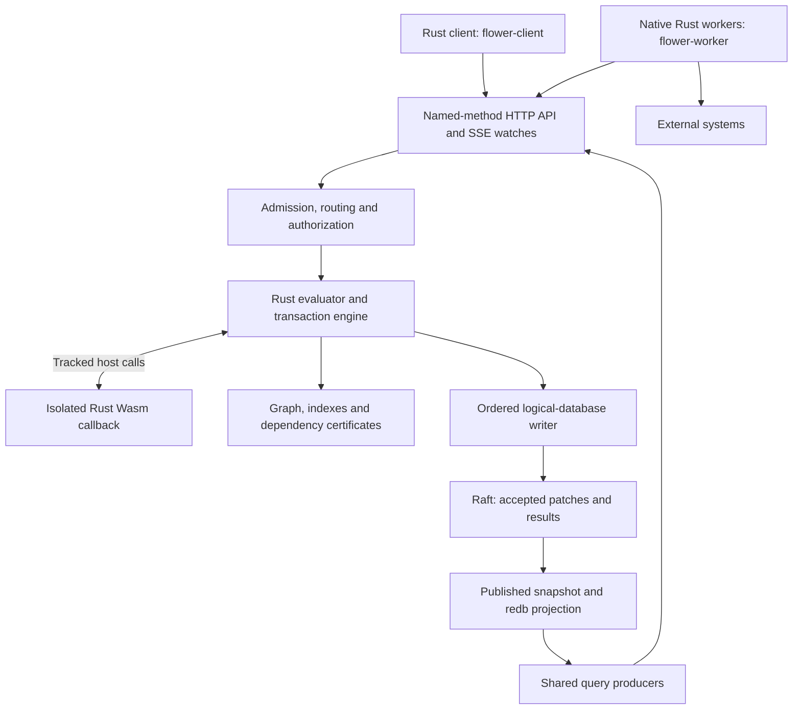

Evaluation, dependency tracking, graph/indexes, the writer lane and the published store are the engine core. Raft ordering, partition placement and movement, and distributed transactions are the replication layer.

A synced replica runs the core against a local store and follows a server group:

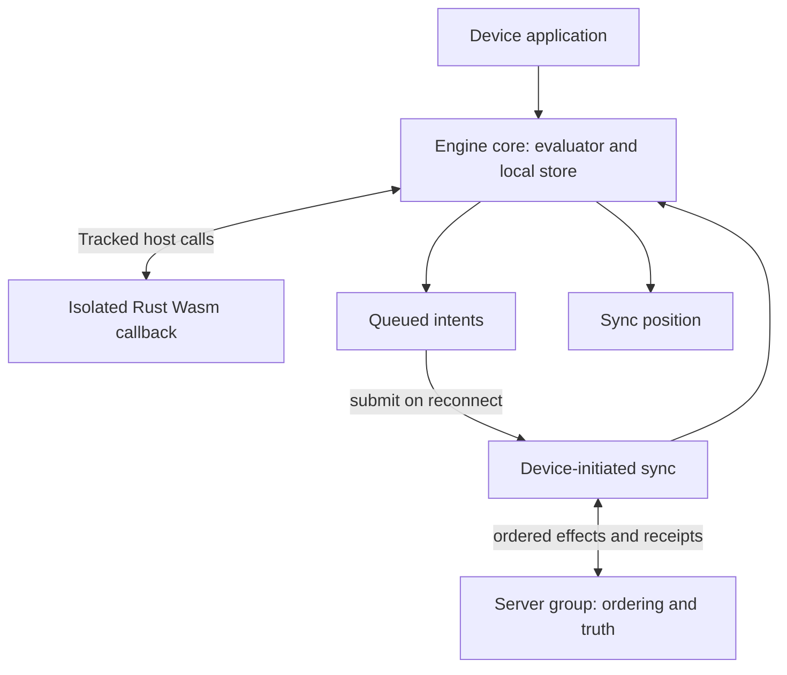

All synchronization is device-initiated outbound traffic; a replica never accepts inbound connections.

The guest does not own a database heap, open sockets, spawn background jobs or execute Raft. Native workers can perform network effects; guest callbacks cannot. SDK components are transactionally maintained records and registered callbacks, not hidden independent services.

### Tenant, app, module, partition, shard and replica

| Term | Exact meaning and boundary |
|---|---|
| Application / `App` | One list of a module's components (methods, collections, queues, hooks, the authorization hook, composites). It is not automatically a separately provisioned server, tenant or shard. |
| Bundle | A compiled Rust Wasm artifact with a manifest and code identity. The same artifact can be deployed as multiple named module instances. |
| Host module | The unnamed module, identity `""`, in one logical database. Distinct from the native database process. |
| Named module instance | Code and namespaced declarations deployed inside a logical database. Module exports and caller rules govern interaction. It does not get a separate Raft log or application revision. |
| Application tenant | A business ownership/security concept, often represented by keys or principal claims. A key containing `tenant_id` does not automatically create a partition. |
| Logical database | An atomic application-state domain: source records, graph/indexes, code, policy, revision, timers, receipts and protocol metadata. The root group holds every database the catalog does not place; any group can host named partitions. |
| Named partition | A separately addressed logical database with stable identity, movable ownership and an independent writer/revision. Under partition authorization, principal tenant must match the partition. |
| Shard | Informal physical-placement vocabulary here. Use a named partition or physical Raft group when an exact API/storage unit is meant. There is no automatic extraction of tenant-key ranges. |
| Raft group | A replicated consensus domain with one ordered log and one leader at a time. One process hosts any number of groups; the root group holds the catalog and every unplaced database, and any group can own named partitions. |
| Replica | One member's copy of a group's state, not an independent slice of its data. Distinct from a synced replica, which follows from outside the group. |
| Process / node | A physical server process that can host multiple group replicas. Replicas and groups need not map one-to-one to processes. |

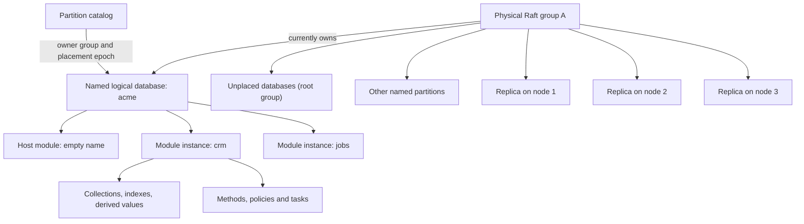

This diagram shows **ownership and containment**, not additional logs for modules. Several application tenants can share one logical database if business policy enforces their isolation. Conversely, an application can deliberately place a tenant in its own named partition. That mapping is an explicit application/placement decision.

A partition move transfers the whole logical database, including its deployed code and history metadata. Physical groups must already be provisioned. Count-based placement/resize is not byte-, CPU- or hot-key-aware automatic sharding.

### Identity dimensions

- **Logical database ID:** stable owner of application state and requests.
- **History incarnation:** distinguishes a non-rolled-back history from a restored or forked one.
- **Placement epoch:** fences the currently authoritative owner group.
- **Retention epoch:** controls which retry identities are still admissible.
- **Deployment/code identity:** selects executable behavior and compatible schema/contracts.

Movement preserves history; disaster restore does not safely preserve every old capability. These identifiers are not interchangeable.

### Engine layers and deployment profiles

| Term | Exact meaning and boundary |
|---|---|
| Engine core | Evaluation, dependency tracking, graph/indexes, writer lane, local storage and admission. Links without consensus or networking; runs on servers and devices. |
| Replication layer | Raft ordering, partition placement and movement, distributed transactions and quorum read fences. Server deployments only. |
| Synced replica | A device deployment running the engine core that follows server-group databases: applies ordered effects, serves local reads and queues intents. Not a Raft member; never commits shared state locally. |
| Local-only database | A logical database whose writer lane commits locally without the replication layer. Device-private state; never synced or moved. Local-only databases join local-only multi-database transactions but never replicated ones. |
| Sync position | The cloud applied-log position a replica has consumed. Sync is ordered and gapless: the position advances only after durable local application. |
| Queued intent | A mutation stored locally for later submission: method, arguments and stable request identity. An intent is not committed state; submission can fail or be rejected. |

| Deployment | Layers | Shared-state commits | Reads | Network |
|---|---|---|---|---|
| Server group member | Core plus replication | Through Raft ordering | Quorum or replica-local | Inbound and outbound |
| Synced replica | Core plus sync client | Never; intents queue for submission | Local snapshot, optional intent preview | Outbound only, device-initiated |

## Rust packages and runtime boundary

| Package | Responsibility |
|---|---|
| `flower-sdk` | `no_std` plus `alloc` guest runtime, codecs, descriptors, contexts, modules and policies, including guest queues, timers and external-value components. |
| `flower-sdk-macros` | Explicit type/error derivation, collection declarations, callback adapters and interface declarations. |
| `flower-client` | Native HTTP transport, unary and typed calls, transactions, retry policy, sync-down replicas, the offline intent queue, watches, work-queue and timer calls and admin calls. |
| `flower-worker` | Native asynchronous work-queue workers and external/reconcile workers over the client. |
| `cargo-flower` | Contract inspection and diffs, deployment, calls, transactions, status, membership, backup, queue and timer operations and serving a node (with the timer sweep). |
| `flower-bench` | The Goblin Pizza stress benchmark and live demo: real `cargo-flower serve` processes hosting one or many Raft groups (tenants as named partitions), process-kill chaos, an end-of-run business audit per group and across groups, `--auth` end-user tokens, OpenTelemetry capture and CPU profiles, goodput and latency accounting, JSON and HTML reports, baseline comparison with a regression threshold, retained results and a live view, and the harness of the fault suite on real processes: kills, unclean restarts, frozen members and TLS (see [Stress benchmark and live demo](#stress-benchmark-and-live-demo)). |
| `flower-engine` | Engine core: Wasmtime execution, evaluator, graph/index engine, admission, storage and sync-position tracking. No consensus or networking. |
| `flower-cluster` | Replication layer: Raft ordering, sync serving, quorum fences, partition placement/movement and multi-database transactions within and across groups. Server deployments only. |
| `flower-crypto` | Host crypto lane: hashing, content identity, versioned AEAD envelopes, the deployment keystore and managed guest signing keys. |
| `flower-backup` | Encrypted continuous backup, archive segments, retention, re-encryption and point-in-time recovery over object storage. |
| `flower-server` | `flower-cluster` plus HTTP API serving: calls, transactions, sync, status, metrics, work-queue and timer endpoints and admin endpoints. |
| Native Flower server | `flower-server` over `flower-engine` plus `flower-cluster`, served by `cargo-flower serve`. |

A device deployment links `flower-engine` with `flower-client` for sync; it never links `flower-cluster`, `flower-backup` or `flower-server`.

A Rust guest is a `wasm32-unknown-unknown` `cdylib`, not a native plugin and not a WASI application. Normal Rust allocation is available through `alloc`; operating-system APIs are not guest capabilities. Guest execution requires an OS that permits JIT-compiled code; platforms that forbid runtime-generated code cannot run the executor.

The host validates the Wasm module and imports. The ABI exposes memory, `flower_alloc`, `flower_invoke`, `flower_manifest` and optional `flower_init`; guests import `host_call` and `crypto_call` at most once each (a guest that never calls the host, a crypto-only module, imports no `host_call`). Backends link `crypto_call` when a crypto manager is configured; without one, invocations of guests importing it fail instantiation, while registration still validates them. `cargo flower serve` always configures one: without key flags it holds no keys, so hashing, verification with keys a guest carries and entropy work, and only a managed key nobody provided fails. Invocation kinds distinguish query, mutation, transaction planner, derived computation and aggregate reducer.

Buffers cross as packed `u64` (`ptr << 32 | len`). A zero return means the guest failed to respond (out of memory or an unencodable envelope); the host treats it as fatal for the invocation. The SDK's `flower_alloc` is a 64 MiB bump region in the guest's static memory for the buffers the host writes and the responses the guest returns; the guest's own values live on its global allocator (std's on `wasm32-unknown-unknown`, which frees). A host-call output lives there only until the guest copies it, synchronously, and each host call then returns the bump pointer to where it found it: nothing the host allocated during the call, a nested invocation's input and response included, outlives the copy, so a loop of host calls runs in constant memory however long it lasts. `flower_alloc` returns null on exhaustion, which the host reports as out of memory rather than crashing, and a limit firing inside it while the host writes an output (the deadline, the fuel) is reported as that limit, not as a host trap.

Invoke inputs are binary `[name, args]` pairs with kind `1` (query), `2` (mutation), `3` (transaction planner), `4` (derived) or `5` (an aggregate's reducer, run without a context: every host call it attempts fails the invocation; see [Materialized values and aggregates](#materialized-values-and-aggregates)). Kind numbers, like host-op numbers, are a stable wire contract: new ones append. Responses are binary values: `["ok", result]`, `["error", {code, message, details}]` or, for savepoint calls only, `["recovered", {code, message, details}]`. Dispatch validates arguments against each definition's args schema before running callbacks. Every manifest definition carries its args schema; manifests without one are rejected at deploy. Invalid arguments fail before any callback runs with `INVALID_ARGUMENT`, whose `details.path` names the offending value as member names and indexes (`["items", 1, "count"]`; `[]` for the arguments themselves): top-level calls fail, nested calls recover without effects even without a savepoint, and derived reads fail as guest failures. The host checks first, and the guest's dispatch again, with the same answer.

Host-call operations and their stable numbers:

| Op | Number | Arguments |
|---|---|---|
| `Get` | 1 | `[module, collection, key]` |
| `RawGet` | 2 | `[module, collection, key]` |
| `GetDerived` | 3 | `[module, name, args]` |
| `Scan` | 4 | `[module, collection, limit, after]` |
| `RawScan` | 5 | `[module, collection, limit, after]` |
| `Range` | 6 | `[module, collection, index, bounds]` |
| `Call` | 7 | `[module, name, args, savepoint]` |
| `Set` | 8 | `[module, collection, key, value]` |
| `Delete` | 9 | `[module, collection, key]` |
| `DeleteIfMatch` | 10 | `[module, collection, key, expected]` |
| `Materialize` | 11 | `[module, name, args]` |
| `Unmaterialize` | 12 | `[module, name, args]` |
| `Settle` | 13 | `[]` |
| `History` | 14 | `[module, collection, key, limit]` |
| `Now` | 15 | `[]` |
| `Clock` | 16 | `[]` |
| `ChangesAt` | 17 | `[instant-or-null]` |
| `Principal` | 18 | `[]` |
| `Caller` | 19 | `[]` |
| `Enqueue` | 20 | `[queue, payload, delay_ms, max_attempts, scope, priority, group-or-null, name-or-null, replace]` (or the first four: default scope, priority 0) |
| `TimerSchedule` | 21 | `[id, due_ms, handler, args, max_attempts]` |
| `TimerCancel` | 22 | `[id]` |
| `TimerGet` | 23 | `[id]` |
| `TimerScan` | 24 | `[state, limit]` |
| `TimerRetry` | 25 | `[id, due_ms]` |
| `QueueClaim` | 26 | `[queue, scope, owner-or-null, limit, lease_ms, wait_ms-or-null]` |
| `QueueRenew` | 27 | `[queue, [[id, token], ...], lease_ms]` |
| `QueueReport` | 28 | `[queue, id, token, action, delay_ms, result]` (`complete` keeps the result; `finish`, `fail`, `kill`, `release`) |
| `QueueCancel` | 29 | `[queue, job]` (an ID, or `{scope, name}`) |
| `QueueRetry` | 30 | `[queue, job, delay_ms]` |
| `QueueGet` | 31 | `[queue, job]` |
| `QueueStats` | 32 | `[queue, scope-or-null, owner-or-null]` |
| `QueueWait` | 33 | `[queue, scope, owner, room, wait_ms]` |
| `QueuePurge` | 34 | `[queue, older_than_ms]` |
| `Sql` | 35 | `[module-local plan name, named parameters, explain]` |
| `SqlDynamic` | 36 | `[declared SQL endpoint, statement, named parameters, explain]` |

Numbers are stable wire contract: new operations append, never reuse. Keys in arguments are canonical text; scan, range and history responses carry decoded values and host-opaque cursors. Distributed planners run without a context and return `{"calls": [...], "value": ...}` with `{"partition": name}` or `{"group": name}` targets. The core single-group profile is narrower: a core planner returns a bare array of `{module, name, args, savepoint}` calls (bounded by what they commit, see [Transaction size](#transaction-size)), the engine validates the shape and each call's arguments, then runs the batch in one session and commits it atomically; the transaction result is the array of per-call outcomes, with savepoint-continued failures encoded as `{code, message, details}` in place.

Initialization produces a pristine memory/global image. Each Rust callback starts from that image: module statics are configuration, not durable mutable state. Arguments/results cross a bounded tagged binary value encoding. Data validity remains JSON-compatible: finite numbers, well-formed strings, unique object keys and bounded depth. The ABI maximum value depth is 128.

Resources are shared across nested work in an invocation: guest/native memory, execution, output and graph work cannot be escaped by recursively calling another callback. Traps, exhausted budgets and fatal invariants discard the invocation's changes. A successful effectful host call followed by a guest result-codec failure traps rather than accidentally committing an undecodable result.

### Guest execution limits

Limits are stated as time, where they are meant, and nobody states fuel. A method declares its own deadline (`#[query(timeout = "2s")]`, `Method::timeout_ms`; the manifest's `timeout_ms`, 1 ms to a day); one that declares none gets the operator's default (`serve --guest-timeout-ms`, 5 s), and no declaration runs past the operator's ceiling (`--guest-max-timeout-ms`, 60 s). A caller can only shorten it: the deadline its `x-flower-timeout-ms` header states (a client's `RequestOptions::deadline` and attempt timeout send it) cuts the invocation's wall-clock deadline, Wasm and native code alike (native runtimes stop at their next host operation). Which deadline passed decides the failure: a call past its own deadline (what it, or the transaction it runs in, declares, else the default) ran out of a limit of its own, `deadline_exceeded`, its own failure (422); a call whose caller's deadline came first fails `caller_deadline_exceeded`, which an attempt with more time may clear (503).

The engine derives every fuel budget from the method's declared deadline and constants, never the caller's deadline or the member's flags, so an invocation's outcome does not depend on who calls it, how loaded the member is or which member leads (`--guest-timeout-ms` and `--guest-max-timeout-ms` bound wall-clock time only): logical fuel (host operations cost 1 unit each, returned rows 1 each, nested calls and derived evaluations 10 each) is 1,000 units a declared millisecond (`engine::FUEL_PER_MS`: a host operation at its cheapest takes about a microsecond), 5,000,000 for the default 5 s (`engine::fuel_for`), and Wasm instruction fuel 10,000,000 a declared millisecond (`wasm::INSTRUCTIONS_PER_MS`, more than a guest runs on a fast core, a guest calling the host in a tight loop burning three to four billion units a second), 50,000,000,000 for the default 5 s (`wasm::Limits::fuel_for`): a method gets the time it declares before any fuel runs out, and the deadline, not the fuel, ends one that uses it. Exhausting either fails the invocation with `budget_exhausted` and never recovers through a savepoint. Wasm guests also run under `wasm::Limits`, shared by an invocation's nested guest calls: the deadline enforced by epoch interruption (the ticker advances the epoch every millisecond while any guest runs and parks otherwise, and each tick checks a running guest's deadline against the clock, so a deadline ends a guest never early and at most about a millisecond late, plus however late the OS wakes the ticker; a guest inside a host call stops when the call returns to it), 128 MiB of linear memory per instance and 1 GiB across an invocation's live instances, 65,536 table elements, a 512 KiB Wasm stack and 32 nesting levels. Exceeding any of them fails unrecoverably with `budget_exhausted`, `deadline_exceeded` (`caller_deadline_exceeded` when the caller's deadline came first), `out_of_memory`, `stack_overflow` or `nesting_too_deep`, and a call that finds no free instance slot fails with `instances_exhausted` (see [Wasm execution and initialized images](#wasm-execution-and-initialized-images)); the process never aborts. `cargo flower serve` sets the limits with `--guest-memory-bytes`, `--guest-invocation-memory-bytes`, `--guest-table-elements`, `--guest-timeout-ms` and `--guest-max-timeout-ms`, each falling back to its `FLOWER_GUEST_*` environment variable (`FLOWER_GUEST_MEMORY_BYTES` for the per-instance memory); the invocation memory may not be below the per-instance memory, nor the ceiling below the default. `cargo flower backup restore` takes the same flags: restoring registers every module again, so it must run under the limits the cluster deployed them with. Backends invoke through shared borrows so nested calls, including same-module recursion, re-enter the same backend.

### Transaction size

A transaction is bounded by what it costs, not by counts: no limit applies to its rows, its multi-database steps or its planner's calls. What bounds it is the size of its encoded effects, the entry it replicates, checked when the entry is built and before anything is proposed: past `serve --max-transaction-bytes` (`FLOWER_MAX_TRANSACTION_BYTES`, 32 MiB) it fails `transaction_too_large`, HTTP 413, saying both sizes. The bound holds for every entry a group proposes, not only one transaction's patch: the writer closes a batch before a write that would take it past the bound (a write alone in its entry may be as large as the bound allows), a business failure replicating with its receipt is checked like any effect, and a cross-group decision carrying every step's result aborts as `transaction_too_large` (413) when they outgrow it, as does a transaction one of whose participants refused a step as too large. The bound must fit the peer frame with its JSON encoding (four times it plus 1 MiB at most `--raft-max-frame-bytes`, `patch::frame_for_entry`): `serve` checks its own at startup, and every member checks every dialer's, since a member's inbound frame is what must carry the entries its leader proposes. A dial's hello (peer protocol version 4) says the largest entry the dialer may send, and a member whose frames cannot carry it refuses the dial (`FRAME_TOO_SMALL`), naming the cap to raise, so a member configured apart never joins a group whose entries it could not receive. A transaction never fails late, at replication. Its deadline and fuel bound its work, and the request body cap what callers send. A transaction has one deadline, never one per step or call: a planner transaction's is what its planner declares (the default 5 s when nothing), from when it begins, and the planner runs under it, each planned call under its own declared timeout and never past it, all drawing on the planner's logical fuel; a client-planned transaction's steps, their authorization included, share `engine::TRANSACTION_TIMEOUT` (60 s) and the logical fuel it implies, each step also within its own declaration. The caller's deadline cuts either. Step lists are checked in linear time, before the writer or any hook sees them. Maintenance tasks run with the host's defaults and declare no timeout (a task entry carrying one is refused at deploy); aggregate reducers are derived values, which declare none.

## Dependencies, build boundary and vendored code

### Dependency contract

The system uses WebAssembly, cryptography, canonical JSON and initialized-image snapshots. Rust guests use those facilities directly.

Versions below give a manifest requirement and an exact version. A manifest requirement such as `"1"` is a range; the lockfile selects an exact version. Explicit features are additive: a workspace build can unify features from several packages. A lock record alone does not prove a crate is compiled, linked or active on a particular target.

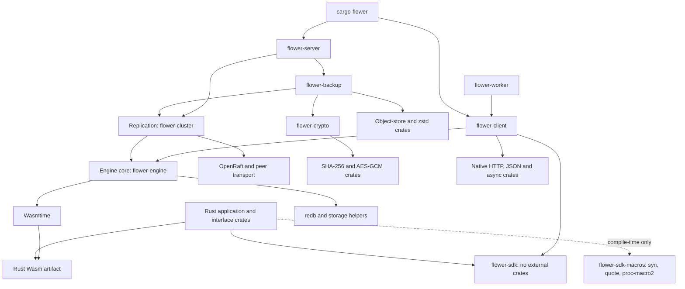

This diagram separates compiler-host macros, Wasm guest code, the engine core and replication dependencies. `cargo-flower` serves nodes and drives the client. An application does not link Tokio, redb or Wasmtime into its guest simply because the native server uses them. `flower-client` links the engine core for its sync-down replica and intent queue; devices link both, never consensus, serving or backup.

### Guest, macros, native client and worker

All workspace packages use edition 2024 and declare Rust 1.96 as their minimum. The reproducible build toolchain uses Rust 1.99.0 and the Rust Wasm target. Minimum source compatibility and the reproducible build toolchain are different declarations.

#### `flower-sdk` 0.1.0: no runtime dependencies

Its only dependency is the build-time `flower-sdk-macros` procedural-macro crate, which expands on the compiler host and emits no guest code of its own. The guest links `core` and `alloc`, supplies guest ABI/value/schema machinery and its Wasm allocation support, and delegates authorized database/crypto operations to the host. `no_std` does not mean allocation-free.

The guest needs neither serde, a native crypto library, HTTP client nor an async runtime. Shared native interface/client code can also use the SDK's type descriptors without becoming a Wasm application. Host enforcement is not replaced by the absence of guest dependencies.

The `native-host` feature (native targets only, pulling in `std`) adds `abi::native`: host and crypto calls go to a thread-local handler instead of Wasm imports. `flower_engine::runtime::NativeRuntime::new(&APP)` uses it to run an SDK `App` in-process with the guest's own dispatch, codecs and host operations — tests and embedders exercise SDK code against the real engine without building Wasm. Guests never enable the feature.

#### `flower-sdk-macros` 0.1.0: compiler-host dependencies

| Crate | Manifest requirement → version | Purpose/features |
|---|---|---|
| `proc-macro2` | `1` → `1.0.107` | Rust token representation for generated declarations. |
| `quote` | `1` → `1.0.47` | Token generation. |
| `syn` | `2` → `2.0.119` | Parse Rust declarations; explicitly `full`. |

`flower-sdk` depends on this crate by path; the dependency expands at build time only. These crates execute on the compiler host; they are not linked into the guest's runtime merely by using a derive. Authors can use explicit descriptors without using the macro crate. There is no procedural-macro runtime, schema server or code-generation daemon. Generated code uses fully-qualified `::flower_sdk` and `::alloc` paths; guests need `extern crate alloc;` and no other imports for them.

#### `flower-client` 0.1.0: native transport, sync and intents

The direct runtime dependencies are:

| Crates and versions | Role |
|---|---|
| Path `flower-engine` `0.1.0`, path `flower-sdk` `0.1.0` | Device engine for sync-down replicas and the intent queue; shared codecs. |
| `reqwest` `0.13` | HTTP transport; defaults disabled, explicitly `http2`, `rustls` (AWS-LC provider and the platform verifier; clang on Windows ARM64) and `stream`. |
| `futures-util` `0.3` | Stream combinators for SSE parsing. |
| `tokio` `1` | Async calls and timeouts; explicitly `rt,macros,sync,time` (`net`, `rt-multi-thread` and `test-util` in tests). |
| `tokio-util` `0.7` | `CancellationToken` for call cancellation, re-exported. |
| `serde` `1`, `serde_json` `1` | Native serialization; serde derive. |
| `uuid` `1` | v4 intent/request identities. |
| `base64` `0.22` | Snapshot and artifact encoding. |
| `sha2` `0.10` | Intent fingerprints. |
| `fastrand` `2` | Retry jitter. |
| `async-trait` `0.1`, `tracing` `0.1` | Transport abstraction and spans. |

The client supports the Wasm bundle/admin deployment path; the server hashes artifacts with `content_identity` when the deploy omits an identity.

Native-client development dependencies are the server, cluster, engine and SDK path crates plus `openraft`, `async-trait`, `tempfile`, Tokio `net`, and `hyper`, `hyper-util`, `http-body-util` and `tokio-rustls` for a local TLS and HTTP/2 test server (with the peer-TLS test certificates copied under `tests/fixtures/tls`). They are test/build scope, not extra guest capabilities.

#### `flower-worker` 0.1.0: native queue workers

Direct dependencies are path `flower-client` and `flower-sdk` (the codecs and `external::Work` of typed reconciling), Tokio `1` with `macros,sync,time,rt`, `futures-util` `0.3` and `serde_json` `1`. The `testing` feature adds the in-memory queue and nothing else. Development dependencies are the crate itself with `testing`, the server, cluster and engine path crates plus `openraft`, `tempfile`, `async-trait` and Tokio `net,rt-multi-thread,test-util` for live and paused-clock tests.

The crate runs `run_queue_worker` over any `QueueClient` (`FlowerClient` implements it) and `reconcile` over any `ReconcileClient`; see [Native worker API](#native-worker-api) and [External computations](#external-computations).

#### `cargo-flower` 0.1.0: operator tooling and serving

Direct dependencies are path `flower-server`, `flower-client`, `flower-cluster`, `flower-engine`, `flower-sdk`, `flower-crypto` and `flower-backup`, plus `clap` `4` with `derive,env`, `openraft` `0.9`, `serde` `1` (derive, for Cargo's JSON messages), `serde_json` `1`, `sha2` `0.10` (artifact digests) and Tokio `1` with `rt-multi-thread,macros,signal`. `tempfile` and Tokio `process,io-util,time` are development dependencies for subprocess tests.

Contract inspection, diffs, `build` and `plan` link the engine core (and its wasmtime backend) and need no operating cluster. Serving links the server and cluster crates. The tool reports string errors to stderr with a nonzero exit; there is no `anyhow` dependency.

### Native server dependencies

The following are **direct dependencies**, grouped by responsibility. Versions are exact required versions; feature lists show explicit manifest requirements, not every transitive/default/unified feature. “Defaults off” means `default-features = false`.

#### Runtime, HTTP and data representation

| Dependency | Requirement → version | Configuration and reason |
|---|---|---|
| `tokio` | `1` | `rt-multi-thread,macros,net,signal,sync,time,io-util,fs` across crates; host concurrency, sockets, storage work, snapshot image files and shutdown. |
| `axum` | `0.8` | Default features; the router for calls and operator surfaces. |
| `hyper-util` | `0.1` | `server-auto,server-graceful,service,tokio,http1,http2`; the API listener's connections: HTTP/1.1 and HTTP/2 (h2c or ALPN `h2`) on one port, graceful drain. |
| `http-body-util` | `0.1` | Request bodies read frame by frame under an admission byte lease. |
| `socket2` | `0.6` | `all`; validating a listening socket inherited from a supervisor (`--listen-fd`). |
| `clap` | `4` | `derive,env`; operator command parsing in `cargo-flower` only. |
| `futures` | `0.3` | Backup object-store streaming. |
| `serde` | `1` | `derive`; persisted/replicated/protocol types. |
| `serde_json` | `1` | Protocol parsing and raw JSON handling under Flower's own validation budgets. |
| `futures-util` | `0.3` | Stream bounds for SSE responses. |
| `tokio-stream` | `0.1` | SSE stream combinators for watches. |
| `base64` | `0.22` | Binary/key/artifact encoding. |

There is no `anyhow` dependency: crates report typed or string errors. There is no `ryu-js`, `rustc-hash` or `futures-executor` dependency, and `libc` only on Unix in `flower-cluster` (the evaluating thread's CPU time, free disk space before a failed member exits, macOS's boot session for `FLOWER_FSYNC=off`), as `windows-sys` is on Windows; canonical number rendering goes through the engine's canonicalizer over `serde_json`. Neither `serde_json/preserve_order` nor `arbitrary_precision` is enabled: workspace feature unification must not change the map/number representation on which server canonicalization relies. Float round-trip parsing policy needs consistency when native callers re-canonicalize read values.

#### Persistence, consensus and allocation

| Dependency | Requirement → version | Configuration and reason |
|---|---|---|
| `openraft` (alias) | `flower-openraft = "=0.9.25-flower.1"` → `vendor/openraft` | Defaults off; `serde,storage-v2,loosen-follower-log-revert`; consensus/log ordering. Vendored with six changes (see "Patched dependencies and why"). |
| `redb` (alias) | `flower-redb = "=4.4.0-flower.1"` → `vendor/redb` | Embedded transactional durable storage and pinned read snapshots. `[patch.crates-io]` resolves it to `vendor/redb`: upstream 4.4.0 plus bounded online compaction (below). |
| `lz4_flex` | `0.14` | Defaults off; `std,safe-encode,safe-decode`; lz4-packed record values. |
| `zstd` | `0.13` | Continuous-backup object/segment compression at level 3. Backup only. |
| `object_store` | `0.14` | Backup object storage: memory and local backends, plus S3 behind the `s3` feature; multipart uploads for objects past one part. |
| `bytes` | `1` | Backup downloads: `object_store`'s byte chunks, opened frame by frame. |
| `tempfile` | `3` | Restore spools each verified backup view to an unnamed temporary file beside its target. |
| `rand` | `0.8` | Nonces and backup identity entropy. |

The workspace `[patch.crates-io]` section redirects `flower-redb` to `vendor/redb` and `flower-openraft` to `vendor/openraft`, both excluded from normal workspace lint/test gates. Dependencies explicitly name those fork packages with exact versions, retaining the Rust aliases `redb` and `openraft`. Registry consumers therefore install the same forks without supplying patches themselves; the release workspace includes and publishes both forks under their upstream licenses. There is no `im` dependency (overlays use standard maps), no `mimalloc`, and `tempfile` is production only in `flower-backup` (restore's spooled views).

A build using unpatched crates with matching version numbers is not equivalent to the forked design below. Fork changes affect durability, read leases, snapshot transport and online compaction, not just speed.

#### Wasm execution and initialized images

| Dependency | Requirement → version | Configuration and reason |
|---|---|---|
| `wasmtime` | **`=49.0.0`** → `49.0.0` | Defaults off; `std,runtime,cranelift,pooling-allocator,incremental-cache`; native compilation, isolated execution, pooled instance slots and an in-memory compiled-function cache. No async, GC, component model or on-disk cache. |
| `wasmparser`, `wasm-encoder` | `0.258` → `0.258.3` | Defaults off; `std` (and `simd` for the parser); read a guest module and write back its initialized image. Wasmtime resolves the same versions, so they add no crates. |

All backends share one process-wide Wasmtime engine, one epoch ticker thread, one pooling allocator and one image cache, created by the first backend and kept for the process's life, so an image prepared to validate a deployment serves its registration when the entry applies. `wasm::configure` fixes their settings before the first backend exists and refuses other settings while the engine runs; `cargo flower serve` passes `--wasm-pool-slots`, `--wasm-keep-resident-bytes`, `--image-cache-bytes` and `--code-cache-bytes` (`FLOWER_WASM_POOL_SLOTS`, `FLOWER_WASM_KEEP_RESIDENT_BYTES`, `FLOWER_IMAGE_CACHE_BYTES`, `FLOWER_CODE_CACHE_BYTES`) and sizes pooled tables for `--guest-table-elements`. A backend is one (database, module) runtime, so deploying new code for a module name in one database never changes another database's code; backends share compiled images, never instances. A module goes through three stages.

**Preparation, once per module bytes per process.** Registration looks the module's image up in the image cache by the SHA-256 of its bytes and, on a miss, prepares it on a thread of its own:

1. Check that linear memory and the mutable globals are the module's whole mutable state: one private 32-bit memory with 64 KiB pages, function imports only, numeric mutable globals, and no instruction that changes a table or a segment (`table.set`, `table.grow`, `table.fill`, `table.copy`, `table.init`, `elem.drop`, `memory.init`, `data.drop`). Modules failing this are refused at deployment.
2. Compile a copy of the module that exports every mutable global, hidden ones such as the shadow-stack pointer included. Instantiate it under the registering backend's limits with neither host nor crypto (host calls answer `invalid_invocation`, `crypto_call` traps), which runs any start function, then run `flower_init`.
3. Snapshot linear memory and every mutable global, and write the *initialized image*: the original module with that state as its initial state. Memory's minimum becomes the snapshot's size, its non-zero bytes become the only data segments, mutable globals start at their snapshot values, and the start function and the `flower_init` export go, since what they did is in the snapshot. Code, tables, element segments and the global exports step 2 added stay as they are.
4. Compile the image and link its `host_call` and `crypto_call` imports once into a reusable `InstancePre`. Its functions are those step 2 compiled, so Cranelift's incremental cache reuses every one of them: in a release build the image compiles in about a third of the first compilation's time.

Preparation is deterministic, since `flower_init` sees no host, clock, key or entropy, so images are keyed by the bytes alone and shared across databases, modules and backends with different limits. Registration then holds the image to the registering backend's own limits, the same way whether the image was cached or just prepared: an image whose `flower_init` used more instruction fuel than an invocation has fails with `budget_exhausted`, and one instantiation under the backend's limits fails an image past its memory or table caps with `out_of_memory`. Only a fresh preparation measures `flower_init` against the wall-clock deadline. A broken module fails deployment, not its first call; a Rust compiler targeting Wasm does not itself prove that every produced module instantiates cleanly.

**Calls.** Every call, nested ones included, instantiates the image in a new store, allocates the request with `flower_alloc`, invokes `flower_invoke`, reads the packed response and drops the store, whatever the outcome: success, business failure, trap or exhausted limit. `flower_init` never runs on a call, so a call's fuel, deadline and memory pay for the call alone. Instances live in slots of Wasmtime's pooling allocator, `--wasm-pool-slots` (1,000) of them across the process, each holding an instance, its memory and its tables; nesting holds one slot per level. A call finding no free slot fails unrecoverably with `instances_exhausted`. If the pool's address space cannot be reserved at startup, the engine allocates every instance on demand instead; `wasm::stats` reports which, with the live instances, warm slots and image cache.

**Recycling.** A released slot remembers the image it last held, and the next instance of the same module prefers it. Wasmtime restores the slot's memory to the image before reuse: where Linux reports written pages (`PAGEMAP_SCAN`, 6.7 and later), it copies back just the pages a call wrote and keeps up to `--wasm-keep-resident-bytes` (1 MiB) of them resident, so the next call writes them without a page fault; elsewhere the kernel takes the written pages back, and the next instance maps the image copy-on-write (Linux, macOS) or copies its data segments (Windows). Globals, tables and instance state are initialized afresh by every instantiation, and memory starts at the image's size. So nothing a call writes, whether memory, globals, grown pages or the memory size itself, reaches a later call, principal or database: a recycled slot and a new one look the same to the guest, which keeps evaluation identical on replicas whose pools have different histories. Tests assert this adversarially against guests that write every kind of state and then return, trap, run out of fuel or time, or outgrow their memory.

**Bounded image cache.** The image cache holds at most `--image-cache-bytes` (512 MiB) of image weight: compiled code plus the image module. Past it, the least recently used images leave; an image larger than the whole budget stays alone. Backends never pin images: they keep their modules' bytes and a weak handle, so an evicted image lives only while calls still run in it, and the next call after that prepares it again. Callers needing the same missing image wait for one preparation, and prepare themselves only if it fails. Compiled functions are kept separately for reuse, oldest dropped first past `--code-cache-bytes` (64 MiB).

Wasmtime's pooled slots with `PAGEMAP_SCAN` resets recycle memory on Linux without keeping stores alive between calls. No admin endpoint reports `wasm::stats` yet.

#### Cryptography and TLS

| Dependency | Requirement → version | Configuration and reason |
|---|---|---|
| `sha2` | `0.10` | SHA-256 content hashing and artifact identity; in the engine core, the owner digest unscoped idempotency receipts record. |
| `aes-gcm` | `0.10` | AES-GCM versioned backup envelopes. |
| `rand` | `0.8` | Nonces and key entropy. |
| `tokio-rustls` | `0.26.5` | `default-features = false`, `aws-lc-rs`, `tls12`: peer TLS on the Raft port (`flower-cluster`) and API TLS on the HTTP port (`flower-server`). |
| `zeroize` | `1` → 1.9.0 | Wipes peer and API TLS private key bytes once loaded, and managed key material and NaCl secrets after use. |
| `ed25519-dalek` | `2` → 2.2.0 | Ed25519 signing for managed keys and NaCl `sign`. |
| `aws-lc-rs` | `1.18.1` → 1.18.2 | RSA, P-256, HMAC and AES-256-GCM for managed keys and JOSE. |
| `jsonwebtoken` | `11.1.0` | `default-features = false`, `aws_lc_rs`, `use_pem`: JWS signing and verification with raw and managed keys. |
| `p256` | `0.14.0` | `ecdsa`, `pem`: managed P-256 (ES256) signing and JOSE P-256 keys. |
| `crypto_secretbox` | `0.1.1` | `default-features = false`, `salsa20`: NaCl `secretbox` and `box`. |
| `x25519-dalek` | `2` → 2.0.1 | NaCl `box` key agreement and managed X25519 keys. |
| `subtle` | `2.6.1` | Constant-time comparisons in NaCl verification. |
| `pem`, `base64` | `3.0.6`, `0.23.1` | Key import and export, JOSE segments. |
| `anyhow` | `1` → 1.0.104 | Error context inside the crypto modules and the catalog. |

The crypto crates live in `flower-crypto`, a native host lane: guests reach them through `crypto_call` and hold no secrets or crypto code of their own (see [Cryptography and managed keys](#cryptography-and-managed-keys)). Peer TLS lives in `flower-cluster` and brings AWS-LC (whose assembly needs clang to build on Windows ARM64) and rustls's PEM parsing; `flower-crypto` shares that AWS-LC build. There is no `getrandom`-direct dependency. The HTTP API terminates TLS in process when given a certificate (see [Listener: TLS, HTTP/2 and inherited sockets](#listener-tls-http2-and-inherited-sockets)); the client's outbound TLS comes from reqwest's default provider.

#### Observability

| Dependency | Requirement → version | Explicit configuration |
|---|---|---|
| `tracing` | `0.1` | Native diagnostic spans/events. |
| `tracing-subscriber` | `0.3` | `env-filter`; log/span subscription and filtering. |
| `opentelemetry`, `opentelemetry_sdk` | `0.33` | Defaults off; `trace,metrics`; spans, the W3C trace-context propagator and metric instruments. |
| `opentelemetry-otlp` | `0.33` | Defaults off; `http-proto,http-json,reqwest-blocking-client,reqwest-rustls,trace,metrics`: OTLP/HTTP export from the SDK's own threads, no gRPC. |
| `tracing-opentelemetry` | `0.34` | Defaults off; the bridge from `flower::otel` spans to the SDK. |

Export is off unless `FLOWER_OTEL_ENABLED` asks for it (see [Diagnostics](#diagnostics)); without it no exporter is built and no thread starts.

### Layer assignment: core versus replication

The server links every dependency above. The engine core links only the subset below; the remainder belongs to the replication layer and API serving. A device build links the core plus `flower-client` for sync.

| Layer | Crates |
|---|---|
| Engine core | `wasmtime`, `wasmparser`, `wasm-encoder`; `redb`, `lz4_flex`; `serde`, `serde_json`; `sha2` (receipt owners, image keys); `tracing` spans and events |
| Replication and API serving | `openraft`; `axum`; `tracing-subscriber` |
| Backup | `object_store`, `zstd`, `futures`, `bytes`, `rand`, `tempfile`; `flower-crypto` (`sha2`, `aes-gcm`) |
| Shared runtime | `tokio` (replication and serving: `net`, `signal`; client: `rt,time,sync`), `clap` (`cargo-flower` only) |

Sync-down serving, intent intake, placement, movement and distributed transactions live in the replication layer. Snapshot encoding, intent queueing and ordered application of synced effects live in the core.

### Patched dependencies and why

The system has two patched projects, both vendored under `vendor/` and wired through `[patch.crates-io]`: redb, and OpenRaft with four of the planned fork's seven areas plus two changes for sub-second failover (below; `vendor/openraft/README.md` lists every change against 0.9.25). Leader-lease reads and grouped writes run without the fork. Substituting the original upstream packages is not equivalent to using the named Flower forks: the differences below are behavior and safety deltas, not mere speed.

| Crate | Upstream | Requirement | Reason for the fork |
|---|---|---|---|
| `openraft` fork | Published OpenRaft `0.9.25`; upstream VCS record `8815cdba2826f74e848acef361ad03f93bb1c3f8`, path `openraft` | **Vendored** (`vendor/openraft`, `[patch.crates-io]`; the first commit holds the published crate unchanged, `vendor/openraft/README.md` records the diff). | An RPC deadline apart from the heartbeat, snapshot segments that renew the leader's lease, lease release for leadership transfer, a leader lease apart from the election timeout, pre-vote. |
| `redb` fork | Published redb `4.4.0` subset | **Vendored** (`vendor/redb`, `[patch.crates-io]`; `vendor/redb/FLOWER.md` records the diff). | Bounded online compaction with pinned readers, allocation accounting and safe tail shrinking. |

#### OpenRaft: why an ordinary registry dependency is insufficient

The fork, as planned, diverges in seven areas:

- **Parallel leader append and replication.** Upstream's leader path waits for local flush before initiating follower replication. Flower makes appended entries readable first and allows replication to overlap that flush. The leader's own matching/durable progress advances only when its flush callback completes; stale-leadership completion is ignored. Acknowledging readable-but-unflushed leader storage as a durable vote would break the design. *Vendored* (change 6): `AppendInputEntries` under the current leader's vote calls `RaftCore::submit_leader_append`, which returns once the store made the entries readable, and only `Notify::LocalLogFlushed` advances the leader's own matching log. The log store's flusher, the lazy-flush mode and the guards for the group file are Flower's (see "Deferred flushes" under Raft log, snapshots and startup recovery). Test: with the leader's Raft disk holding every sync, a write still commits on its followers; with upstream's core it times out.
- **Snapshot traffic renews follower leader contact.** Long chunked transfers otherwise trigger elections that repeatedly invalidate/restart their own transfer. The fork forwards chunk votes/contact into the Raft core, including during final installation. *Vendored:* `Raft::install_snapshot` accepts each segment's vote through the core (`RaftMsg::SnapshotChunk`) and repeats it every heartbeat while the final segment installs. A follower whose segments arrive further apart than the leader lease (300 ms by default; 4 MiB segments need about 14 MB/s) may ask to campaign, and pre-vote (below) refuses it while the other voters hear the leader. Test, with pre-vote off and a 1 s lease: a nine-segment snapshot sent 500 ms per segment starts no election; with the segment's vote only read, as upstream, elections restart it and it never installs.
- **Streaming snapshot sender.** Read until EOF rather than seeking to determine the size. This permits streaming while encoding. Yield between chunks rather than imposing an arbitrary sleep. *Not needed:* Flower's images are complete files before they are sent.
- **Independent RPC timeout.** AppendEntries/leadership checks use an explicit timeout instead of one heartbeat interval. Network plus follower fsync can legitimately exceed the heartbeat cadence without proving the peer failed. *Vendored:* `Config::rpc_timeout` bounds every AppendEntries, data or heartbeat, and the heartbeats behind `ensure_linearizable`, at 500 ms beside 50 ms heartbeats. With the registry crate the heartbeat had to be the 500 ms deadline, which held elections at 1.5–3 s and failover at 4.71–4.79 s measured. A follower whose fsync plus round trip outlasts the heartbeat keeps its leader and keeps replicating under sustained writes; with upstream's deadline its appends restart forever.
- **Leader-lease reads.** Reuse sufficiently recent quorum-confirmed leadership, while still waiting for the read log position to apply. A resumed RPC response is credited to its original send time, not the later collection time. Otherwise the response could incorrectly extend the lease. *Implemented without the fork:* `flower-cluster/src/read.rs` confirms a lease only from a quorum round of its own, credited to the instant before the round began, so no late response can extend it; renewals cost a round every half lease while reads continue, which the fork's crediting of ordinary heartbeats would avoid.
- **Group queued client writes.** Up to 64 adjacent queued client writes share append/flush/replication/apply work while retaining separate log indexes, responders and outcomes in arrival order. This is not a new atomic transaction spanning independent callers. *Reached without the fork:* Flower has one writer per group, which already groups queued writes into one batch entry before Raft (see [The writer](#the-writer-staged-preparation-and-group-commit)), each write keeping its own outcome.
- **Leadership transfer.** Release lease authority, temporarily refuse new proposals and request an eligible caught-up voter to lead. A leader whose lease was released cannot resume lease reads in that term merely because transfer times out; restored leadership also avoids resurrecting released authority. *Vendored, the lease release only:* `Raft::release_leader_lease` makes a member whose committed vote is that leadership's grant votes as Raft's term and log rules alone allow. Proposal refusal, lease surrender and the target's checks stay in `leadership.rs` and `read.rs` (see "Membership, leadership transfer and rejoin"), and a leadership OpenRaft restores from the files on reopening confirms no read lease, since nothing persists a release. A group of four or more voters no longer waits out its voters' leases.

Two more changes, beyond the planned seven, take failover under a second:

- **A leader lease apart from the election timeout.** Upstream ties the voters' refusal window to election max, so failover took election max plus election min..max. *Vendored:* `Config::leader_lease` (300 ms by default); the election timeout (100–200 ms) only spreads followers apart past it, and the read lease stays nine tenths of the leader lease.
- **Pre-vote.** Upstream campaigns as soon as the election timer fires, raising the term. A follower that alone stopped hearing its leader (its own fsync stalls, or appends to it queue behind a slow one) then deposed a leader the others still followed, one back from a partition did the same, so elections had to wait out the RPC deadline; and under load a lagging follower that campaigned first forced rounds of split votes (the benchmark's 3.2 s elections). *Vendored:* `Config::pre_vote`: the follower first asks the voters whether they would vote for it in the next term, changing nothing on either side, and campaigns only once a quorum would; a voter says yes only past its own lease, not while it leads, and only to a log at least as long as its own. A voter that refuses holding a greater vote hands it back, and the follower adopts it uncommitted, as OpenRaft does a refused vote's, so its next pre-vote asks for the term after it (etcd adopts the refusal's term): the member with the longest log, refused by a voter that had voted in its next term, and that voter, refused for its shorter log, otherwise left the group without a leader until another member returned. Thirty seconds of writes with a slow follower (fsync 100–150 ms at its 99th percentile, 250 ms stalls) and jittering round trips keep one leader and one term, and a follower partitioned away and back deposes nobody; of five voters, the one holding an entry nobody else has is elected although a survivor holds a vote in its next term. Heartbeats still queue behind data to the same follower: with pre-vote that quiets only that follower, and heartbeats sent around the core would hide a leader stuck in its own flush.

Flower's corresponding lazy-leader-flush store mode (`flower-cluster/src/flush.rs`) permits followers alone to form a majority only when **every voter configuration in joint membership has at least three members**, judged on both the last membership appended and the last applied; otherwise the leader flushes each append at once, in parallel with replication. Unflushed leader progress cannot count toward commitment. Follower responses retain their configured durability requirement. Conventional quorum durability assumes fsync-enabled storage; `FLOWER_FSYNC=off` is a separately weaker crash model, not the same optimization.

These changes couple the library fork to Flower's storage callback, network timing, read fence and membership code. Replacing the fork with an unpatched crate because the package version matches changes both behavior and safety assumptions: Flower's timing would bound every AppendEntries by a 50 ms heartbeat, the 270 ms read lease would outlast upstream's refusal window (election max, 200 ms) and serve stale reads, elections would fire without asking, and transfers would count on releases that never happen.

**Decision: a minimal fork.** The six vendored changes are 763 added lines in fifteen files of OpenRaft 0.9.25's thirty thousand (236 of them in its engine tests, 216 of those Flower's own pre-vote tests beside upstream's vote tests), each marked `Flower:`, each with a Flower test that fails without it; OpenRaft's own unit tests (197 with Flower's seven) and its storage conformance suite pass on the patched crate. Re-applying them is the cost of an upgrade. The parallel leader append uses `submit_leader_append`, `Notify::LocalLogFlushed` and `LogFlushed::is_leader_append`; with the log store's flusher, the lazy-flush mode and deferred applies it takes a write from three fsyncs in a row to one. The measured numbers are under "Deferred flushes" (Raft log, snapshots and startup recovery).

#### Peer transport and Raft timing

Members talk over persistent TCP connections, one per Raft client, returned to a small per-peer pool (four idle, for half the listener's idle timeout) when the client goes, so the short-lived clients OpenRaft opens for every quorum read reuse authenticated connections; a pooled connection the listener already closed is redialed once. An idle connection its peer closed (a process that dies closes every one at once) is dropped when taken from the pool, before anything is sent on it, so a forwarded request, which must not be sent twice, goes on a fresh dial instead of failing as `forward_failed` with its outcome unknown. A dialer opens with a hello (protocol version 2) carrying the peer token, its own node ID, the node ID it means to reach and this build's compatibility contract. The listener compares the token in constant time before reading anything else, then refuses a hello addressed to another node ID or carrying another contract, and answers with its own ID and contract, which the dialer checks in turn: every request on a connection is between the two members its hello named, built to the same contract, so an address alias cannot count one process as two voters and a member of an incompatible build never exchanges an entry. The contract (`flower_cluster::compat`) is the peer wire version, the state-machine version (entry variants and what applying them does, deploy-time module validation included), the snapshot and stored-value encodings and the Wasm runtime version that validates deployed modules; the package version is diagnostic only, so compatible bugfix builds roll one member at a time. A member's files record the part their bytes depend on, and never open under another (see [Storage failure](#storage-failure)). Builds before this protocol cannot join a group running it.

Bodies grow as bytes arrive rather than being allocated from a claimed length. Frames are capped (`--raft-max-frame-bytes`, default 256 MiB; an AppendEntries batch over the cap answers `PayloadTooLarge` so OpenRaft resends fewer entries), inbound connections are capped (`--raft-max-connections`, default 512, every hosted group's together), and each connection has handshake, idle and I/O deadlines. A dial first takes one of as many places for connections still saying hello (TLS, then the token and identities); with every one taken it is closed at once and nothing else is touched, so a dialer without the token can delay others' dials but never close their connections. Past its hello a connection takes a place under the cap. Dialers pool idle connections per peer and group, so idle ones alone could fill it: a connection at the cap closes the one idle longest and takes its place, and only a cap of connections all serving requests refuses one. The evicted connection is told first: the listener writes an empty frame, which no response is, then reads off unread whatever arrives until the dialer hangs up, so a request already on its way is known never to have run and is sent again on a fresh dial, a forwarded client request included (one a connection answered nothing to may have run, and is not). Forwarded client requests are served at most half the cap at once and answered beyond it as admission answers an overload (503 `overloaded`, `Retry-After: 1`), so a flood of them never holds every connection while heartbeats and votes wait for one. A replication stream that fails to dial or say hello tries again after 25 ms, doubling to 500 ms (OpenRaft waits 500 ms from the first failure, longer than a follower's lease, and one RPC OpenRaft abandons closes its connection, so under CPU or disk pressure a heartbeat can need a fresh dial). With the older default of 64, a process hosting eight groups had every connection busy after a member restarted under the stress preset, and one group elected four times in two seconds. Frames over 64 KiB also hold room in a replication budget (`--raft-queued-input-bytes`, default twice the frame cap plus 1 MiB, never less than one frame plus 1 MiB) from their first byte until their response is written; a frame that finds no room is read off the wire unkept and answered `Busy`. The leader then resends one entry, and after a second refusal in a row waits 25 ms before its next data append, doubling per refusal up to half the RPC deadline; heartbeats never wait. A slow follower thus costs its leader time, not its own memory.

Every RPC honors OpenRaft's hard TTL, and an exchange takes its connection out of the client until its whole response has arrived: one OpenRaft abandons at its deadline closes its connection instead of leaving a late response to answer the next request (which could credit a follower with entries it never received). Data appends run in a task of their own with time for their bytes (`--raft-append-timeout-ms`, default 5 s, plus each byte at `--raft-append-bytes-per-second`, default 8 MiB/s), and OpenRaft's retry of the same entries resumes waiting for that task instead of sending them again: OpenRaft gives every AppendEntries one RPC deadline (500 ms by default), which a large entry on a slow link would otherwise miss forever. Snapshots travel as chunked InstallSnapshot segments (`--raft-snapshot-chunk-bytes`, default 4 MiB) under a 60 s install deadline. `serve` refuses a non-loopback Raft listener without a peer token (`--peer-token`, falling back to the admin token); a loopback listener runs with a warning.

Peer TLS (`flower_cluster::tls`, `--raft-tls-cert`, `--raft-tls-key`, `--raft-tls-ca`, all three or none) runs every peer connection inside server-authenticated TLS: rustls with the AWS-LC provider, TLS 1.2 and 1.3, the listener presenting its chain (PKCS#8, PKCS#1 or SEC1 keys), the dialer trusting only the configured roots and checking that the certificate covers the host name or IP of the member address it dialed. There are no client certificates: the peer token, now inside TLS, authenticates peers. The hello, identity and contract checks and every frame run unchanged inside the stream. A silent or failed handshake closes the connection within the handshake deadline before any hello is read. Members must agree on TLS mode: neither side falls back to plaintext, so enabling TLS on a running group is a coordinated cutover; certificates load at startup. The HTTP API remains plaintext.

The same connections carry the member channel (`flower-cluster/src/peer.rs`, `Member` requests): a follower's read-fence requests to the leader, client requests a follower forwards to the leader's API, and the question of where a member's API serves; a bare `serve` listener answers none of them. A member sends at most 16 at once, and a forwarded request at most once: a pooled connection that answers nothing is not retried for it, since the request may have run. Each listener also tells its member about every append from the leader that takes, which is how a follower knows its staleness.

Timing derives from one knob, `--raft-rtt-ms` (`FLOWER_RAFT_RTT_MS`): heartbeat, RPC timeout, leader lease and election bounds each derive from the round trip and may be set individually (`--raft-heartbeat-ms`, `--raft-rpc-timeout-ms`, `--raft-leader-lease-ms`, `--raft-election-min-ms`, `--raft-election-max-ms`). The defaults: 50 ms heartbeats; an RPC deadline for every AppendEntries and quorum acknowledgement of at least 500 ms (above a follower's fsync tail, with appends queued ahead of a heartbeat), the fork's `Config::rpc_timeout`; a 300 ms leader lease, the fork's `Config::leader_lease`, during which voters refuse other candidates after their leader's last message; and election timeouts of 100–200 ms past it, after which a follower runs a pre-vote (`Config::pre_vote`) and campaigns only if a quorum would vote for it. A follower therefore asks to campaign 0.4–0.5 s after its leader's last heartbeat (0.8–1 s at a 100 ms RTT, where the lease grows to six heartbeats). Under sustained writes from clients routing by leader, killing the leader of a three-member group had a client's write acknowledged after a median of 0.56 s and at worst 0.65 s over a hundred kills (`flower-client/tests/failover.rs`: election 0.43–0.59 s, the new leader's first commit about 50 ms later, parked writes right after), and every client whose URL names a survivor after a median of 0.58 s; cutting the leader off by a partition, 0.63 s at worst over fifty. A group other than the root fails over the same way (see [Every subsystem, per group](#every-subsystem-per-group)). `flower-bench`'s demo reads 0.61 s from the kill to the first acknowledged write (its status polling saw the new leader at 0.59 s), with no failed customer call and the killed member caught up 2.7 s after the kill. The registry crate's timing took 4.7–4.8 s to elect and 5.15 s in the demo. Raising the timers trades failover time for tolerance: a leader whose own log fsync stalls longer than the lease less 1.5 heartbeats (about 225 ms by default) loses its leadership to a failover, and failover takes about the lease plus the longest election timeout plus 0.1–0.2 s. A follower's own flush does not count against its leader: the leader sends it nothing more until it answers, so its lease and election timer run from when its leader's entries are durable (the fork's change 7), and followers whose disks stall together, every replica of a busy host flushing at once, keep their leader. A leader counts as cut off from its quorum, refusing and giving up writes as `leader_isolated`, once no quorum acknowledged it for its lease plus the shortest election timeout (400 ms by default); cut off after the lease alone, a leader merely slowed by its followers' flushes gave writes up. The window bounds liveness only: a follower that lost the leader earlier asks for a pre-vote every election timeout and is granted one once the others' leases ran out, so another leader can exist from the lease on, and nothing commits or is read on the strength of the window. The read lease (`--raft-read-lease-ms`, `FLOWER_RAFT_READ_LEASE_MS`) defaults to nine tenths of the leader lease (270 ms), must be shorter than it, and 0 turns it off. Its safety rests on every voter refusing candidates for the same leader lease, so the compatibility contract's wire version moved to 5 with these defaults and the pre-vote flag (4 is hellos naming their group): a member of an earlier build never joins a group of this one. Snapshots trigger every 10,000 entries, and sooner for applied bytes or age under a duty cycle (see Raft log, snapshots and startup recovery); 10,000 entries of log stay after each.

#### Membership, leadership transfer and rejoin

Voter sets, member addresses and the membership log ID live in the Raft log and snapshots. `Node::membership` (`GET /v1/admin/membership`, `cargo flower membership` without `--members`) reports a member's local view: leader, membership log ID, last applied log ID, voter sets (two during a joint change), every member's address and the build's compatibility. `Node::reconfigure` (`POST /v1/admin/membership`) takes the complete desired voter set, an optional `expected_log_id` and `retain`. The leader confirms its leadership through a quorum; refuses the change if membership moved past `expected_log_id`, if a joint change toward another voter set is in progress, if an existing ID would move to another address, if an address would belong to two IDs, or if the set is empty or an ID is zero; probes every proposed member over the peer transport (`Info`), refusing one that answers as another node ID, runs another contract or, when new to the group, already holds Raft state (this cannot merge clusters or silently reincorporate an old member's directory); registers the missing members as learners; captures a fence (a committed log position after their registration) and waits until every proposed voter holds it while its leadership holds; then commits the voter set through joint consensus. Changes are serialized per member and bounded by 15 s; a refused, timed-out or interrupted change answers 409 `membership` and may have left learners, a joint configuration or the final one committed, so operators inspect before retrying. `Node::change_membership` remains as the unvalidated primitive for in-process clusters.

`Node::transfer_leadership` (`POST /v1/admin/leadership {"to": id}`, `cargo flower leadership`) hands leadership to another voter at the leader; a follower forwards, and asking the current leader answers `unchanged`. OpenRaft's voters refuse any candidate while their leader's lease (300 ms from its last AppendEntries) runs, and the leader itself for as long after it began to lead. So the leader gives up its read lease for the rest of its term (the voters are about to release the refusal it rests on, and the target will campaign at once, ignoring its own; see [Read consistency, leases and routing](#read-consistency-leases-and-routing)), stops proposing (writes answer 503 `leadership_transfer`; writes already proposed finish first), and waits a lease and an election timeout at most for the target to hold its whole log. It then releases its own lease and sends `TransferLeader`, which names the target, to every other voter (OpenRaft fork, `Raft::release_leader_lease`): a voter that follows that leader in that term releases its lease and grants the target's vote at once. Should too few confirm for a majority, it falls back to the registry crate's way: it sends AppendEntries and snapshots to the target alone until the other voters' leases lapse, one lease (their own elections wait a further election timeout, so the target campaigns first). Last it asks the target to campaign, which the target does only if it follows that leader in that term, is a voter, holds the log and is not rejoining, and waits twice a lease and an election timeout at most for it to lead. A transfer that does not happen answers 409 `transfer_failed` and the old leader resumes; one whose target campaigned without winning leaves the group to elect as after any failure. Raft's vote rules alone decide the election, so a lost message or crash costs time, never safety. Groups of any size hand over in a release round trip and one vote round trip; before the release a group of four or more took an election timeout (3 s with the registry crate's timing), and a leader that had led for less than one waited out its own lease. `cargo flower serve` stopping on a signal hands over the leadership of every group it leads this way first, all at once (`Host::hand_off_leadership`; each group's `Node::hand_off_leadership` picks the voter holding the most log, then the next), while its API still answers: a planned restart costs each group it leads a transfer of a few milliseconds, writes meanwhile answer the retryable `leadership_transfer` or forward, and nobody waits out a lease.

A member that opens a directory without Raft state (no vote, entry, purge position or snapshot: a new member, a wiped disk, a restored group file) cannot tell whether it forgot what it acknowledged, and one whose machine went down with unsynced writes (`FLOWER_FSYNC=off` boot markers) may have; either is *rejoining* (`flower_cluster::rejoin`): it records a `rejoining` mark in `raft.redb` before its Raft core starts, so a restart before it caught up changes nothing, and reloads its saved vote as uncommitted (OpenRaft restores a member whose own committed vote is saved straight to leader); it grants no vote except to a candidate whose log ends at the initial membership entry (a cluster being bootstrapped), starts no election, takes no leadership transfer, refuses sync batches (503 `rejoining`) and reports `/health/ready` 503 with `"rejoining": true`. Its leader replicates to it as to any lagging follower; a background task asks that leader for a read fence (`Fence`: the leader confirms its leadership through a quorum and answers its read log ID), and once the member applied it, it holds everything its group committed before it came back: the mark clears and it votes, campaigns and serves. `initialize` makes a member the founder of a new cluster, which ends it too. Meanwhile the group needs a quorum of its other voters: a three-voter group with one member rejoining tolerates no other failure, and if its leader goes too, the remaining voter cannot be elected with the rejoining member's vote, which is what keeps an entry the leader committed with that member from being lost. A vote granted in the term the data was lost in cannot be recovered; the gate closes the data-loss path, not a same-term double vote.

#### redb: compaction without stopping all readers

redb is copy-on-write and reuses a freed page only once no reader can see it, so under load a file grows (by doubling) with live pages near its end, and a commit gives space back only from the end. Flower continuously holds redb read snapshots. Upstream `Database::compact` requires exclusive access and no open read transaction, so it cannot serve as the normal online compactor. The vendored fork (redb 4.4.0) adds four public `WriteTransaction` methods:

| Added method | Behavior and reason |
|---|---|
| `compact_some(max_pages)` | Bounded selection of tail pages for relocation, plus necessary parent-path work, within an ordinary write transaction; request tail trim on commit. |
| `allocated_bytes()` | Count allocated pages from region allocators without walking every table. |
| `occupied_bytes()` | Report extent through the last occupied page, distinguishing immediately trimmable free tail from live allocation. |
| `trim_on_commit()` | Request maximum free-tail release on a durable commit. |

The relocation allocator also refuses to grow the file merely to seek a lower destination page. If no lower page exists, the step stops; a parent relocation with nowhere to go is undone. This avoids growth/doubling under readers that pin reusable pages.

Copy-on-write reader protection still applies. A relocated page can remain pinned until readers release it; later commits reclaim the tail. “Bounded compaction” does not mean immediate reclamation, constant latency for all parent work, or guaranteed file shrink in one call.

Every member compacts both of its files, `group.redb` and `raft.redb`, through one `Compactor` each (`flower-engine/src/storage/compact.rs`), paced by `Node::run_compaction` (`flower-cluster/src/compaction.rs`), which `serve` starts beside maintenance and stops before Raft. Steps run on the blocking pool and take only redb's write lock, never the engine lock: queries keep flowing, and a writer waits at most one step. Each file is measured every `--compact-check-ms` (10 s). A run starts once the occupied extent is at least `--compact-ratio` (2; 0 disables) times the allocated pages and at least `--compact-min-file-bytes` (16 MiB); each step moves up to `--compact-step-pages` (256) pages in its own durable transaction, and steps take `--compact-duty-percent` (20) of the time. Free pages already at the end of the file don't count toward the extent: redb fills them first. A run ends once the extent is within a quarter of the allocated pages, a step moves nothing, or 64 steps pass without lowering the extent; its final commit trims the free tail. That last bound matters because a reader held across a run pins every page freed after it began, so under writes each commit allocates fresh pages that the next step moves again while the pinned tail never trims. A run that ends short of its goal waits before starting again, from 20 s doubling to 640 s, unless the file grows past where it stopped or an eighth of its allocation is freed. Each flag reads the matching `FLOWER_COMPACT_*` variable. `/v1/metrics` reports each file's run state, checks, steps, step time, file, occupied and allocated bytes and remaining wait.

Tests cover a file shrinking more than threefold while some snapshot is open at every moment (group store, Raft log with appends between steps, raw redb), a long-held reader beside a run that never grows the file and ends by the stall bound, give-up backoff, and compaction stopping on shutdown with both files closed.

The vendored subset includes source, manifest, build script and licenses, omitting upstream tests/examples/benchmarks/dev-dependencies. The patch assumes **no redb savepoints**; adding those requires tracking moved pages. This is separate from the SDK's higher-level call-savepoint API.

This fork is about long-lived snapshots and online storage operation.

### Transitive dependencies and native code

The native build is not pure Rust. Important transitive families include:

| Family | Examples | Build/runtime significance |
|---|---|---|
| Wasm compiler/runtime | Wasmtime `49.0.0`, Cranelift, register allocation, object/debug-format and platform mapping crates | Native compilation and isolated execution. |
| Backup compression | `zstd-sys`, `cc` | Native Zstandard codec/build for backup objects and segments. A C compiler is required. |
| TLS/certificates | rustls with `aws-lc-sys`; reqwest's default provider in the client | Peer TLS, the API's in-process TLS and OTLP export over HTTPS; AWS-LC's C and assembly need clang on Windows ARM64. The client's outbound HTTPS uses reqwest's default provider. |
| OpenTelemetry | `opentelemetry-proto`, `prost`; the `opentelemetry` API and `tracing-opentelemetry` in `flower-cluster` | OTLP/HTTP encoding for export, built whether or not export is enabled; the cluster's instruments bind through the API's `experimental_metrics_bound_instruments`, which the server's SDK enables too (without it bound measurements would be dropped). |
| Rust cryptographic primitives | SHA-256 and AES-GCM families | Host hashing and backup envelopes. |
| HTTP plumbing | Hyper, Tower, URL/IDNA | API transport via axum/reqwest. |

These crates come through Cargo/registry resolution and their own source packages. A registry `-sys` crate can include bundled upstream C/assembly. Neither form is a runtime dependency on a system executable.

Registry crates may support multiple targets; the native build links only its target's paths.

Flower does not enable HTTP/3. The resolved build graph establishes what is active.

Canonical JSON rendering goes through the engine's canonicalizer over `serde_json`; there is no `ryu-js` dependency. Replacing the formatting rules changes fingerprints, derived identities and potentially persisted keys. Switching renderings is a data/protocol change.

### Build and deployment boundary

Build inputs are Rust/Cargo, a C compiler for the zstd native codec, and `wasm32-unknown-unknown` only for compiling guest artifacts. Runtime requires the native Flower server and deployed Rust Wasm artifacts.

The build pins its toolchain inputs. The server prepares each Rust module into an initialized image, compiled with Wasmtime and cached by the module's content; each call instantiates the image in a pooled slot. Preparing compiles the module twice (the instrumented copy, then the image), so dev builds optimize the Wasm compiler and module loader crates (`[profile.dev.package.*]` in the workspace manifest: Cranelift, regalloc2, wasmparser, wasmtime): unoptimized, a debug `serve` took 9 s to deploy the 200 KB release test guest and 20 s for the 2.3 MB debug one, against the client's 20 s attempt timeout; optimized, 0.7 s and 1.7 s. Flower's own crates keep unoptimized debug builds. Tests that deploy guests build them in release.

The example guests under `examples/` (`external-transactions`, `crypto-ticket`, `goblin-pizza` and the `typed-modules-contract`/`-provider`/`-consumer` trio) are workspace members: the gates build and lint them for the host, and their tests build them for wasm32 and deploy them.

Guest ABI/value contracts are explicit: key encoding, number rendering, request fingerprints and persistent state are stable. Versions in this section are required versions, not a claim that dependencies are newest or that a security/update audit has been performed.


## Values, schemas and errors

### `FlowerType`: the typed wire contract

```rust
pub trait FlowerType: Sized + 'static {
    const SCHEMA: Schema;
    const OPTIONAL_FIELD: bool = false;
    fn encode(&self) -> flower_sdk::Result<Value>;
    fn decode(value: Value) -> flower_sdk::Result<Self>;
    fn decode_field(value: Option<Value>) -> flower_sdk::Result<Self>;
}
```

`FlowerType` owns decoded values. It is not a borrow into guest ABI memory and does not require serde. Its schema is used for validation and canonical module contracts. The default `decode_field` rejects missing required members.

Built-in types include `()`, `bool`, `String`, finite `f64`, checked integer types, `Option<T>`, `Vec<T>`, `Box<T>`, tuples of one through four elements, and explicit `Value` escape data.

Important distinctions:

- `i64` and `u64` accept only the exact safe-integer interval supported by the value model. They reject inexact wide values instead of rounding.
- `DecimalI64` and `DecimalU64` preserve the full integer range as canonical decimal **strings**, with explicit `decimal_i64` / `decimal_u64` schemas validating syntax and range. Legacy indexes still compare their canonical JSON bytes; SQL compares these logical types numerically without floating-point conversion. Old manifests declaring `string` retain string semantics.
- `Option<T>` represents visible JSON null. It does not by itself make an object member optional.
- `Field<T>::Redacted` is policy-hidden/absent data. `Field<Option<T>>::Visible(None)` is visible null. Encoding redacted data fails rather than overwriting an unknown field.
- `Collection::get` returns `None` for a missing row. Typed stored records cannot be null; deliberately nullable low-level records need explicit existence-aware handling.
- Explicit `Value` does not excuse invalid nonfinite data: the guest codec checks recursively.

Native serde callers are a separate boundary: serde can convert nonfinite floating-point values into null before transmission. They must not be treated as proof that a guest's strict numeric contract was preserved.

### Derivation and stable names

Example shared contract:

```rust
use alloc::string::String;
use flower_sdk::FlowerType;

#[derive(Clone, Debug, PartialEq, FlowerType)]
pub struct Task {
    pub owner: String,
    pub title: String,
    pub done: bool,
    #[flower(default)]
    pub count: u64,
    #[flower(skip)]
    pub cache: u64,
}
```

Wire names always match Rust field names: derivation has no rename, flatten or redaction options. `#[flower(default)]` (or `#[flower(default = path)]`) fills absent members; `#[flower(skip)]` excludes a field from schema and encoding and fills `Default` on decode. Redacted members use `typed::Field<T>` as the field type.

Named structs decode as closed objects; unknown members are rejected with `INVALID_VALUE`, before any missing-member check. Unit enums map to closed string enums naming each variant. Single-payload enums map to `{"tag", "value"}` objects with a closed tag set. The derive rejects tuple structs, unions, mixed unit/payload enums, multi-field variants and container-level `#[flower(...)]` attributes. It does not infer a stable storage API from every Rust type. Generic declarations are supported with `FlowerType` bounds on every type parameter (plus `Default` where skipped or defaulted fields need it).

The schema marks exactly the member types with `OPTIONAL_FIELD` optional, plus every defaulted field, so dispatch-time schema checks and decoding agree on absent members.

### Explicit schema API

`flower_sdk::schema::{Schema, v}` supports `v::string`, `number`, `int`, `boolean`, `null`, `json`, `array`, `tuple`, `object`, `nullable`, `str_enum`, `field`, `optional` and `field_or_optional`. Schema builders include `.min`, `.max` and `.pattern`; `Schema::parse` returns a validation error with a path and message, while `Schema::is` checks membership. String enums carry a closed variant list; manifests encode them as `{"type": "enum", "variants": [...]}`.

Not every validator constraint has a canonical cross-module contract representation. Unsupported constraints fail contract emission; they must not silently become a broader promise. Hand-written `FlowerType` implementations must keep schema, encoding and decoding consistent.

### Failures and declared business errors

The low-level guest result is `flower_sdk::Result<T>` with `Failure` carrying code, message and optional details. `fail`/`fail_with` create structured application failures. Infrastructure, trap and budget failures remain distinct from application-declared errors.

```rust
use flower_sdk::FlowerError;

#[derive(Clone, Debug, PartialEq, FlowerError)]
pub enum TaskRejection {
    #[flower(code = "TASK_DONE")]
    AlreadyDone,
    #[flower(code = "REJECTED", retryable)]
    Rejected(String),
    #[flower(code = "OUT_OF_STOCK", message = "The goblins have run out of dough")]
    OutOfStock,
    // Every other failure, so `?` works on SDK calls.
    #[flower(other)]
    Host(flower_sdk::Failure),
}
```

A variant's message is its `message` option, else its name. One single-payload variant over `Failure` may be `#[flower(other)]`: every failure no declared code matches converts into it (`from_failure`, and a generated `From<Failure>`, so `?` on an SDK call needs no `map_err`), it converts back unchanged, and the contract then admits any code.

`FlowerError` implements `typed::BusinessError`: its schema, conversion into `Failure`, and checked conversion back. Every variant requires `#[flower(code = "...")]`, in `UPPER_SNAKE_CASE` (a lowercase code fails to compile, since the server tells a call's own failures, 422, from its own by it); codes discriminate variants, so the schema stays `json`. Unit variants encode without details; payload variants encode the payload as details (an unencodable payload surfaces its codec failure instead). Decoding treats absent details as null. `#[flower(retryable)]` feeds the generated `is_retryable` helper. The ordinary `FlowerType` derive is not the business-error derive. `Failure` itself implements `BusinessError` as the universal pass-through, so fallible methods can return the one-parameter `flower_sdk::Result<T>` alias directly.

Only recognized envelopes become typed declared errors. Authorization, transport, unknown failures and fatal host conditions cannot be assumed to fit the business enum.

## Collections, indexes and context capabilities

### Collection descriptors

```rust
use flower_sdk::collection;

#[collection(
    name = "tasks",
    key = TaskId,
    value = Task,
    index(name = "by_owner", fields(owner)),
    reference(target = Posts, fields(post), on_delete = cascade),
)]
pub struct Tasks;
```

The macro keeps the marker struct, makes it the component an app lists (`App::new(&[&Tasks, ...])`), and gives it an inherent handle: `NAME`, `raw()` (a `const fn`), and typed `get`/`set`/`delete` by key (`Tasks::get(ctx, &id)`). Writes take `&mut MutationCtx`; reads take `&mut impl ReadCtx`. A field reference needs a covering index (an index leading with its fields, after the discriminator for a polymorphic one), as deploy checks: the attribute refuses one without at compile time, naming the index to add. The option `export` lets other modules read the collection, and `access = policy` (a `fn() -> access::Policy`) guards callers' operations on it. A hidden `TASKS_COLLECTION` static carries the raw descriptor. Index and reference `fields` name wire fields directly. References use `fields(...)` (or `key` / `key_prefix` instead), `target` or poly `targets(...)` with `discriminator`, and `on_delete` (`restrict`, `cascade` or `set_null`, defaulting to `restrict`). Only field references can be polymorphic. Reference targets name marker structs and resolve to the sibling `*_COLLECTION` static, so renamed imports do not resolve. Markers cannot be generic.

Keys are values: typed handles take `&K`, the raw context `&Value`, and the SDK renders the canonical text the host compares (canonical JSON, quotes around string keys and Rust `Display` number formatting included) at the call, so no guest ever builds key text. Hosts treat key bytes opaquely and never re-render them. Scan and range responses carry keys back as decoded values so guests never parse canonical text. Low-level unkeyed raw string storage has a different encoding: writes go through `set`/`delete` addressed at `$raw/<namespace>` with verbatim key text and string values, while `raw_get`/`raw_scan` accept either the `$raw/<namespace>` or the bare `<namespace>` spelling; both fold to one namespace under the shared `$raw` collection with verbatim stored strings, no schemas and no triggers. Preserving an existing collection requires preserving its raw descriptor, not merely choosing the same Rust key type. Typed stored records cannot be null; a missing row reads as `None`.

Core handle operations, with `Result` abbreviating `flower_sdk::Result`:

| Operation | Signature and meaning |
|---|---|
| `get` | `(ctx: &mut impl ReadCtx, key: &K) -> Result<Option<V>>`; decodes the stored row |
| `set` | `(ctx: &mut MutationCtx<'_, '_>, key: &K, value: &V) -> Result<()>`; encodes, then upserts |
| `delete` | `(ctx: &mut MutationCtx<'_, '_>, key: &K) -> Result<()>` |

`Row<K, V>` has typed `key` and `value`. `Page<K, V>` has `rows: Vec<Row<K, V>>` and `cursor: Option<String>`. Limits are plain positive `u32` values validated at the call. The host owns ordering and issues continuation cursors; do not synthesize cursors or substitute Rust `Ord`.

### Index descriptors and bounded ranges

Indexes are `IndexDef::new(name, fields)` descriptors inside the raw collection descriptor; the host builds and maintains them. Bounded range scans go through `ReadCtx::range` with an explicit `RangeBounds` (`prefix`, `gt`, `gte`, `lt`, `lte` as values, `limit`, `after`, `reverse`); `RangeBounds::limited(limit)` supplies empty bounds with a row limit. Bound components render to canonical text at the call; the host compares them opaquely in stored component order — length first, then bytes, the order ranges iterate in (see Storage layout) — and pushes the bounds into the storage scan, so pages and cursors are exact whatever precedes the bound. Raw pages decode row-wise with `typed::decode_page` into `Page<K, V>`; the first undecodable row fails the page.

Typed handles (`flower_sdk::index`) sit on top. `Index<K, V, F>` names one declared index of a collection with key `K`, row `V` and indexed field types `F`, a tuple of up to four types. A range fixes a `Prefix` of the fields, then bounds the next field (`gt`/`gte`, `lt`/`lte`, each side once), both type-checked against `F`; a full prefix's next component is the uninhabited `Full`, so it takes no bounds. `after(cursor)`, `reverse()` and `page(ctx, limit)` complete it. `#[collection]` generates one `Index` const per identifier-named index (`BY_OWNER` for `by_owner`), typed by the index option `types(...)` or with `Value` components without it. `Source<K, V>` reads a whole collection: `get(ctx, &key)` by typed key and `page(ctx, limit, after)` in host order, a complete inventory when walked to the end with rows the caller may not read left out; `#[collection]` adds `SOURCE` and `page()`. Both reach another module's exported collection through `in_module(name or $slot)` and never write. The host checks that a scan or range cursor belongs to the range it continues (`INVALID_VALUE`, "out of scope").

```rust
// index(name = "by_owner_due", fields(owner, due), types(String, u64))
let page = Tasks::BY_OWNER_DUE
    .prefix((owner,))
    .gte(&since)
    .lt(&until)
    .page(ctx, 100)?;
let next = Tasks::BY_OWNER_DUE
    .prefix((owner,))
    .gte(&since)
    .lt(&until)
    .after(page.cursor.as_deref().unwrap_or_default())
    .page(ctx, 100)?;
```

The raw form stays available for deliberately dynamic code:

```rust
let mut bounds = flower_sdk::RangeBounds::limited(100);
bounds.prefix = alloc::vec![owner.encode()?];
let page = flower_sdk::typed::decode_page::<String, Task>(
    ctx.range(flower_sdk::CollectionRef::local(Tasks::NAME), "by_owner", bounds)?,
)?;
```

Live pagination can skip/repeat records changed between pages. It is not snapshot pagination. Index and record updates publish atomically; phantom dependencies include insertions into empty windows and rows crossing bounds.

### Capability contexts

| Capability | `DerivedCtx` | `QueryCtx` | `MutationCtx` |
|---|---|---|---|
| Collection/index reads and derived values | Yes | Yes | Yes |
| Invocation time/deadline declarations | Yes | Yes | Yes |
| Principal/caller access through `MethodCtx` | No | Yes | Yes |
| Call exported queries | No | Yes | Yes |
| Write local collections | No | No | Yes |
| Call exported mutations | No | No | Yes |
| Write imported collection handles | No | No | No |

The two context lifetimes describe callback/runtime borrowing. Contexts are private to adapters, neither `Send` nor `Sync`, and cannot be returned as owned results. Sealed traits prevent user code from manufacturing a write capability.

`ReadCtx` provides `get`, `raw_get`, `get_derived`, `scan`, `raw_scan`, `range`, `now`, `clock` and `changes_at(Option<f64>)`. `MethodCtx` extends it with `principal`, `caller` and exported method calls (`call`, savepoint `try_call`); `principal` is absent for anonymous invocations and `caller` is absent for external entry. `MutationCtx` adds local writes (`set`, `delete`, `delete_permanently`, `delete_if_match`), mutation calls (`call_mutation`, savepoint `try_mutation`) and `materialize`/`unmaterialize` operations. Typed calling help lives in `typed::call_typed` (typed arguments, decoded result, ordinary poisoning) and `typed::decode_outcome` (decodes a savepoint outcome into a typed success or a declared `BusinessError`).

The low-level `Ctx`/`Value` layer is available for deliberately dynamic code and component adapters. It exposes `get`, `raw_get`, `get_derived`, `scan`, `raw_scan`, `range`, `method_call`, `set`, `delete`, `delete_if_match`, `materialize`, `unmaterialize`, `settle`, `history`, time and principal operations. `method_call` invokes any method kind with a savepoint flag; the host routes by target kind and enforces caller capability. Host enforcement remains authoritative even when Rust's typed layer is bypassed intentionally.

There is no public typed-context-to-raw-context escape method. `features::raw_set` and `raw_delete` are explicit mutation-only bridges that still enforce host schemas, policies, triggers, references and retention.

## Queries, mutations and application registration

Request-time read-only SQL uses a `SqlEndpoint` component with a nonempty local
collection allowlist and fixed candidate/byte/work ceilings. An ordinary module
query exposes `endpoint.run(ctx, &statement, &params) -> Vec<Value>`; `run_as<R>`
optionally decodes typed rows, and `explain` binds a request without reading rows.
The endpoint grants no HTTP alias or authority by itself. The module's query
authorization, principal, collection policies and normal invocation capabilities
apply. The manifest's `sql_endpoints` declarations fix scope/limits at deployment;
request-time SQL cannot supply replacement ceilings. Request-owned parameter
metadata infers column contexts (including decimal strings), rejects missing or
extra names and incompatible contexts, and never leaks static schemas per call.
Binding work reduces the execution budget. Endpoint `require_index()` rejects
requests without a proven indexed path. It uses host operation 36, within the
same state machine contract 10 and stored value format 4.

Named read-only SQL plans use `SqlQuery<Params, Row>` components, called from
ordinary query, mutation or derived callbacks with `run(ctx, &params)`. The host
binds each manifest declaration against local collection schemas at deployment;
the guest sends only the plan name and typed parameters. The initial dialect
supports projection, three-valued predicates, logical ordering and a mandatory
total limit, with explicit candidate/byte/work ceilings. It selects exact
primary-key reads or complete secondary-index equality buckets when their byte
semantics preserve logical equality; otherwise it uses a bounded collection
scan. `require_index()` rejects deployment when no such indexed path is proven.
Dependencies cover the selected record/bucket and policy lookups; bucket reads
also observe each candidate record for non-indexed field changes. Policy filtering
and redaction precede SQL evaluation. It returns
complete results at one pinned snapshot, including staged writes; it has no
pagination or value-ordered index ranges. `explain(ctx)` and offline
`cargo flower sql-explain --manifest FILE --plan NAME` expose the plan and its
configured limits, distinguishing the proven one-row point bound from bounded
nonunique equality buckets. Host operation 35 and
decimal schemas require state machine contract 10; stored value format remains 4.
See [SQL.md](SQL.md) for exact semantics, compatibility and deferred features.

### One declaration per operation

Methods are plain synchronous functions; the `#[query]`, `#[mutation]` and `#[derived]` attributes make each one a complete operation, declared once:

```rust
use flower_sdk::{query, QueryCtx};

#[query(name = "tasks.get", consistency = replica_local, access = authenticated, timeout = "200ms")]
pub fn get_task(ctx: &mut QueryCtx<'_, '_>, id: String) -> Result<Option<Task>> {
    Tasks::get(ctx, &id)
}
```

The attribute keeps the function, derives its public argument struct (`GetTaskArgs`, one field per parameter; an `Option` parameter may be left out), and emits a raw-callback shim plus an upper-cased static (`GET_TASK`) carrying every option of the operation: an `Op<GetTaskArgs, Output, Error>`, the `Method` with its types, which timers and the native client take their types from (a `Derived` static for `#[derived]`). The first parameter must be the context receiver named `ctx` with the matching wrapper type; the rest become decoded arguments. Methods must be synchronous, non-generic and free of `self`. Options, all optional:

| Option | Meaning |
|---|---|
| `name = "..."` | The definition name, which is also its HTTP alias; the function's name by default. |
| `http` | Callable over HTTP under its name. Nothing is without it: timer and queue handlers, trigger targets and methods for other modules need no alias. |
| `consistency = linearizable \| replica_local`, `max_staleness_ms = N` | A query's read consistency; linearizable by default. |
| `access = public \| authenticated \| path` | Who may call it, decided by the module's authorization component; its `default` otherwise. Declaring access without one fails the manifest. |
| `export`, `callers("module", ...)` | Other modules may call it: all of them, or only these module identities. Private by default. |
| `timeout = "250ms"` | The method's own deadline (`ms`, `s` or `m`), from which its fuel follows; see [Guest execution limits](#guest-execution-limits). |
| `rename_all = "camelCase"` | The argument members' wire names, as `#[flower(rename_all = "camelCase")]` gives a `FlowerType` struct's. |
| `bare_arg` | The only parameter is the whole argument (a string, a tuple, a struct) rather than one member of an argument object. |

`#[derived]` takes `name`, `export`, `materialize = always | never | each(Marker)` (one root per row of a `#[collection]`; a marker's `raw()` is a `const fn`, so raw code writes `Materialize::Each(Orders::raw())` in a static) and `access = rule` (a `fn() -> access::Rule`). One callback may serve two operations: `SHOP.named("pizza.shop.local").consistency(Consistency::ReplicaLocal)` is a twin descriptor with the same types. Fallible methods return `Result<Output, E>` where `E: BusinessError`, including `Failure` itself; business failures encode into the error envelope with their declared codes, and the error type is visible in the signature.

### `App` is one list of components

```rust
pub static APP: App = App::new(&[&Tasks, &Owners, &AUTH, &GET_TASK, &PUT_TASK, &EMAILS]);
flower_sdk::export!(APP);
```

Everything a module is made of is a `Component`: methods (`Method`), derived values, transactions, collections (`Collection`, `#[collection]` markers), triggers, queues (`TypedQueue`, `QueueDef`), maintenance `Task`s, `Retention` hooks, catalog `KeyDeclaration`s, `Import`s (an interface handle is one), the `auth::Authorization` hook (at most one), and composites that list parts of their own: an external value (`external!`), an interface provider (`TasksProvider::<P>::COMPONENT`), or a static array of components, which groups parts for reuse. `App::new(components)` takes them in one flat list and `.init(callback)` adds an image-preparation callback, which runs once per module image while the host prepares it, without an invocation context, host calls, crypto or entropy; the memory and statics it leaves are where every call starts, and a failure reports `init_failed`. The `Component` trait has one defaulted accessor per kind, so a component implements only what it provides.

The manifest is generated from the components: every collection, definition and trigger; the HTTP aliases, one per method and transaction declared `http`, under its own name; the exports, from what each collection, derived value and method declares; the imports; and per-method access, which the authorization hook applies. `export!(APP)` emits the guest ABI for an application.

At the raw descriptor layer, `Method::query(name, callback)` and `Method::mutation(name, callback)` wrap `fn(&mut Ctx, Value) -> Result<Value>`, with the same options as builders: `.args(schema)`, `.result(schema)`, `.errors(schema)`, `.consistency(c)`, `.http()`, `.access(a)`, `.export()` / `.export_to(modules)` (an empty list admits no module) and `.timeout_ms(ms)`; a raw method, like a macro's, is off HTTP and private until it says otherwise. `.result` and `.errors` declare the result and business-failure contracts other modules may rely on (`json` by default; the attributes fill all three from the signature, and a `FlowerError` enum's schema is `{code: <declared codes>, message, details?}`); the manifest carries `result`/`errors` only when they are not `json`. `Definition` is `Method(&Method)`, `Derived(&Derived)` or `Transaction(&Transaction)`. `Consistency` has `Linearizable`, explicitly potentially unbounded `ReplicaLocal`, and `ReplicaLocalWithin(ms)`, replica-local at most `ms` milliseconds stale (up to 2^31 − 1). The manifest carries it as each query's `consistency` (`linearizable` when absent) plus `max_staleness_ms` for a bounded one, and every member serves each query the way it declares (see [Read consistency, leases and routing](#read-consistency-leases-and-routing)). A caller may tighten a query's bound (`x-flower-max-staleness-ms`, `RequestOptions::max_staleness`) but never loosen it.

## Modules, contracts and calls

### Interface-only dependencies

Modules are separate Wasm artifacts; a provider module and its consumers share only canonical contracts, never implementation code. The shared contract is the manifest: argument, result, declared failure and collection shapes. Calls address module names as strings (`""` denotes the calling module, `$slot` a binding) and the host enforces exports, bindings and caller allowlists. A method's HTTP alias is its definition name, so modules and HTTP clients address the same name.

**Exports.** A module exports nothing it does not declare exported: a collection with `#[collection(..., export)]` (`Collection::export`), a derived value with `#[derived(export)]`, a method with `#[query(export)]` / `#[mutation(export)]`, or `callers("module", ...)` for an allowlist of actual module identities (`Method::export_to`; `Method::export` is `Export::All`, and an empty `Export::Only(&[])` admits no module). From another module, reading a collection or derived value it does not export, or calling such a method, fails `MODULE_PRIVATE` (a call refusal recovers like an unknown method, even without a savepoint); raw `$raw/` namespaces are never exported. Exported collections are read-only to other modules: writing one fails `MODULE_READ_ONLY`, so changes go through the owner's mutations and its own checks, triggers and references. A method with an allowlist refuses other callers with `MODULE_PRIVATE`. Within a module exports change nothing. The manifest carries `exports: {collections, derived, methods, callers}`; a manifest without it exports nothing.

**Imports.** An `Import` component declares what a module expects of one provider: `module` (a concrete name, or `$slot`), `collections` (`ImportedCollection { name, key, row }`), `derived` (`ImportedDerived { name, contract }`) and `methods` (`ImportedMethod { name, kind, contract }`), where a `Contract { args, result, errors }` is the importer's view and `None` is an explicit untyped link. The manifest carries `imports: [...]`.

**Interface crates.** `#[interface(name = "tasks.v1", handle = TasksApi)]` on a trait of `#[query]`, `#[mutation]` and `#[derived]` signatures gives both sides one contract. Consumers declare the handle once — `static TASKS: TasksApi = TasksApi::import("$tasks")` — which is both the typed calls (`TASKS.get_task(ctx, id)`, `try_get_task` through a savepoint decoding the declared error type) and the `Import` component to list. Providers implement the trait on a marker `P` and list `TasksProvider::<P>::COMPONENT`, which brings every interface method exported to other modules and off HTTP; `TasksProvider::<P>::COMPONENT.http()` also exposes the methods over HTTP under their names (`provider = Name` renames the type). The authorization component's `methods` table says who may call each. Both sides derive their contracts from the same signatures, so they link; an incompatible next version of the interface does not.

```rust
#[interface(name = "tasks.v1", handle = TasksApi)]
pub trait Tasks {
    #[query]
    fn get_task(ctx: &mut QueryCtx<'_, '_>, id: String) -> Result<Option<Task>>;
    #[mutation]
    fn add_task(ctx: &mut MutationCtx<'_, '_>, id: String, title: String) -> Result<(), TaskError>;
}
// Provider:  impl Tasks for Impl { ... }
//            App::new(&[&Rows, &TasksProvider::<Impl>::COMPONENT])
// Consumer:  static TASKS: TasksApi = TasksApi::import("$tasks");
//            App::new(&[&TASKS, &PLAN, &SHOW])
```

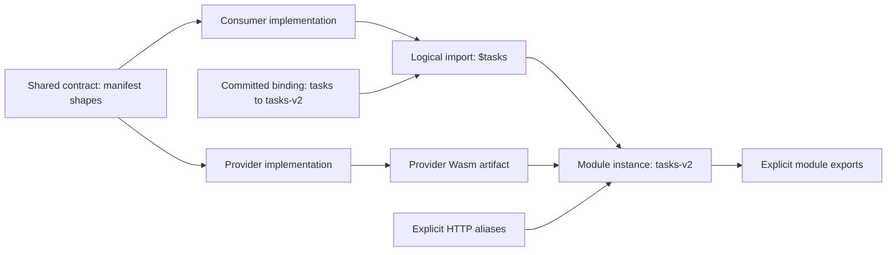

**Bindings.** Deployment binds logical slots to instances, such as `{"tasks":"tasks-v2"}`: the deployer adds a root `bindings` member to the manifest it deploys, so the content identity covers it and the binding travels with the activation through every member. Every slot an import names must be bound and every binding used; module identities never start with `$`. Caller allowlists contain actual module identities, not slot names. Rebinding is a redeploy of the same binary with other bindings. `cargo flower deploy`, `plan` and `deployment stage` take `--bind SLOT=MODULE` (repeatable) or `--bindings FILE` (a JSON object) and insert them before the identity is computed; `build` leaves slots unbound, since bindings belong to a deployment. The `examples/typed-modules-*` trio is the worked case: a contract crate with the `tasks.v1` interface, a provider exporting it, and a consumer importing it through `$tasks`.

**Compatibility.** `Schema::accepts` is conservative structural containment: bounds nest, integers fit numbers but not the reverse, enums fit pattern-free strings, patterns must be equal, nullability only widens, closed objects keep every member the narrower one may carry and require what the wider one requires, tuples keep their arity. Providers accept every argument the importer sends (`provider.args ⊇ contract.args`) and produce only results and failures it accepts (`contract.result ⊇ provider.result`, `contract.errors ⊇ provider.errors`); collection keys agree both ways and rows fit (`contract.row ⊇ provider.value`). Deployment (`contracts::check_links`) checks the module's own imports against deployed providers and every deployed importer against what the module is about to export, kind and allowlist included, and fails `MODULE_CONFLICT` naming what would break; it checks again before an activation is proposed. Two different modules deployed concurrently can still both pass: the host remains the authority at runtime. Where another module answers a call or a derived read, the host holds the answer to the provider's exported result and error contracts: a breach is `MODULE_CONTRACT_VIOLATION`, the callee's failure (rolled back, recoverable through a savepoint, otherwise poisoning).

Derived values evaluate as their own module: an imported derived value's `""` names its provider's collections, whichever module reads it.

### Removing modules and purging their data

An operator removes a module from a database through consensus (`POST /v1/admin/modules` `{"operation": "remove", "db", "module", "purge"}`, `flower_client::admin` `remove_module` and `purge_module`, `cargo flower modules --db D remove --module M [--purge]`). The leader checks the removal first, so a refused one never reaches the log, and proposes one `ClusterWrite::Remove` entry; every member, synced device and restore replay applies it through `Engine::commit_removal`, checking again on the state it applies to, in the transaction that records the entry's position (`flower_engine::purge`). A removal refuses (`MODULE_CONFLICT`, 409 over HTTP) a module another deployed module imports from, by name or through a slot bound to it, naming the importers; a module not deployed, unless its data is to be purged; an invalid name; and, as deployments do, a database that does not serve here or that a prepared transaction holds. A member claims the module while it removes it, as a deployment does.

Removed, a module loses its code identity, aliases, hooks and runtime (readers fenced out while it goes), a staging of it left open on the member, its derived outcomes with their edges (pins included: each member drops its own caches) and every outcome another module computed from its collections, indexes or derived values, transitively. Its records, index entries, raw rows and timers stay, unreachable, and so do its declarations: the meta row `removed\0<module>` names the code it last ran, so deploying it again diffs against those declarations and builds only the indexes that changed (none for the same declarations), and the row goes once it runs again. `GET /v1/admin/modules` lists such modules under `removed`.

With `purge`, or on a module removed earlier, its data goes too: the removal records the module in the database's `module_purges` row (keys deleted so far and a cursor), and the group's leader deletes it in pages as part of its maintenance. A page is a batch item (`BatchItem::Purge`) the writer prepares on the state it stages, so it orders with the writes it serves: at most 1,024 keys (`flower_engine::purge::PAGE`), walking the records and index entries under every name the module interned (retired ones included) by intern ID, then its raw namespaces' rows in the shared `$raw` collection, its timers in `$timer` (held ones included), the rows of its queues in `$queue` and its maintenance tasks' failure states in `$task` (so a module deployed again under the name inherits no backoff or last error), reading at most 8,192 rows per page there. Queues are named by queue, not by module: a module's are those its manifest declared that no other module declares, deployed or removed with its data kept, fixed when its purge begins (`Progress::queues` in the `module_purges` row); every row of those queues goes (items, ID rows, fences, turns, groups, lines), and other queues stay. Guest code uses only the queues its module declares (see the queues section), so those queues hold no other module's work. Until the purge ends, no operation touches them: every queue operation on one, from workers, operators or node-local calls, fails `queue_purging` (retryable once the modules listing no longer shows the purge) before it plans, since a half-deleted queue does not plan, and every applier refuses a patch writing one of their rows, changing nothing, so an operation planned before the removal and committed after it lands neither behind the walk (pointer rows left dangling, a fence counter starting over) nor ahead of it (rows a later page deletes). The page carries the keys it deletes and where the next starts; every applier checks it continues the purge where it stands and names only the module's keys (otherwise it changes nothing: `purge_stale`, `purge_refused`), deletes exactly those keys and records the same progress, so members, devices and replays agree, and a new leader continues from the replicated cursor. Pages pace as retention collection does: after a page that took `T` the next waits `T × 9` (at most 10 s), a tenth of the writer. Purges go one module at a time, by name. Until a module's purge ends it cannot deploy: staging (the leader preparing it and every applier of a staging step), activation and every applier of an activation refuse it, so its new data never mixes with the old; they refuse alike a module declaring one of the queues the purge deletes. Asked again while its purge is in flight, a purge changes nothing; on a module never deployed it records a purge that its first page ends. `GET /v1/admin/modules` lists purges in flight under `purging` with the keys deleted so far, and `Node::purge_stats` counts the leader's pages, keys and finished purges.

A removed module's timers wait for it: one that comes due while the module is removed (its declarations kept, or a purge in flight) is held, attempts untouched, through a revision-guarded patch the sweep proposes as it would a retry, and leaves the due order (see the timers section); deployed again, the module gets its held timers due at once; a purge deletes them. A timer naming a module that was never deployed still spends its retry budget as a missing handler's does. Removals and purges work per group: requests name their database and route to the group that owns it, whose log carries the entries and whose maintenance purges. State machine contract 5; contract 8 adds the purged queues and task states, held timers, the deployment refusal and `queue_purging`.

### Calls and savepoints

Query/mutation contexts through `MethodCtx` provide:

```rust
call(module, name, &args) -> Result<Value>
try_call(module, name, &args) -> Result<CallOutcome<Value>, CallError>
```

`MutationCtx` adds `call_mutation`/`try_mutation` for exported mutations. Typed help lives in `typed::call_typed` (encodes typed arguments, decodes the typed result, ordinary poisoning) and `typed::decode_outcome` (decodes a savepoint outcome into `CallOutcome<Output, DeclaredError>` after recognized-envelope decoding). There are no descriptor-generic `call::<Q>` forms: modules, names and arguments stay explicit at the call site.

A normal failed call poisons the **host invocation**, even if Rust catches or ignores its `Err`. A savepoint call rolls back the callee's effects and returns `CallOutcome::Failure` only when the host confirms recovery is legal. Reads performed by the failed branch remain dependencies. Budgets/cycles/fatal failures remain fatal. Fatal `CallError::Host` stays explicit at the call site; it is not declared-error recovery. Unknown definitions, non-callable targets and invalid arguments are deterministic with no effects, so they recover even without a savepoint. Nested calls run with callee module identity: `""` resolves to the callee and `caller` reports the caller, restored afterwards so nesting stacks correctly.

`DerivedCtx` exposes `ReadCtx` only and cannot call methods.

Cross-module calls share the selected snapshot, overlay and final atomic publication. **They are not cross-database transactions.** Modules are capability/namespace boundaries within a logical database, not separate consensus domains or a claim of isolation from every hostile co-resident application.

## Reactive computations, triggers and maintenance

### Materialized values and aggregates

A derived instance is identified by definition name plus canonical arguments. Stored outcomes include either a value or an ordinary computation error. Actual reads build a dynamic dependency graph. Successful evaluation replaces edges; failed evaluation retains old plus newly observed dependencies so changes can repair it.

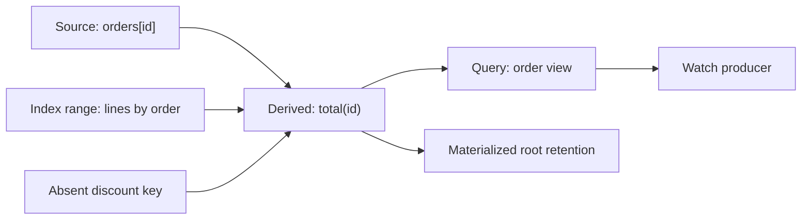

Edges are observed reads, not manually maintained subscriptions. An empty range and absent key matter as much as returned records. Unchanged source writes do not invalidate; unchanged derived outcomes can stop propagation where ordering permits. Wide invalidation can mark cells stale, with demanded values refreshed on reads and the remainder through paged maintenance. Required freshness is never traded away for an eager-work budget. The core invalidates conservatively: any touched key drops its dependents without before/after value comparison, and range matching scans the edge table once per batch testing bounds in memory. Value-equality short-circuits are future work; over-invalidation is always safe.

`Derived::new(name, raw_callback)` supplies ordinary computation. An optional args schema (default `json`) validates invocation arguments. `.materialize(Materialize::Never | Always | Each(&source))` controls root retention. The `#[derived]` macro emits the descriptor static with `Never` retention; applications needing other retention build the raw descriptor over the generated shim. `MutationCtx::materialize(module, name, &args)` and `unmaterialize(module, name, &args)` manage explicit roots by name. `Always` pins every evaluated outcome. `Each(&source)` keeps one root per row of a collection of the same module, at arguments `{"key": <row key>}` (so a `#[derived]` function taking one `key` argument of the collection's key type fits; deployment checks the arguments accept that shape): the manifest carries the definition's `source`, a mutation inserting a row pins its root (evaluating it in the mutation), deleting the row unpins it, and a row older than the deployment pins at its root's first evaluation rather than at deployment. Manifests from before the source was encoded carry none and behave as `Never`. `unmaterialize` clears the pin without evicting the cached value: the value stays until invalidation or cache pressure evicts it. Dropped pinned roots re-evaluate eagerly at settle and commit, so commits never leave pinned values stale; unpinned instances re-evaluate lazily on next read. Fresh evaluations keep the current pin flag. Stored outcomes record their module's *code era*, which every activation mints afresh (`code_era\0<module>`: a domain-separated hash of the database's `code_eras` counter), even for code the module ran before, so activation retires every outcome computed before it: the next read re-evaluates instead of serving a stale value, keeping the pin. Deploying A, then B, then A again therefore never serves what A cached the first time, which read structures that B's retirements, their collection, the re-add's purge and A's backfill, or B's writes to an index only A declares, changed without invalidating anything. Members mint alike, applying activations in log order, and the counter travels with the database's rows (snapshots and moves included), so no member and no restart reuses an era; a replicated staging's graph takes the new era as it moves in. Activation also drops, transitively, every outcome of another module that reached the activated one: reading another module's collections, indexes or derived values records a reserved module marker, refused reads included, so a provider that stops exporting, retires and re-adds a structure, or starts exporting leaves no reader serving its old rows or its old refusal. Certificates leave the marker out, since their code version covers every module. Mutation patches carry the revision they were prepared at; derived outcomes install at apply only if the database has not moved since, otherwise they drop (a dropped pin stays as an invalid marker and re-evaluates on read), and apply re-runs invalidation against committed edges, so a value cached between prepare and apply cannot survive a write it missed. Evaluation nests at most 16 deep; deeper nesting and dependency cycles fail as guest failures.

`index::TypedAggregate` keeps one accumulator per equality group of a declared index: it names the `Source` marker, the `INDEX`, the index field types `Fields`, the `Group` (a full prefix of them), the `Accumulator`, `initial(group)`, `add(accumulator, key, row, group)` and, optionally, `remove(accumulator, key, row, group) -> Result<Option<Accumulator>>`, the inverse of `add`. Its `DERIVED` definition, read at `{"group": …}`, builds a group by folding its rows in index order through paged typed ranges; the outcome caches per group and depends on that group's index entries only, so writes to other groups leave it cached. A collection declared untyped serves as a source through a `TypedCollection` marker whose `Key` and `Value` are `Value` (rows arrive as their JSON), with `Value` index fields and group; Goblin Pizza's `pizza.orderStats` is one.

A write to a group whose value is cached (pinned or not) does not rebuild it: the value goes on from its accumulator by deltas, in the writing transaction. The derived definition carries an `Aggregation { collection, index, reduce, version }` (`Derived::aggregate`; the manifest's `aggregate` member, which deployment checks names an index of the module's own collection), the raw layer `TypedAggregate` builds on. When invalidation reaches a cached aggregate value (a servable value computed under the current code), the host captures it before the drop, then gathers the source rows written since the value was computed, in key order: the journal past the value's *basis* (the staged writes the value already reflects: none for a committed value, all of them up to its evaluation or maintenance for one staged in the session, a basis that savepoint rollback restores with the value), with each row's image at the basis and now, kept where the row's index components equal the group's. Each change goes to the reducer as `{key, old?, new?}` (`old` leaving the group, `new` entering it: an insert has only `new`, a delete or a move out only `old`, an update within the group both), with the group and the previous accumulator, in one invocation of kind `5` that runs without a context (`index::ReduceCall` in, `index::Reduced` out); `TypedAggregate`'s reducer applies `remove` then `add` per change. The result is staged with the value's edges and the session's journal length as its new basis, so changes settled mid-transaction and those after fold in exactly once. No change in the group restages the value as it was. The reducer answering `Reduced::Rebuild` (`remove` returning `None`, which is its default: a minimum cannot take a row out), or failing, leaves the value dropped: a pinned group builds again from its rows at once (phase two of invalidation), an unpinned one at its next read. A reducer reaching for a host call or the key catalog fails the invocation as `aggregate_context_forbidden`. The maintained value replicates in the patch like any outcome and installs only when the database has not moved since the prepare. Changes come in key order, not write order, so `add` and `remove` must be order-independent inverses (integer units for sums).

Cached aggregate values outlive deployments while the aggregate declares a `VERSION` (1 to 128 bytes, no control characters) that the new code keeps, with the same collection, index and index fields: activation keeps the aggregate's *lineage*, a meta row whose value its outcomes carry as their code identity instead of the module's, and begins a new lineage (a domain-separated hash of a per-database counter) whenever any of those change or the aggregate was absent from the active code. A value from an earlier run of the same version (the aggregate removed and declared again, its index dropped and rebuilt meanwhile, or the same bundle deployed again after a gap) therefore never serves. Without a version, new code rebuilds every group it reaches, as for any derived value.

### Triggers and deletion hooks are different

`features::TypedTrigger` names its `Source` (a `#[collection]` marker, which implements `typed::TypedCollection`), a stable `NAME` and:

```rust
fn run(
    ctx: &mut MutationCtx<'_, '_>,
    key: <Self::Source as TypedCollection>::Key,
    before: Option<<Self::Source as TypedCollection>::Value>,
    after: Option<<Self::Source as TypedCollection>::Value>,
) -> Result<()>;
```

Its associated `TRIGGER` is registered in `App::triggers`. It is a source-change hook inside the mutation, not an asynchronous subscriber. Raw `Trigger` receives `&Change`. The host fires a trigger as the mutation of its name: the SDK manifest declares that mutation for every trigger without a same-named definition and dispatches it to the trigger's callback. Trigger settlement participates in rollback and budgets. Change arguments are `{collection, key, before, after}` with the key as the decoded key value and absent images as null; the before-image reads from the pinned snapshot, unaffected by staged writes. Triggers fire at explicit settle and again at commit for changes staged since, every trigger of the collection exactly once per `(collection, key, after-image)`; each firing runs as a mutation under its own savepoint, so a failing trigger rolls its own writes back and fails the settle or commit with its failure. Deploy rejects triggers that do not name a mutation. Cascading trigger and foreign-key rounds abort past 16 rounds with `cascade_too_deep` and commit nothing.

Deletion retention observes successful deletion events separately from net-change triggers. Delete/recreate can therefore matter to retention even if final state resembles the original value.

### Maintenance and time

`ReadCtx::now()` and `clock()` return the invocation's fixed timestamp in milliseconds since the Unix epoch. Both return the same value; they differ only in dependency tracking. `changes_at(Some(t))` declares an instant when the result can change: the earliest instant declared stands, so no later declaration lifts one (a token check's expiry, say, under a session row's later one), and `None` declares nothing. `now()` marks the result as polling the clock; `clock()` alone does not. A derived value keeps both with its outcome, its reads' included (`OutcomeTime`): one that polled serves reads at that instant alone, one that declared an instant serves from its evaluation's clock until then, and other reads evaluate it again, keeping its pin; every reader inherits the poll or the instant, cached or not. A query's declaration bounds how long its cached result and its watches' value hold: a watch refreshes at the declared instant, one whose result polled refreshes every poll interval, and a declaration not after the evaluation's own clock counts as a poll (see [Dependency certificates, query reuse and watch wakes](#dependency-certificates-query-reuse-and-watch-wakes)). Committed mutation time has a monotonic floor; node clocks are not synchronized distributed time. Mutations record `changes_at` declarations and commit normally.

Maintenance tasks are components (`flower-engine/src/task.rs`). A raw `Task { name, due, run, on_error }` is a component; `features::TypedTask` names a `NAME`, `due(&mut QueryCtx) -> Result<Option<f64>>`, `run(&mut MutationCtx) -> Result<Value>` and, with `HANDLES_FAILURES`, `on_error(&mut MutationCtx, &TaskFailure)`, and registers its `TASK`. The manifest lists them (`tasks: [{name, on_error}]`; deployment refuses a name shared with a definition or hook, or longer than 128 bytes), and the SDK dispatches the task's name as a query to `due` and as a mutation to `run` (no arguments) or the error callback (`{error, failed_at}`). `due` answers when the task next has work, in epoch milliseconds, or `null`; it must depend only on data and time. `run` performs one bounded unit and the task stays eligible while `due` stays in the past.

The group's leader runs them (`Node::run_tasks`, beside the maintenance loop of every hosted group) waking at the next time a task may be due (a later `due` answer or a backoff's end, which the plan reports), after a write (a commit notice: a write may make a task due), on a change of leader, and at least every `--timer-sweep-ms`, never starting two passes within 250 ms. A pass (`Node::sweep_tasks_once`) plans per database on the read side (`EngineReader::plan_tasks`: every task whose `due` answers now or earlier and that is not backing off, earliest first, `due` evaluated with definer rights on a fresh snapshot, a failing `due` counting as due), runs the earliest through the writer (`Node::run_task`, `Engine::prepare_task_run`) and plans again, until nothing is due or the database had a 50 ms burst. While every unit of a task runs, the pass submits more of them at once, doubling up to 16: the writer prepares each on the state the ones before it staged and commits them in one entry. A run's preparation evaluates `due` again in the run's own transaction, read-only, and runs only when that still says due, so one unit of work never runs twice; the patch replicates like any write (followers run no guest code), guarded by the revision it was prepared at, and a second preparation on the writer sees the first's effects. Followers never run tasks, and a new leader picks up from the replicated state.

A failed run (its business failure, a trap, an exhausted budget; not a storage failure, which fails the pass) rolls back. A task with `on_error` then gets the failure as a mutation over the state the run saw; without it, or when that fails too, a planned patch records the task's failure state in the reserved `$task` collection (interned when a module declares tasks; keyed by module and task): failures so far, when it may run again (one second after the first failure, doubling to a minute) and the last failure. Other tasks stay eligible meanwhile, and the next successful run deletes the state in its own patch. Operators read every task and its state in the module listing (`GET /v1/admin/modules`, `ModuleSummary::tasks`, `EngineReader::tasks`).

A maintenance callback does one bounded unit. Due work, retries and scheduling remain authoritative transactional state. Leadership, quorum and admission can delay execution; no hard real-time guarantee is implied. Periodic work can also schedule itself through durable timers (see [Schedulers](#schedulers)).

## Authentication, policies and deletion

### Authentication: the authorization hook

`auth::Principal` has `subject: String`, `tenant: Option<String>` and `claims: Option<Value>`. `Principal::new` rejects empty subjects and the reserved `$anonymous` subject. Guests observe the principal a call runs as through `MethodCtx::principal`; derived values always read `None`, because their cached outcomes serve every caller.

Every call into a module from outside it decides who it runs as before anything else happens (`flower-engine/src/auth.rs`):

1. **Alias resolution.** A call over HTTP names an alias, which the engine resolves through the module's `http` allowlist (`CallOptions::external`): the SDK lists every method and transaction declared `http`, under its own name. A name the allowlist doesn't list fails `UNKNOWN_METHOD` (HTTP 404), whether or not an internal definition has that name. Aliases name queries, mutations or transactions; deployment rejects aliases to derived values or unknown definitions, duplicate aliases and empty names. Local embedders (devices, tests, the cluster itself) address internal names.
2. **The hook.** A module that registers an `auth::Authorization` component declares `"authorize": true` in its manifest. Before the call, the engine invokes the query `$flower.authorize` on the call's own snapshot, with definer rights, no principal, the default fuel and the call's deadline, on `{"credentials", "method", "args", "principal"}`: `method` is the alias (or the definition name for local calls) and `principal` the one the caller asserted, or `null`. It answers `{"principal": …}`, the principal the call runs as (`null` is anonymous), and may add `"reads_args": false` (the decision does not depend on the arguments; absent means it may) and `"until": ms` (the instant it stops holding, such as a token's expiry, which bounds its certificate like a declared `changes_at`). Any failure denies the call with `unauthorized` (HTTP 403), whose message carries the hook's own code and message (`UNAUTHENTICATED`, `FORBIDDEN`, …); disk failures pass through as `host_io`. The hook is not a definition: no alias and no guest call reaches it.
3. **No hook.** The call runs as the principal the caller asserted (`CallOptions::principal`). Over HTTP only a gateway holding the admin credential asserts one; everyone else is anonymous.

**Ordering.** The decision comes first, before unscoped idempotency replay (memory and durable alike), scoped retry admission, transaction planning, query and preview evaluation, and every watch delivery. A revoked caller therefore never recovers a recorded result, while a refreshed token recovers its own. Calls without a caller, timer fires, skip the hook and run with definer rights.

**Across members.** A write reaches the leader before anything runs: a follower forwards it untouched (body and `Authorization` header alike), so the hook decides on the leader's own state and no follower's decision travels. A query is decided where it is served, on the snapshot it evaluates: after the fresh-read proof for a linearizable query, so a committed revocation is seen, and on the member's own state for a replica-local one, whose authorization lags as its data may, within the staleness it reports. Replica-local consistency is looked up through the alias, so an alias reads the way its definition declares.

**Credentials** are opaque to the engine and reach the hook only: never the arguments, the retry fingerprint or any receipt. Over HTTP they are the call body's `credentials` member, or else `{"bearer": token}` for an `Authorization: Bearer` token that matches none of the server's own tokens (admin, worker and sync tokens are never shown to guest code). Watches take either, in the body or the header, as calls do. A gateway's asserted principal reaches the hook as `principal`, and `Authentication::Gateway` trusts it.

**Receipt owners.** An unscoped idempotency receipt records its owner: SHA-256 over the decided principal's framed subject and tenant, or zeros for anonymous callers, which such receipts always carried. Claims own nothing, since they change as tokens refresh. Another principal reusing the key gets `identity_conflict`, learning neither the result nor whether it succeeded, and nothing runs. Two principals racing on one key both miss at prepare; the applier answers the loser with the same conflict instead of the winner's result. A multi-database transaction's receipt belongs to the principal its first step's module decided.

**Kept decisions.** The engine keeps hook decisions in a memo (`flower-engine/src/decisions.rs`, 4 MiB by default, insertion-order eviction; `EngineReader::{decision_memo_stats, set_decision_memo_bytes}`, `serve --decision-memo-bytes` / `FLOWER_DECISION_MEMO_BYTES`, zero disables it; `/v1/metrics` reports it under `authorization.decisions`). A decision is keyed by a SHA-256 digest of everything the call presents: database, module, method name, whether it is an alias, credentials, asserted principal (claims included), plus the canonical arguments unless the decision said `reads_args: false` (arguments rendering past 16 KiB are never kept). Beside it the memo keeps the certificate of what the hook read, the database's code version and its place in the change journal. A later call with the same key reuses it, without running the hook, only when all of these hold: the same code version is deployed (a redeploy, a changed policy or alias table is a new version); no change the journal recorded since touches what the hook read (a deleted session row, a removed membership); the call's clock is at or after the decision's and before its `until` or declared instant; no key-catalog change began since the decision if it resolved a managed key; and the call reads a committed snapshot no older than the decision's. Decisions that polled the clock with `now()`, read anything no dependency names, or denied the call are never kept. Only committed snapshots recall and keep decisions: a writer preparing on its staged state, or speculatively on an overlay, runs the hook, so a revocation staged earlier in the same batch denies and a speculation's read set holds what the decision read (a candidate prepared before a revocation in its wave conflicts with it and is prepared again). Readers (queries, previews, watch reauthorization) and the writer on committed state share one memo per member.

**The SDK component.** `auth::Authorization { authenticate, default, sessions, methods }`, listed among the app's components (at most one per module), runs the hook guest-side. Each method and transaction declares its own access (`#[mutation(access = ...)]`, `Method::access`, `Transaction::access`); `methods` gives access, by name, to definitions another macro declares (an `external!` value's operations such as `words.publish`, an interface provider's methods); `default` covers the rest, and `sessions` the retry-session operations. The manifest refuses a `methods` entry that names no method or transaction of the app, names one twice, or names one that declares its own access. `Authentication::Callback(fn(&mut QueryCtx, &credentials, &AuthRequest) -> Result<Option<Principal>>)` verifies credentials with the whole request, `Typed(&'static dyn Authenticator)` verifies credentials alone, `Gateway` takes the asserted principal and `Anonymous` ignores both. An `Authenticator` answers `Authenticated { principal, until }` and lists the catalog keys it verifies with (`keys()`), which join the module's keys. Then the method's `Access` admits the call or fails `UNAUTHENTICATED` or `FORBIDDEN`: `Public`, `Authenticated` or `Check(fn(&mut QueryCtx, Option<&Principal>, &args) -> Result<bool>)`, the definition's own, else its `methods` entry, else `default`; retry-session operations (`$flower.session.open`, `.status`, `.ack`, `.close`) take `sessions` instead, which `methods` never names. The decision reports `reads_args: false` unless a callback authenticated or a check ran, and the authenticator's `until`. The host reaches the component through the `Component` vtable, so guests without one link none of it.

`auth::JwtBearer` is the typed bearer-token authenticator (`JwtBearer { audience: &["api"], ..JwtBearer::new(BearerKey::Managed(&KEY)) }`): credentials are the token, `"Bearer <token>"`, `{"bearer": …}` (what the server makes of an `Authorization: Bearer` header) or `{"token": …}`, `null` is anonymous, and anything else, or a token that fails verification, fails `UNAUTHENTICATED`, while key trouble (an unknown or forbidden catalog key) keeps its own code. `BearerKey` is a catalog key declaration (its binding decides the algorithm), raw or DER bytes or a PEM key with the algorithms tokens may use; `issuer`, `audience` and `clock_tolerance_seconds` validate standard claims, and `principal` maps verified claims (by default `claims_principal`: `sub`, a `tenant` claim, all claims). It verifies at the invocation clock without polling it and reports `until = (exp + tolerance) * 1000 - 1` ms, so a decision is kept until the token expires and a watch rechecks at that instant.

A subject-string authenticator is demonstration plumbing, not a credential-verification scheme. Production code validates real credentials, resolves revocation and session state (rows the hook reads with definer rights) and returns the authorized principal. State-changing checks, such as consuming a one-time challenge, belong inside the mutation: the hook is a query and commits nothing.

**Distributed transactions.** A participant prepares its steps with the caller's credentials and asserted principal, forwarded untouched in the prepare request, and each step's module runs its own hook on them, exactly as for a direct call: no group vouches for a caller to another.

Planned, not implemented: per-field argument reads. Authorization decisions currently depend on all arguments or none.

### Watch reauthorization

The watch hub (`flower-server/src/watch.rs`) shares an evaluation among subscribers that run as the same whole principal, but never shares access: each subscriber's own credentials are presented again before every delivery. A refresh pins one read view, reauthorizes each subscriber on it and evaluates the query on the same view, so every delivered snapshot is authorized at exactly the revision it shows; subscribers presenting identical credentials share one hook run per refresh. A subscriber the hook now denies (a revoked session, an expired token, a removed alias) receives an `error` event with the denial's code and its stream ends. One whose principal changed (refreshed claims, another tenant) ends with `watch_scope_changed` and reconnects into the right evaluation. A subscriber that joined while a refresh ran was authorized before that refresh's revision: it is held back from that delivery and caught up by another round.

Each decision carries the certificate of what the hook read. A commit that touches it reauthorizes the entry's subscribers, without evaluating the query when nothing the result read changed; a commit touching neither wakes nothing. A decision that resolved a managed key (a token verified under a catalog key) is rechecked on every key-catalog change, so a revoked key ends the stream. A decision that declared an instant with `changes_at` or answered `until` (a token's expiry, read with `clock()`, as `JwtBearer` does) is rechecked at that instant. For revocations nothing records, such as a hook that reads the clock with `now()`, every subscriber is reauthorized every `REAUTHORIZE_INTERVAL` (30 s; `Hub::with_reauthorize_interval`), which bounds how long a stream outlives its credentials. Reauthorizing rounds read the member's own state with no fresh-read proof: a follower cut off from its leader keeps the watches it cannot refresh instead of ending them for want of a proof, and applies a committed revocation once it arrives. Bytes already delivered cannot be retracted: a snapshot delivered before a revocation commits stays delivered.

### Declarative access rules

A collection may declare an access policy (`Collection::access(fn() -> access::Policy)`) and a derived value an access rule (`Derived::access(fn() -> access::Rule)`). Rules are data: `flower_sdk::access` builds them into the manifest, and the engine evaluates them natively (`flower-engine/src/access.rs`) on every collection operation a caller's code performs.

```rust
use flower_sdk::access::{FieldAccess, Operand, Policy, Rule};

fn tasks_policy() -> Policy {
    let owner = Operand::row(&["owner_id"]).eq(Operand::subject());
    let admin = Operand::claim(&["role"]).eq(Operand::literal("admin"));
    let member = Rule::stored(
        "members",
        Operand::list([Operand::row(&["team"]), Operand::subject()]),
    );
    Policy::new()
        .read(owner.clone().or(admin.clone()).or(member))
        .insert(Operand::next(&["owner_id"]).eq(Operand::subject()).or(admin.clone()))
        .update(
            owner.clone()
                .and(Operand::next(&["owner_id"]).eq(Operand::row(&["owner_id"])))
                .or(admin.clone()),
        )
        .delete(owner.or(admin.clone()))
        .field("notes", FieldAccess::new().read(admin))
}

static TASKS_COLLECTION: Collection = Collection::new("tasks").access(tasks_policy);
```

**Language.** Operands are literals (`Operand::literal`), paths below a root, and lists. The roots are `principal` (`subject`, `tenant` or `claims…`), `row` (the stored row), `next` (the row being written), `key` (the row key, or a path into an array or object key), `args` (a derived value's arguments) and `now` (the invocation time in milliseconds). A `list` of up to 16 operands is an array key for lookups only. Rules are `const`, `all`, `any`, `not`, the comparisons `eq`, `ne`, `lt`, `lte`, `gt`, `gte`, `starts_with` and `in` (`has` swaps its sides), `exists`, `stored(collection, key)` and `readable(collection, key)`; `Policy::write` sets the insert, update and delete rules at once. Comparisons with a missing or null side are false, even with two missing sides, so a row without an owner never matches an anonymous caller's missing subject; only numbers order against numbers and strings against strings (by code point). Anonymous callers are an empty principal. `stored` holds when the module's collection has a row at the key, whoever may read it; the key is the operand's value as a canonical key, as for reference fields. `readable` holds when the collection has a row there that the caller may read by that collection's read rule. Every lookup records the row as a dependency, so results follow its changes.

**Scopes and validation.** Each rule may use only the operands meaningful to it: `read` and `delete` see `principal`, `row`, `key` and `now`; `insert` sees `next` but not `row`; `update` and field `write` rules see both; field `read` rules see the stored row; derived rules see `principal`, `args` and `now`. Deployment rejects any other operand, rules over 256 nodes or 32 levels deep, unknown members, field entries without a rule, lookups naming undeclared collections, `readable` targets without a policy or whose read rule uses `readable` itself (so one lookup never leads to another), and `access` on anything but a derived definition. An operation the policy gives no rule is denied.

**Enforcement.**

- Reads: a hidden row reads as absent. Scans and index ranges drop hidden rows before the limit and the cursor, reading on until the page fills or the scope ends; a range also hides rows whose selecting index fields the caller can't read, since finding a row through a field reveals it. Visible rows are **redacted**: fields whose read rule fails are removed (the member is missing, never `null`), which typed rows decode as `Field::Redacted`. `history` shows the versions the read rule shows, redacted, and a deletion only of a version it showed.
- Writes: an insert needs the `insert` rule and a replacement the `update` rule, over `row` and `next`. Fields the caller can't read and didn't write keep their stored values, so a read-modify-write of a redacted row preserves them; the value schema then checks the row as it will be stored. To remove such a field, name it: `Ctx::set_clearing(collection, key, value, &["token"])` (the host's `set` takes the names as an optional fifth member, at most 256). A named field the caller can't read is removed instead of carried over, which takes its `write` rule (without one, it can't be cleared) whether or not the row holds it, so a denied clear never tells whether a hidden field was there; named fields the caller can read are ordinary removals. An owner can thus clear a write-only token (`{read: admin, write: owner}`) while other hidden fields stay. A changed field needs its `write` rule or, without one, its `read` rule on the stored row (on the new row for an insert). Denials fail `ACCESS_DENIED`, a guest-recoverable failure, and denied inserts and updates fail alike. A delete needs the `delete` rule, but deleting a row the caller can't see skips like deleting a missing key, so the caller learns nothing. A conditional delete compares against the row as the caller sees it. Raw `$raw/` namespaces carry no policies.
- Derived values: a caller reading one needs its rule; values without one are open.

**Definer rights.** Only callers are guarded. Code without one sees and writes every row: derived evaluation (whose cached outcomes serve every caller), triggers, timer handlers and the authorization hook. Derived values computed this way can expose guarded rows, so expose them deliberately and give them access rules. A definer's call into another module drops those rights there: the callee runs as an anonymous caller under its own module's policies.

**Cost.** A policy folds once per invocation and collection, for the principal the invocation runs as (`access::Folded`, cached in the session and set aside with the principal while a definer's call into another module runs anonymous): caller paths become values, comparisons of values become constants, and `all`/`any` drop neutral constants and stop at absorbing ones, so a rule about the caller alone (an admin claim) costs nothing per row and an admin's reads look nothing up. A `readable` whose target's read rule folds to false for the caller is false without a lookup. A comparison with the clock stays a clocked constant, so evaluating it still marks the result time-dependent. When the folded read rule is, or has a conjunct, `row.f == "<string>"` for one top-level field `f` (`row.owner == principal.subject`) and an index covers exactly `f`, a plain scan reads that index bucket plus the invocation's own staged rows instead of the collection: every row the caller may see holds that string there, so the page, cursor and redaction are the full scan's, and the result depends on the bucket's entries and the rows it examined, not the whole collection, so other owners' writes leave cached answers and watches valid. The per-row evaluator stays as a test oracle: a randomized test checks folded checks decide visibility, redaction, writes and deletes exactly as it does, and another compares indexed and unindexed collections page for page.

Planned, not implemented: sharing watch evaluations among principals that agree on everything the rules read (Flower shares by whole principal), and replica-local authorization freshness.

### References and retention

`Reference::new(&target, Place::{Fields,Key,KeyPrefix}).on_delete(...)` declares a foreign key. Delete behavior is `Restrict` by default, or explicit `Cascade`/`SetNull`. Key references cannot use `SetNull`; deploy rejects `SetNull` on `Key` and `KeyPrefix` places, with a runtime `reference_misuse` backstop. References remain inside a module; no cross-module foreign keys are promised.

Match encodings are exact bytes. A single-field reference matches the field's canonical bytes against target keys; a multi-field reference matches the canonical array of its field values. `Key` matches the row key. `KeyPrefix` matches structurally: an array target key prefixes an array row key element-wise, a scalar target key prefixes an array row key by first element, and anything else matches exactly. Missing and null fields skip the check; non-object rows skip field checks. `SetNull` revalidates the nulled row against its value schema and fails the commit when the schema forbids null. Cascade and set-null writes re-enter the commit loop, bounded by the cascade round cap.

```rust
Collection::new("children").references(&[
    Reference::new(&PARENTS, Place::Fields(&["parent"]))
        .on_delete(OnDelete::Cascade)
])
```

Here the names are raw `flower_sdk::Collection` and `references` descriptors. `Collection::new` starts unconstrained (`json` key/value schemas, no indexes); builders add key/value schemas, index descriptors and references. Engine constraints remain authoritative; SDK deletion handling supplies cascade/set-null behavior.

A polymorphic reference points from one field set at rows in any of several target collections. The discriminator field names the target collection per row; the key fields hold that target's key:

```rust
Collection::new("comments").references(&[
    Reference::poly(&[&POSTS, &PHOTOS], "target_type", Place::Fields(&["target_id"]))
        .on_delete(OnDelete::Restrict)
])
```

The discriminator value must name a declared target; anything else fails validation. Existence checks decode the key fields with the named target's key codec and require the row. The declared on-delete behavior applies to deletes in every target: `Restrict` blocks, `Cascade` deletes referencing rows, `SetNull` clears both discriminator and key fields. Like all references, every target stays inside the module, and `Key`/`KeyPrefix` places stay single-target: only `Fields` places can be polymorphic. A missing or null discriminator skips the check like any other null field.

Each polymorphic reference requires a declared index covering its discriminator plus key fields; deployment fails without one. The engine uses that index for existence checks and for finding referencing rows on delete, so no hidden reverse index exists. Referencing-row lookup prefixes the deleted key's field components with the target name; without a discriminator-leading index the engine falls back to the fields-leading index plus a row-level discriminator filter.

`features::TypedRetention` names its `Source` marker and a stable `NAME`, supplies `retain(ctx, key, value, deleted_at)` with key and row decoded, and exposes `RETENTION`, the component to list. Raw `Retention { name, source, retain }` receives `DeletedRow { collection, key, value, deleted_at }`. The host hands each hook every successful delete of a source row inside the deleting transaction — direct, conditional (`delete_if_match`) and cascaded deletes alike, delete-then-recreate included — at settle and again at commit for deletions staged since, with definer rights and under its own savepoint, as the mutation of the hook's name (the SDK manifest declares it and lists the hook under `retention`); a failing hook fails the settle or commit. It receives the full stored row, including caller-hidden fields, and chooses the archival destination and policy. `delete_permanently` (a fourth `true` member of the delete op) skips retention, and so do the deletes it cascades into; missing and policy-skipped deletes emit no event. There is no automatic restore API.

Deletion retention is unrelated to retry receipt retention. Neither guarantees erasure from logs, replicas or backups.

## Timers, queues and native workers

Queues, native workers and timers are implemented as described here.

### Schedulers

Guest mutations schedule durable timers by stable ID; the leader fires due timers by running their handler with the scheduled arguments. The guest API:

```rust
Timers::after(ctx, "flush", Duration::from_secs(5), &FLUSH_CACHE, &FlushCacheArgs { region })?;
```

The handler is the descriptor of a mutation of the same module (usually without `http`: only the timer calls it), and the arguments its argument type, so a mismatch does not compile; they are also checked against the handler's contract when the timer is scheduled (`Timers::schedule` takes any `Method` and raw arguments), and firing uses currently deployed handler code. `ScheduleOptions` carries `max_attempts` (default 3, 1–100), through `Timers::schedule`. Timer IDs are 1–128 bytes of text without control characters (the bound is the width of the timer index's keys), so an order's canonical key names its oven bell as is.

| Timer operation | Meaning |
|---|---|
| `after(ctx,id,delay,&HANDLER,&args)` | Schedule `delay` (a `Duration`) after the invocation time. |
| `at(ctx,id,due_ms,&HANDLER,&args)` | Schedule at an absolute epoch-millisecond time. |
| `schedule(ctx,id,due_ms,&HANDLER,&args,&options)` | The full form, with options. |
| `cancel(ctx,id)` | Remove a timer, reporting whether one existed. |
| `get(ctx,id)` / `scan(ctx,state,limit)` | Inspect timers in queries and mutations alike. |
| `retry(ctx,id,delay)` | Requeue a dead timer with a fresh budget. |

Same-ID scheduling replaces (debounces) the timer. Timer removal and handler effects commit together in one fire patch, allowing a handler to replace its own ID. Failure rolls back before retry handling. Default policy is three attempts, 1 s initial delay doubling per attempt and 60 s maximum retry delay. A deadline means **not before**, not exact execution time.

Timers live as records under the reserved `$timer` collection (interned at deploy), in fixed-width state rows — state tag, big-endian due time, ID padded to 128 bytes — so pending and dead timers are separate due-ordered ranges whatever their count, plus one ID row per timer pointing at its state row, so lookups, cancels and reschedules by ID are point reads. A held timer (its module removed) is keyed by tag, module and a zero byte, then due time and ID: longer than every other row, out of the due order, and one module's held timers are one range. Values carry the module, handler, arguments, state (`pending`, `dead`, `held`), attempts, budget and schedule time. Timer records skip triggers and foreign-key checks, like queues.

Firing runs through consensus: the leader prepares the handler mutation with the timer deletion staged in the same session, and proposes the patch revision-guarded, so concurrent sweeps cannot double-fire — the loser's patch rejects as stale and retries next tick. A handler business failure (or a handler that vanished from the deployment) rolls back into a retry patch that advances attempts and backs off, or retains the timer dead past its budget. A timer whose module was removed is held instead, attempts untouched; the sweep lists due pending timers first, then the held timers of modules deployed again (one read per module holding some), whose fires run as any other. Timer fires carry no principal: they run with system authority, so custom policies must admit system writes for handler collections.

The leader's sweep (`Node::run_maintenance`, spawned by `serve` every `--timer-sweep-ms`, default 1 s, and stopped on shutdown) establishes the history incarnation while none is applied and fires due timers across replicated databases (its report counts fired, retried, held, stale and skipped timers); followers never fire. There is no worker protocol for timers: firing is in-cluster work. Operators inspect and maintain timers over HTTP (`GET /v1/timer/stats|get|list`, `POST /v1/timer/cancel|retry|purge`, admin credential; cancel, retry and purge commit through Raft, revision-guarded), through matching `FlowerClient` methods, and through `cargo-flower timer` (`stats`, `get`, `list`, `cancel`, `retry`, `purge`).

Each timer handler is named by its own descriptor.

### Queue records and options

Guest mutations enqueue durable jobs into a queue's *scope* at a *priority*, optionally in a *group* and under a *name*; native workers over HTTP and guest mutations alike claim them under fenced leases and report on them:

```rust
static MAIL: QueueDef = QueueDef::new("mail").payload(MAIL_SCHEMA).result(SENT_SCHEMA);
let options = EnqueueOptions::default().scope("tenant:7").priority(-1).group("acme").named("invoice-42");
Queue::enqueue(ctx, "mail", payload, &options)?;
let claim = ClaimOptions::new("relay-1").scope("tenant:7").limit(10).wait_ms(30_000);
for claim in Queue::claim(ctx, "mail", &claim)? {
    send(&claim.payload, claim.fence)?;
    Queue::complete(ctx, "mail", &claim.lease(), receipt)?;
}
```

`EnqueueOptions` carries `delay_ms` (default 0, at most 30 days, as every delay before a job is due again: `fail`, `release` and `retry` refuse a longer one with `INVALID_VALUE` whether a guest, a native caller or HTTP asks) or an absolute `at_ms` (a past time is due now; not both), `max_attempts` (default 5, 1–100), `scope` (default `""`, the default scope; any text up to 1,024 bytes), `priority` (default 0, any safe integer; lower values claim first), `group`, a `name` and `replace`. Queue names take 1–128 ASCII letters, digits, dots, dashes and underscores, and are deployment-global: modules namespace by convention (`billing.email`). Enqueues stage into the mutation through host op 20 and commit atomically with it — a rolled-back mutation enqueues nothing — then replicate as ordinary records. Op 20 takes `[queue, payload, delay_ms, max_attempts, scope, priority, group, name, replace]`; guests built before scopes send the first four.

**Scopes.** A scope is a namespace within a queue: a claim takes jobs of its own scope only; stats, lines, turns and fencing tokens are per scope. Scopes separate work logically; they do not authenticate anyone (a module derives the scope it claims from, for example, its principal's tenant).

**Claim order: priorities and group turns.** Within a scope, the lowest priority goes first. Within a priority, groups take turns: each priority keeps the turn it last claimed, and each group the next turn of its queued jobs, so a job takes the priority's current turn, or its group's next turn when that is later; claims go by turn, so each ready group's next job goes before any group's second. Within a turn, the job that waited longest goes first, ID breaking ties. A failed or released job keeps its turn; a retried dead job takes a new one.

**Named jobs.** A job enqueued under a name has the ID derived from its scope and name (`flower_engine::work_queue::named_id`: the first 16 bytes of SHA-256 over both), so names are unique per scope, a second enqueue of a name fails `JOB_EXISTS`, and with `replace` a completed or dead job of that name is replaced under the same ID (a pending or claimed one still fails). Every operation that names a job takes its ID or its scope and name (`Job::Id`, `Job::Named`; `name` and `scope` on `GET /v1/queue/item`, `FlowerClient::get_queue_job`).

**Kept results.** `complete` with a result (`Queue::complete` in guests; a `result` on `POST /v1/queue/complete`, `FlowerClient::complete_queue_with`) keeps the job as `completed` with its result, which `get` returns (`TypedQueue::result` decodes it); `finish` (and a completion without a result, as workers send it) deletes the job. Completed jobs stay until cancelled, replaced or purged: `purge` deletes dead and completed jobs enqueued before a cutoff, from operators (`POST /v1/queue/purge`) and guests (`Queue::purge`) alike, so retention is the application's to bound.

**Declared contracts.** A module declares a queue with a `TypedQueue<P, R>` (contracts from its payload and result types; `TypedQueue::new("mail")`, also the handle its operations go through) or a raw `QueueDef`, listed among its components (the manifest's `queues`): its payload and result contracts and its line turn (default 1 s). Guest code uses only the queues its own module declares: any other name fails `queue_undeclared`. A queue's jobs are thus its declarers' work, and a purge deletes a queue only once no other module declares it (see removal). Native workers and node-local calls name any queue; workers never enqueue. The host checks every enqueued payload (guest or native) and every kept result (guest or worker) against every declaration of that queue in the database, failing `SCHEMA_MISMATCH`; a queue no module declares takes any JSON.

**The waiter line and admission.** A claim with `wait_ms` that comes back short puts (or keeps) its owner in the scope's line, asking for the room it has left, for `wait_ms`; a claim that gets what it wanted, or a `wait_ms` of 0, leaves the line. The first owner in line has new work to itself for the queue's turn: `Queue::ready(ctx, queue, scope, owner)` (`Queue::stats_for`, `FlowerClient::queue_readiness`, `GET /v1/queue/ready?owner=` and `GET /v1/queue/stats?owner=`) answers true for it and false for the others until the turn has passed since the next job became claimable, and a query reading it re-runs when that changes, so one process wakes per job. A first owner that lets work wait a whole turn loses its place to whoever claims instead; places that ran out are dropped as claims pass them. `Queue::claim_admitting(ctx, queue, &options, admit)` claims one job at a time and runs `admit` (the calling mutation's own code) on each: a refused job is deleted and the next one taken, until `limit` are admitted or none is left, then waits in line when short (`Queue::wait`, host op 33) — refused jobs are discarded rather than left for others.

**Fencing and history.** Each claim takes a fresh secret claim token (its reports must present it) and its scope's next *fencing token*: tokens increase strictly per queue and scope across every claimer, native and guest, and outlive the jobs they were issued for, so a later holder of any job always carries a larger token than any earlier one, and a downstream system that remembers the largest token it accepted can refuse a write from a holder whose lease lapsed and was taken over. A claim may name its owner, recorded on the lease. Each claim is bound to the database's history incarnation: after a restore to an earlier history, its holder can no longer renew or report (`the claim was taken in another history`), and the job is claimable again once the lease lapses. A move to another group is not another history: the database takes its new group's incarnation but keeps the source's in its lineage (see [Moving a partition](#moving-a-partition)), so a claim taken before the move renews and reports after it, until a restore. Fencing tokens restart from the restored counter after a point-in-time restore.

**Storage.** Items live as records under the reserved `$queue` collection (interned at deploy, like `$raw`). Every key starts with a tag and the queue name padded to 128 bytes; most continue with the 16-byte hash of the scope, so a scope is one contiguous range whatever its text. Ready rows (pending jobs due now) key on priority (sign-flipped big-endian, so negative priorities sort first), turn, due time and ID, so a claim takes the first rows; waiting (not yet due), claimed (by lease expiry), dead and completed rows key on their time and ID. An ID row per job points at its state row; counter rows hold each scope's last fencing token, each priority's last claimed turn and each group's next turn; line rows hold places in line by when each owner started waiting, with a pointer per owner. Each kind of row has one key length, and record keys are length-prefixed, so each kind of one queue (or scope) is exactly one byte-ordered range. Values are canonical JSON: the payload plus state (`pending`, `claimed`, `dead`, `completed`), attempts, attempt budget, lease expiry, claim token, fencing token, owner, scope, priority, turn, group, name, result, the claim's incarnation and enqueue, due and update times. Queue records skip triggers and foreign-key checks, like raw storage. Rows stored before scopes existed (a shorter key without scope or priority) still read, as the default scope at priority 0 and turn 0 (ahead of newer work at that priority), and move to the current layout when a claim takes them. Members agree on the layout through the compatibility contract's `value_format` (2).

**Claims.** A claim first moves into the ready rows what became claimable since: waiting jobs now due and claims whose lease lapsed, at most 256 of each per claim, a lapse on a job's last attempt killing it instead of redelivering it. It then takes the first ready rows. Such a job is dead from its lease's end, whether or not a claim has passed since to move its row: `stats` count it dead, `get` reads it dead, `retry` and a named `replace` take it, and its holder's renewals and reports fail (`claim lapsed on its last attempt`). A claim with attempts left reads as claimed until it is claimed again, and its holder may still report meanwhile. Its cost follows the rows it moves and takes, never the queue's size.

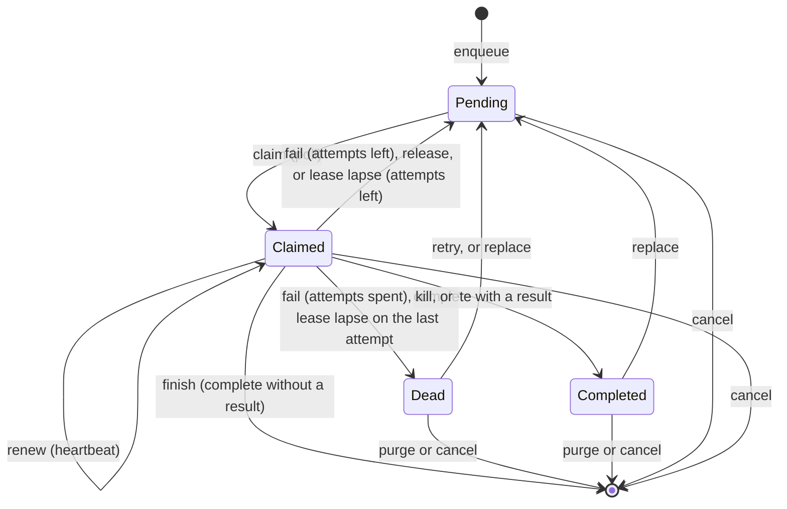

The claim protocol, over the engine, over HTTP and from guests alike:

| Operation | Meaning |
|---|---|
| `poll` / `claim` | Claim up to `limit` claimable jobs of one scope (default `""`) under `lease_ms` leases, recording the owner when given and waiting in line with `wait_ms`; returns IDs, names, payloads, claim tokens, fencing tokens, scopes, priorities, groups, attempt counts, lease expiries and when each job became claimable. |
| `heartbeat` / `renew` | Renew a claim's lease, keeping its fencing token; wrong tokens, lapsed claims and claims of another history fail (guests renew up to 1,024 leases per call and get a null expiry for each lease no longer held). |
| `complete` / `finish` | Keep the job as completed with a result, or delete it; wrong tokens and claims that lapsed on their last attempt fail. |
| `fail` | Requeue after an optional delay (at most 30 days), keeping its turn, or die past the budget; wrong tokens fail. |
| `kill` | Move a claim to the dead letter file now, whatever attempts remain. |
| `release` | Return a claim to pending after an optional delay (at most 30 days), keeping its turn and attempt count. |
| `cancel` | Delete a job in any state; reports whether one existed. |
| `retry` | Requeue a dead job (a claim that lapsed on its last attempt included) with a fresh attempt budget and a new turn, after an optional delay (at most 30 days). |
| `purge` | Delete dead and completed jobs enqueued before a cutoff, in every scope (a claim that lapsed on its last attempt once a claim has moved it). |
| `stats`, `get`, `ready` | Count pending/claimed/dead/completed of one scope or all, with readiness for an owner; read one job including dead and completed ones, by ID or name; a claim that lapsed on its last attempt counts and reads as dead. |

Attempts count claims: each claim increments, nothing else does. Queues are at-least-once: lapsed leases redeliver, and handlers must be idempotent; a paused holder can still act after losing its lease, which only the downstream fencing check can refuse. Claims, renewals and reports commit through Raft at the leader (a follower forwards them there), so every member holds them: failover redelivers only lapsed leases, and dead letters, results, attempt counts and counters survive. The leader serializes worker operations per queue from planning through commit and chooses claim tokens and clock readings itself; they travel inside the replicated records, so apply is deterministic. Each claim or report advances the database revision. Report operations verify the claim token; a report that arrives after the claim settled fails as a business failure rather than resurrecting the work.

Guest mutations claim and report through host ops 26–34 (`QueueClaim`, `QueueRenew`, `QueueReport` for complete/finish/fail/kill/release, `QueueCancel`, `QueueRetry`, `QueueGet`, `QueueStats`, `QueueWait`, `QueuePurge`), planned by the same code over the invocation's staged state: a mutation sees its own enqueues and claims, two claims in one mutation never take one job, and everything commits or rolls back with the mutation. Every write of a group, worker operations and guest mutations alike, prepares in the writer's one queue on the state the writes before it staged (see [The writer](#the-writer-staged-preparation-and-group-commit)), so a guest claim and a worker poll never take the same job. The SDK's `flower_sdk::queue::Queue` wraps the operations (`enqueue`, `claim`, `claim_admitting`, `wait`, `renew`, `complete`, `finish`, `fail`, `kill`, `release`, `cancel`, `retry`, `purge` in mutations; `get`, `stats`, `stats_for` and `ready` in queries and mutations), `Claim::lease()` gives the `{id, token}` reports name, and `TypedQueue<P, R>` encodes payloads and results and decodes them with `FlowerType` codecs. Queue reads in queries declare when their answer next changes through `changes_at`, so a watch on them wakes when work becomes claimable.

The HTTP contract is `POST /v1/queue/poll|heartbeat|complete|fail|kill|release|cancel|retry|purge` plus `GET /v1/queue/stats`, `GET /v1/queue/ready` and `GET /v1/queue/item`; `poll` takes `scope`, `owner` and `wait_ms`, `complete` a `result`, `complete`, `fail` and `kill` a `next` claim (a poll's `scope`, `owner`, `limit`, `lease_ms` and `wait_ms`, claimed over the state the report leaves in the same commit and answered as a poll's `items`), `stats` a `scope` and an `owner` (answering `completed`, `ready` and `next_ms` too), `ready` a `scope` and an `owner` (answering `ready` and `next_ms` alone: it counts nothing, reading the scope's next items and the line's head, so its cost does not grow with dead or completed jobs), `item` an `id` or a `scope` and `name`, and claims and items carry `fence`, `scope`, `priority`, `group`, `name`, the owner and, for items, the turn and result. Queue failures complete with HTTP 200 and `ok: false`; missing items read as `UNKNOWN_ITEM`. The client mirrors every operation on `FlowerClient` (`claim_queue` with a `QueuePoll`, `report_queue` with a `QueueReport` and an optional next `QueuePoll`, `complete_queue_with`, `queue_stats_in`, `queue_readiness`, `get_queue_job`), with missing items reading as `None`. `cargo-flower queue` exposes the same operations for operators: `stats` (`--scope`), `peek`, `poll` (`--scope`, `--owner`, `--wait-ms`), `heartbeat`, `complete`, `fail`, `kill`, `release`, `cancel`, `retry`, `purge`.

### Native worker API

```rust
pub async fn run_queue_worker<C, F, Fut>(
    client: C,
    options: QueueWorkerOptions,
    stop: Arc<Notify>,
    handler: F,
) -> Result<WorkerSummary, FlowerError>
where
    C: QueueClient,
    F: Fn(Claim) -> Fut + Send + Sync + 'static,
    Fut: Future<Output = Result<(), WorkError>> + Send + 'static;
```

This runs outside Wasm on the caller's Tokio runtime. `QueueClient` is the queue surface a worker needs (poll, a scoped poll, a claim with an owner and a line wait, a readiness read, a report chained to the next claim, heartbeat, complete, fail, kill, release, and the count of replies refusing its calls for load); `FlowerClient` implements it with one attempt per call, and `flower_worker::testing::FakeQueue` (feature `testing`) implements it in memory with the engine's queue semantics on tokio's clock (scopes, priorities, fencing tokens, owners, the waiter line and its turn, chained claims in one step, the 30-day delay bound and lapses on the last attempt killing the item at the lease's end included; `enqueue_in` sets the scope and priority), with injectable refusals, failures and poll latency and counters of polls, readiness reads, reports and chained claims. Conformance tests run the same lease, claim-order, scope, fencing and worker scenarios against the fake and a live server and compare transcripts. A client that implements only `poll` serves the default scope and refuses others; one without lines answers every readiness read ready, and one without chained claims reports, then claims (a claim failing after the report landed answers none).

`QueueWorkerOptions::new(db, queue)` selects the queue and `.scope(name)` one scope of it (claims arrive lowest priority first, each `Claim` carrying its `fence`, `scope`, `priority` and lease expiry); options set a fixed `concurrency` or an `adaptive(min, initial, max)` limit with its `health` and `adjust_every` (250 ms), the poll `batch`, `claimers`, lease length, poll interval, the default backoff base/cap and an `on_event` callback (`WorkerEvent::Limit` changes and `Throttled` pauses). Polls claim only what can start now. Once a poll comes back full, up to `claimers` (default 4, at most the largest limit) run at once, each holding the room it asked for until it answers; a short, empty or failed poll drops back to one poll per interval. The adaptive limit (`capacity::Limiter`) follows load: while polls come back full and the pool is full, it doubles at each adjustment when the process's load is under 0.5 and grows by a sixteenth (at least one) when busier or within 5 s of a cut; a load of 1 or more cuts it by a quarter, at most once a second. `ProcessHealth` reads the share of time the Tokio runtime's workers were busy since the last read against 0.9, and on Linux resident memory against what remains available against 0.85; any `Fn() -> Load` serves as health. Whenever the client's count of refusals for load grows, claims pause for a second and an adaptive limit halves (30 s of gentle growth after). A fixed limit never adapts but still pauses.

The loop runs handlers concurrently, renews each claim at a third of the lease, and reports: `Ok(())` completes, `WorkError::Retry(delay)` fails (default exponential backoff from the attempt count when `None`), `WorkError::Terminal(reason)` kills into the dead letter file. Handler panics fail with backoff; a claim that lapses mid-run drops its result and counts as lost. Reports run concurrently with claiming, each holding the room its chained claim asks for. Firing `stop` drains in-flight items, then returns the completed/failed/killed/lost/drained counts; polls and chained reports still out are awaited and whatever they claim is released at once.

Every claim records `.owner(name)` (default `worker-` and a random ID) on its leases. Worker options:

- **Queue lines** (`.wait(duration)`, 2 ms to an hour): a claim that comes back short keeps the owner's place in the scope's line for that long. The worker then reads readiness (`GET /v1/queue/ready?scope=&owner=`, a leader read of the scope's next items and the line's head rather than a replicated claim) once per poll interval instead of claiming, and claims once it is its turn: the first in line has new work to itself for the queue's turn, so a new job wakes one worker, not every one. It claims again at a random time between 3/8 and half the wait to keep its place, and gives the place up when it stops, after its last poll and report answered (always, since a claim whose answer was lost may hold a place unseen), rather than when the place runs out. A due refresh cuts the wait for the next poll interval short, so a place shorter than two intervals is still kept. A native worker reads readiness each interval.
- **Chained claims** (`.chain()`): each complete, fail or kill carries a claim of the worker's next items, as many as it has room for (the finished item's slot included), committed with the report (`QueueOp::Chained`, planned as the report then the claim over the state the report leaves, one patch): while work waits, an item costs its report alone rather than a poll too. A refused report claims nothing; a retried report goes alone, since the first attempt may have committed with its claim, whose items then lapse and redeliver. No report chains while claims pause or the worker stops. A chained claim that comes back short counts as a short poll (the line, the poll interval).
- **Idle jobs and throttles** (`run_queue_worker_with`, whose handler also takes a `JobControl`): `JobControl::idle()` says the job mostly waits from now on (a child process, a remote service): it stops counting toward the limit, so long jobs cannot keep the worker from short ones, while its lease still renews. `JobControl::throttle(pause, reason)` says the service behind the job refused it for load: claims pause for `pause` and an adaptive limit halves, as on Flower's own refusals, applied before the job's room is reused.
- **Drain deadlines** (`.drain(deadline)`, `.release_drained()`): once stopping, handlers still running at the deadline are dropped at their next await point and their claims failed with the default backoff, or released to run again at once: never completed, so a drained item is never acknowledged as done. Handlers stuck outside an await point for 5 s more are given up on, unreported and counted lost; their claims redeliver when their leases lapse. Without a deadline the drain waits for every handler.

Options no run can honor (an empty owner, a wait out of range, `release_drained` without `drain`) refuse to start.

Permanent poll failures (business failures, auth refusals such as a revoked worker token, non-retryable statuses, undecodable answers) stop claiming, let held items finish and report, then return the error; forwards, overload and transport failures sleep and retry inside the loop. Reports are best-effort with one retry: anything still unreported redelivers by lease, so handlers must be idempotent. A report the server refuses counts the item as lost. Client calls run without the client's own retry loop; the worker owns every retry decision.

Not built: batch renewal over HTTP (the worker renews one claim per call; guests renew up to 1,024 per call).

## External computations

An external computation is a derived input plus a conditionally accepted result. It expresses “compute this value for the current inputs,” not “execute every change as a durable event.” `flower_sdk::external` declares one, and `flower_worker::reconcile` keeps it current.

```rust
fn words_input(ctx: &mut Ctx<'_, '_>, id: Value) -> Result<Value> { /* {text} or null */ }
static WORDS_RESULT: Schema = v::object(&[v::field("count", v::int().min(0).build())]);
external!(pub static WORDS = "words", input = words_input, result = WORDS_RESULT);
external!(pub static TRACKED = "tracked", input = tracked_input, tracks = "docs", lease = (30_000, 300_000));
static TYPED: TypedExternal<String, String, Value> = TRACKED.typed();
```

`external!` builds an `External` static holding every descriptor, named after the value: the results collection `<name>.results`, a pool's stale markers `<name>.stale` (indexed by `since`), the input as the derived value `<name>.input`, the queries `<name>.get`, `<name>.pending`, `<name>.next`, `<name>.ready` and `<name>.stats`, the mutations `<name>.publish`, `<name>.claim`, `<name>.renew` and `<name>.release`, and for a pool the trigger `<name>.track` with the mutation the engine runs for it. `lease = (default_ms, max_ms)` sets a pool's default and longest lease (30 s and 300 s by default). The `External` static is a component: listing `&WORDS` brings its collections, eleven definitions and, for a pool, its trigger. With the `http` option (`external!(pub static WORDS = "words", input = words_input, http)`) workers and clients reach get, pending, publish, next, claim, renew, release, ready and stats over HTTP under their names; without it they answer engine calls only. Who may call each is the authorization component's `methods` table to say (`("words.publish", Access::Check(worker))`). The pool operations refuse outside pools with `INVALID_INVOCATION`.

The input runs as a derived value, so the host keeps it read-only. Null means no work. Work identity, the key, is the canonical JSON of `[args, input]`, not a cryptographic hash; results are stored by the canonical JSON of the arguments as `{key, value}`.

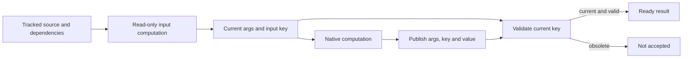

| API | Contract |
|---|---|
| `get` / `External::state(ctx, &args)` | `{status: "ready", value}` for a current result, `{status: "pending"}` when there is work, null when the input is null. |
| `pending` / `work(ctx, &args)` | Work `{args, key, input}`, or null when the result is current or there is nothing to compute. |
| `publish` / `publish(ctx, &args, key, value)` over `{args, key, value}` | `bool`: the value is checked against the result contract first (`INVALID_VALUE`), then accepted only for the current key; the first result for a key wins and a repeat for the same key is accepted without overwriting it. A pool's marker goes with an accepted result. |
| `next` / `next(ctx, Next { limit, shard })` over `{limit, shard}` (default 16, at most 256) | Pools: work for up to `limit` stale markers, oldest marker first (leased and delayed markers ordered by when their lease or delay ends), skipping markers whose result is already current; with `shard: [index, count]`, only argument sets whose canonical key hashes (FNV-1a over UTF-16 code units) into shard `index` of `count`. |
| `claim` / `claim(ctx, owner, ClaimOptions { limit, lease_ms })` over `{owner, limit, leaseMs}` | Leased pools: inspect up to `limit` due markers (`since` at or before now) in `since` order, drop those whose work is done, and lease the rest to `owner`: each claim is `{args, key, input, owner, attempt, expiresAt}`. A lease longer than the value's maximum fails `LEASE_TOO_LONG`. |
| `renew` / `renew(ctx, &leases, lease_ms)` over `{leases, leaseMs}` (at most 1,024) | Leased pools: extend each lease `{args, key, owner, attempt}` still held, answering its new expiry, or null for a lease lost (lapsed, released, published, or dropped by an input change). |
| `release` / `release(ctx, &lease, delay_ms)` over a lease plus `delayMs` | Leased pools: hand a held lease back, claimable again after the delay by anyone; false when no longer held. |
| `ready` / `ready(ctx)`, `stats` / `pool_stats(ctx)` | Leased pools: whether a due marker exists; `{ready, oldestReadyAt, nextAvailableAt}`. A query reading them declares the next lease or delay end through `changes_at`, so a watch wakes when work becomes claimable. |
| trigger `<name>.track` | Pools: a changed source row (its key is the argument set) is marked stale unless its stored result is still current; a marker already there keeps its place, lease and release delay unless it was for a key the change made obsolete, in which case the lease is dropped and the key is due at once; a removed row takes its result and marker with it. |

`next` reads markers in pages until it has `limit` work items (fuel bounds it), so a shard of a large backlog still finds its own work. A lease spreads work; it does not fence publication: any authorized publisher holding the current key can publish, an accepted result takes the marker (lease included), and conditional acceptance is not exactly-once execution of external effects, which need destination idempotency. A claim's attempt counts claims of the same key across every process and starts again at 1 for a new key; lease expiry is exclusive (a lease ending at `t` is due at `t`).

`External::typed::<A, I, R>()` gives a `TypedExternal` over typed arguments, inputs and results with `FlowerType` codecs: `state` (`Option<State<R>>`, `Pending` or `Ready(r)`), `pending` and `next` (`Work<A, I>`), `ready` and `stats` (`PoolStats`) on any context's raw `Ctx`, and `publish`, `claim` (`Claimed<A, I>` holding a `Lease<A>` and the expiry), `renew` and `release` on a `MutationCtx` only.

Native `flower_worker::reconcile(client, options, stop, compute)` runs over any `ReconcileClient` (`FlowerClient` implements it: queries and publications retried with one request ID, waits as reconnecting watches). `ReconcileOptions::new(db, module, name)` with `.args(json)` keeps one key current: it waits for `<name>.pending` to be non-null, computes, publishes, and repeats; a result whose input changed meanwhile is rejected (`ReconcileSummary::rejected`) and the fresh work is picked up. Without arguments it drains the pool: up to `concurrency` computations at once (default 4), `batch` items per `next` (default 16), never two for one argument set, a failed computation retrying after its own exponential backoff (`retry`, default 1 s to 60 s) while others proceed, and a watch on `next` while there is nothing to do; `.shard(index, count)` drains one shard, so unleased workers split a pool. `compute` receives `ExternalWork { args, key, input }` and returns the value or a failure message; panics count as failures. Permanent client failures (an unknown module or value, revoked credentials) end the run with the error. Stopping drops computations in flight unpublished; their work stays pending.

`.leased()` drains the pool through leases instead, so each key is computed by one process at a time across every worker: it claims only as many keys as it has free computations (`batch` at most per claim), under `.owner(name)` (default `reconciler-<random>`) and `.lease(lease, margin)` (default 30 s and a fifth of it); renews every held lease in calls of up to 1,024 at a third of the lease less the margin; stops a computation (`ReconcileSummary::lost`) when a renewal answers null or its lease would end within the margin; publishes results, releasing a key whose result was rejected so the current input is claimed at once; releases a failed key after its backoff (`retry`), a delay every process honours and an attempt count that carries across them; watches `<name>.ready` while a claim comes back short; and hands every held key back once on the way out. Its concurrency is `concurrency` or `.adaptive(min, initial, max)`, the queue worker's limiter (`health`, `adjust_every`) growing while claims come back full and the pool is full, at most 1,024. Leased pools take no `args` or shard, and adaptive concurrency needs a leased pool (`invalid_options`). `reconcile_typed::<A, I, R>` runs any mode over typed work (`flower_sdk::external::Work<A, I>`) and results through the same codecs; work that does not decode fails its computation.

`.on_event(handler)` receives events in order: `ReconcileEvent::Claimed { key, attempt }`, `Published { key, accepted }`, `Failed { key, error }`, `Lost { key }`, `Limit` changes, `Waiting { error }`, and from a leased pool with an adaptive limit `Load(PoolLoad)`: the load its health last read and why, its limit and bounds, the computations running, whether work waited beyond the limit, and what the limiter did, reported by the load gate (`LoadGate`: at once when the load moves to another band, under 0.5, under 1 or from 1, or the limiter starts or stops holding back, at most every five seconds, and once a minute while the pool works). `.call_retry(policy)` sets the retry policy of every call: publications retry with it (one request ID across retries; the client's default policy otherwise), and a leased pool's claims, renewals and releases with it and a deadline (a claim's lease, the earliest of the renewed leases' deadlines, a release's lease end; one attempt for the releases on the way out), through `ReconcileClient::mutate_with` (`FlowerClient` honours both; a client without per-call options falls back to `mutate`).

## Transactions across logical databases

Module calls are local atomic composition. Multi-database transactions are implemented: one mutation per participant database, prepared in order and committed atomically through one consensus entry when every participant lives in one group, and by two-phase commit across groups otherwise (see [Groups, partitions and cross-group transactions](#groups-partitions-and-cross-group-transactions)). The guest-side `Target`/`Plan`/`Transaction` planner descriptors below remain a design target: server transactions are lists of steps naming databases, and ownership decides their groups. The core single-group profile from the runtime boundary also executes: a planner returns a bare array of at most 1024 `{module, name, args, savepoint}` calls, the engine validates and runs the batch in one session and commits it atomically.

A multi-database transaction carries 1–64 steps, each naming a different database; same-database batches stay with single-database transactions. Steps prepare in order in isolated sessions — a step never observes another step's staged writes — and each step revision-guards to its own database automatically; caller expected revisions and retry identities are rejected. Any step failure aborts before anything replicates: no patch is proposed and nothing commits. The combined result is the array of step values in order.

The replicated entry carries one patch per participant and applies all-or-nothing at one log position: every participant's journal lands with every revision bump, or a stale participant rejects the whole batch while every applied log still advances. Each participant's watchers are notified with its own revision. Responses carry the combined values plus per-participant revisions. Local-only databases transact together through the same all-or-nothing commit without consensus; mixing local-only and replicated participants is rejected. The transaction stores one durable idempotency receipt under the first participant's database; aborts leave no receipt and redeliver by re-executing.

Transactions run through `Node::transaction`, over HTTP (`POST /v1/transaction`), through `FlowerClient::transaction` and through `cargo flower transaction --steps`. Backup archives multi-database entries and point-in-time recovery replays them like any other write. Opening a node over a fresh Raft log resets per-database applied positions and clears the history incarnation: a new log is a new history, so replayed positions from the old history never collide with the new log's indices, and the new leader establishes a fresh incarnation.

Cross-group transactions follow the protocol in [Transactions across groups](#transactions-across-groups); the planner sketch below is the guest-side design target, which no server path runs yet.

```rust
Target::partition(name) -> Result<Target>
Target::group(name) -> Result<Target>
target.call(http_alias, Value) -> Result<Call>
```

The alias is explicit on every call. A group target addresses that configured group's root database. A partition target follows named ownership. No `Target::transaction` is provided for nested transaction participants.

`Plan<V = Value> { calls: Vec<Call>, value: Option<V> }` is a list of instructions, not already executed calls. Planning has arguments only—no `Ctx`, database reads, network or branching on participant results. Calls retain their order, including repeated calls to one target. `None` differs from explicit `Some(Value::Null)`.

`Transaction::new(name, fn(Value) -> Result<Plan>).args(schema)` supplies a raw planner, off HTTP unless `.http()` (then `POST /v1/mutate` naming it runs it: authorization, planning under its deadline, its calls in one session committing together), decided by the authorization component's default unless it declares `.access(a)`. There is no typed-planner macro: planners validate and encode arguments by hand. List the descriptor among the app's components. `Committed<V>::decode` separates raw participant `results` from optional typed plan `value`.

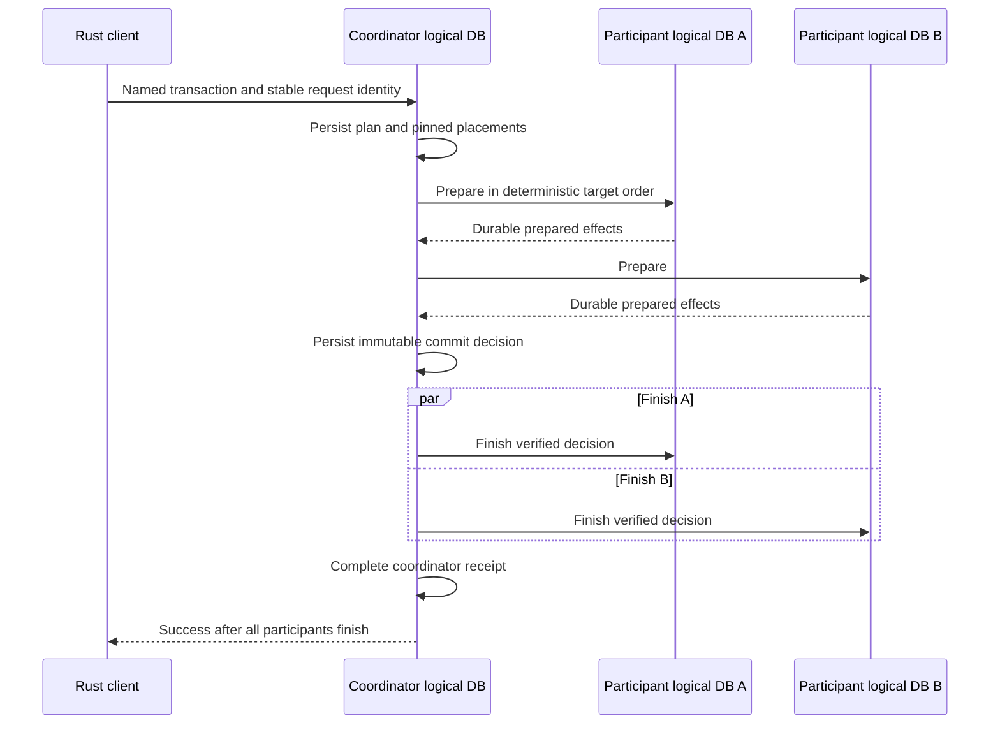

The coordinator owns delegated authorization, durable preparation/decision and recovery. A prepared lock never expires merely because time passed. Unavailable coordinators can block progress. Disjoint reads can proceed when their certified observations avoid prepared writes. Commuting writes additionally need known prepared read footprints; those are leader-local and conservative after failover. Deployment, maintenance and key operations remain more restrictive.

Transaction closure obtains durable participant rejection floors before collecting decisions/completions. Receipt expiry cannot by itself make delayed prepare/finish messages harmless. Independent rollback of one participant is not a supported cross-group recovery protocol.

## Groups, partitions and cross-group transactions

One `serve` process hosts any number of Raft groups. Each group is a complete member as before (its own log, state machine, engine, writer, leader, snapshots, compaction, backup and health), so everything earlier in this document holds per group. What this section adds is how a process hosts several of them, how a cluster-wide *catalog* places named partitions on groups under ownership epochs, how requests reach a partition's owner, how a partition moves live between groups, and how one transaction commits atomically across groups. A deployment that never creates a group is one group, the *root*, exactly as before: same files, same wire, same API.

Flower hosts multiple physical groups per process. Named partitions move whole through a roll-forward protocol, with durable coordination for cross-group transactions.

### Group identity and storage layout

A group has a name (`[a-z0-9][a-z0-9-]{0,62}`) and a random non-zero 64-bit *uid* fixed when the catalog creates it. The name addresses it in the API; the uid tells two groups apart that had the same name at different times. `root` is the bootstrap group: the one a fresh `serve` initializes with `--bootstrap`, uid 0. A process's files:

| Path | Holds |
|---|---|
| `<dir>/group.redb`, `raft.redb`, `snapshots/` | the root group's replica, where single-group deployments always kept it |
| `<dir>/groups/<name>/group.redb`, `raft.redb`, `snapshots/` | each further group this process hosts |
| `<dir>/groups/.retired/<name>-<uid>/` | a removed group's files, left for the operator |

`raft.redb` records the group's uid (`group_uid`) when the replica is created; opening a replica whose recorded uid differs from the catalog's refuses, so the files of a removed group never join a new group of the same name.

**Per-group files, not one shared file.** Every group keeps its own two redb files. The alternative, one log file and one state file shared by every group, would coalesce the fsyncs of concurrent appends across groups into one, but every group's appends would then wait on one redb write lock, a snapshot install or a compaction step of one group would stall all of them, a group's restore would rewrite a file other groups live in, and a disk failure under one transaction would fail every group's handle at once. Separate files keep groups independent in exactly the ways the earlier sections rely on (independent compaction, snapshot install, restore and PITR, storage-failure handling) at the cost of one fsync per group per round: N busy groups issue N concurrent fsyncs, which solid-state disks serve in parallel and a single rotating disk serializes. Within a group the writer still puts every queued write into one batch entry, so fsyncs scale with groups and rounds, never with writes.

### One process, many groups

`flower_cluster::host::Host` owns the process-wide parts: the node ID, the data directory, the runtime factory (and with it the process-wide Wasm engine, image cache and pool), the peer listener and its group directory, the process-wide admission, and the open groups (`Host::group(name) -> Arc<Node>`). `Host::open` opens the root and every group directory the catalog lists for this node; a keeper task (`Host::run_keeper`) follows the catalog as the root applies it and opens, initializes or closes replicas as groups are created, become active or are removed (below). Every background duty `serve` ran for its one node (maintenance and the timer sweep, soft snapshot triggers, compaction, continuous backup, retention rotation) runs per open group, stopped with it.

**The peer channel.** One Raft port serves every group. The hello (version 3) names the group as well as both node IDs and the contract: magic, version, token, source and target node, group name and uid, contract. The listener looks the group up in its directory (`PeerDirectory`, which groups join as they open and leave as they close) and refuses a hello for a group it does not host or under another uid (`WRONG_GROUP`) before reading a request; every request on the connection then belongs to that group's member, exactly as before. Dialers pool connections per peer *and group*. One connection per group rather than every group's frames on one connection, because the transport runs one exchange at a time per connection: on a shared connection a large append or snapshot segment of one group would hold up the heartbeats of every other, while separate connections keep each group's deadlines, retained appends and `Busy` backoff its own. The listener's connection cap and its follower byte budget (`--raft-queued-input-bytes`) bound the process, whatever the group count. The in-process registry keys services by group and node, and `Registry::block(from, to)` cuts every group's traffic between two nodes, as a network partition would.

**Admission per group.** Queries and watch refreshes evaluate in one process-wide pool (`--query-workers` slots, the evaluation memory budget, the ingress byte budgets, the control slots): CPU, memory and request bodies are the process's whatever the group. Writes are per group: each group's writer has its own writer-class admission, its own 1,024 places, byte budget and writers' CoDel. A group whose writer stands therefore sheds its own writers and never another group's, and one hot group cannot take the places another group's writes need.

### Which nodes host which groups

The root group spans every process of the cluster: each process is a root voter or learner (`cargo flower membership` adds learners). It holds the catalog, so every process routes from a catalog it applied itself, with no cache to expire and no catalog group to ask. Root can still hold databases of its own: everything not placed elsewhere lives there, as in a single-group deployment.

A group is created in the catalog with its initial members, which must be root members (the catalog knows their addresses from root's membership): `POST /v1/admin/groups {"operation":"create","group":"east","members":[2,3,4]}`. The root leader picks the uid; applying the change lists the group as `creating` on every process. Each listed member's keeper opens an empty replica. The lowest listed node founds the group, but only through the catalog: it first proposes `initializing` naming itself, and initializes the group's Raft membership only once that is applied and only if it holds no Raft state for the group. A founder that finds `initializing` naming itself and holds no state either crashed before initializing or lost its disk after: it probes the other members (`Info`) and initializes only if none is initialized, else it opens rejoining like any wiped member. So a disk lost at any moment never founds a second history under the same group. Once the group elects a leader, its leader's keeper proposes `active`. Membership changes after that are the group's own (`/v1/admin/membership?group=`); the catalog's member list stays the founding set plus a routing hint. Removing a group (`"operation":"remove"`) is refused while it owns a partition, holds a move or a prepared transaction; once removed, each member closes its replica and moves its files under `groups/.retired/`.

### The catalog and ownership epochs

The catalog is a reserved database `$catalog` in the root group, changed only by `BatchItem::Catalog` items on the root's writer, so its changes are ordered, replicated, snapshotted and backed up like any write, applied deterministically on every member, device and restore replay, and their apply records the group head like every batch. It holds:

- groups: name, uid, founding members, status (`creating`, `initializing` with its founder, `active`, `removed`);
- partitions: name, owner group, epoch, status (`creating`, `active`, `moving`, `retired`), the operation that last changed it, and the move in progress;
- the last 256 finished moves, for operators.

A *named partition* is a logical database the catalog places. Its *ownership epoch* starts at 1 and rises with every change of owner: a move from epoch `e` activates its destination at `e + 1`, and an aborted move thaws its source at `e + 2`, so no command, route or prepare that named the source or transfer epoch acts again. Every operator change names an *operation* string; repeating one returns the outcome it had, so an uncertain request is retried safely.

**Placement in the owning group.** The catalog says where a partition should be; the owner group's own state says what it may do, and that is the fence. Each group's store keeps a `placement` meta row per placed database (`flower_engine::placement`): `active(e)`, `frozen(e, op)`, `importing(e, op)` and `staged(e, op)` on a destination, or `retired(e)` with the group it moved to. A database without the row is unplaced and lives in root, as every database did before. Placement rows change only through `BatchItem::Placement` items on the owning group's writer, ordered with that group's writes. Every data item (patches, multi-patches, retention, transaction prepares) checks the placement of its databases at apply, on members, devices and replay alike: a database that is frozen, importing, staged or retired refuses it (`partition_moving` or `partition_moved`, retryable), and the leader refuses before preparing. Since a freeze is an entry in the source group's own log, every write ordered before it is in the frozen state and every write ordered after it is refused: nothing is lost and nothing lands twice, however stale a router or a leader is. Linearizable reads read the same applied state, so a read fence proves the placement too: a frozen or retired database refuses reads, which keeps a source that froze from answering after its destination took writes. A replica-local read on a lagging follower may still answer from before a freeze, within its declared staleness bound.

Creating a partition (`POST /v1/admin/partitions {"operation":"create","partition":"acme","group":"east","op":"create-acme-1"}`) records it `creating` at epoch 1; the move driver (below) has the owner apply `create` (absent → `active(1)`), then marks it `active`. Creating a partition in root for a database that already exists there *adopts* it in place: its rows stay, it gains a placement row and becomes movable.

### Routing and forwarding

The HTTP layer (`flower-server` `groups`) gives each open group its own API state (its node, watch hub, backup driver, activity) and serves all of them on one listener behind a dispatcher. A request goes to:

1. the group its `x-flower-group` header names, when it names one (forwarded requests always do; operators may);
2. otherwise the owner of the database it names (`db` in its query string or body, or every step of a transaction), looked up in this process's applied catalog: the owner group of a placed partition, root for an unplaced database;
3. otherwise root (process-wide routes: health, metrics, the dashboard, catalog operations).

If this process hosts that group, the group's own router serves the request, forwarding to the group's leader over the member channel as before. If it does not, the dispatcher forwards it, once, over the member channel to the group: to its leader when known (from the replicas this process hosts, or learned from earlier answers), else to a founding member, which answers who leads without forwarding again (`NotLeader`), and the dispatcher retries there within the forward budget. A member whose exchange failed (unreachable, or broken off) is tried only after every other for a second, and hints naming it are not followed meanwhile: members go on naming a dead leader until they notice its silence. A dial still unanswered after three heartbeats is given up (nothing was sent yet), twice as late each round in case a live member's dial takes longer: dialing a dead host can take seconds (2 s on Windows loopback). Before both, the clients of a process outside a group whose leader died took 2.5–3.4 s to write again, while those of the group's members took 0.55 s. Forwarded requests carry `x-flower-group` and are never forwarded again, so a stale route fails instead of looping. When the owner refuses with `partition_moved` (this process's catalog was behind a move), the dispatcher proves a fresh catalog (a root read fence), resolves again and retries once; `partition_moving` passes to the client as a retryable 503 with a short `Retry-After`.

Every answer names the owner group (`x-flower-group`), the partition's epoch when it is placed (`x-flower-partition-epoch`) and, in `x-flower-leader-url`, the advertised API URL of the process that leads the *owner group*: the contract stays "send this database's writes here". The client's leader routing (`Builder::leader_routing`) therefore remembers a leader per database, not one per client, and forgets a database's leader when it stops taking that database's writes.

### Moving a partition

A move takes a partition from its source group to a destination group without losing or repeating a write, while the source serves until the freeze. `POST /v1/admin/partitions {"operation":"move","partition":"acme","group":"west","op":"move-acme-7"}` records the move in the catalog (`moving`, phase `copying`, source epoch `e`, transfer epoch `e + 1`). Refused when the destination is the owner or not an active group, or the partition is not active (already moving, creating or retired). Moves of different partitions run concurrently, up to four steps at a time.

The *move driver* runs on the root leader (`flower_cluster::moves`). It reads each unfinished move from the catalog and takes the next step; each step is an idempotent command to a group naming the partition, the operation and an epoch, refused unless that group's placement row says the step is due. The catalog phase is advanced only after the step's command applied. A driver that crashes, loses leadership or runs twice (a deposed leader still running) is therefore harmless: the next driver repeats the step its phase names, and a command the group already applied answers as applied.

| Phase | Driver's step | Group state after it |
|---|---|---|
| `copying` | The driver carries a *base* from the source's leader into the destination, page by page, and seals it; the destination's leader must then be able to unwrap the base's managed keys | source `active(e)`; destination `importing(e+1)` then `copied` at the base revision |
| `freezing` | The source applies `freeze` (refused while a prepared transaction holds the partition: the driver tries again), recording its history incarnation in the partition's lineage | source `frozen(e)` at revision `r` |
| `importing` | The driver carries the *delta* from the base to `r` (or the whole frozen image) and seals; the destination's leader must then be able to unwrap the frozen managed keys | destination `staged(e+1)` at `r`, digest checked |
| `activating` | The catalog records the cutover first (owner = destination, epoch `e+1`): the move can no longer be given up. The destination applies `activate` | destination `active(e+1)`, its modules registered |
| `retiring` | The source applies `retire` | source `retired(e)`, moved to the destination; its rows deleted |
| `complete` | — | — |

**Pre-copy.** The source leader answers export requests (`ControlRequest::Export`) from a pinned redb read: the first base page opens a read transaction (revision `r0`) and keeps it in the leader's export cache, keyed by partition and operation, until the move thaws or retires the source, the member stops leading, or the pin sits unused for 15 minutes (maintenance checks the last two every interval, with or without another export: a pinned read keeps the group file from reusing the pages it sees); pages are the database's raw rows across its ten tables in key order, each at most 1 MiB, resumed from a cursor, encoded as a compact binary run, LZ4-packed and carried as hex (the log encodes entries as JSON). The driver hands each page to the destination's leader, which proposes it as a numbered `import_rows` placement item on its own writer: the rows land in the partition's key range of the destination's group file, through the destination's log, so every destination member, every snapshot and every backup of the destination holds the same rows. A page repeated by a driver that lost its answer applies once; a stage interrupted anywhere starts over (its `import_begin` clears what the interrupted one left). The data passes through the root leader's process: one place drives every step and its retries. The source keeps serving and taking writes meanwhile.

**Managed keys.** A partition's key catalog is a meta row of its database (see [Cryptography and managed keys](#cryptography-and-managed-keys)), so it moves verbatim with the other rows, envelopes, security domain, bindings and request receipts included, and counts in the digest. Its material stays sealed under the wrapping key, which the destination's members must mount, so the move holds until they can: after the base is sealed, before the source freezes, and again after the rest is sealed, before the cutover, the driver asks the destination's leader (`ControlRequest::Keys`, `Node::check_keys`) whether every unrevoked version of the catalog it holds unwraps and parses under its wrapping keys. A refusal (`KEYS_LOCKED`, naming the wrapping key that is missing) is the step's error: the driver tries again on its next tick and warns, at most every 10 s per move. A destination with the wrong key therefore keeps the move `copying` while the source serves on, for at most the freeze limit: past it the driver gives the move up (`the destination could not serve the partition's keys past <n> ms: …`, counted from the first refusal this driver saw), so the source's pinned base never outlives a locked destination. Keys the source gained after the base keep it `importing`, the source frozen, until the freeze limit gives the move up. Restarted with the right key, the destination passes on the next try. The activation checks once more, on the destination's leader that proposes it (`Node::place`): a leader elected since the last check that cannot unwrap the keys refuses `activate` with `KEYS_LOCKED`, and the move, past its cutover, waits `activating` (warning why) until a leader that can proposes it. Key changes are refused, like every write, where the database does not serve: a frozen source takes none the import would miss.

**Freeze and delta.** Once the base is copied, the source applies `freeze`. The delta is computed exactly, from the two MVCC reads the source holds, the pinned base and the frozen state: a merge of both reads' rows per table yields every row put or changed and every row deleted since the base. When the source lost its base (a leader change or restart of the source), the delta is the whole frozen image instead, which needs no pin: nothing changes a frozen database. The destination imports the delta the same way and seals.

**Integrity.** Every import item maintains, deterministically on every destination member, a 128-bit additive digest of the partition's rows (the sum of a SHA-256 truncation per row, so puts and deletes update it in constant time). The source computes the same digest of its frozen rows; sealing compares the two, and a mismatch leaves the destination `importing` and makes the driver start over from the whole image. Rows that describe the group rather than the database (its applied position and history incarnation, the placement row and a transaction lock) neither move nor count, and `activate` sets the destination's own. An import row outside the partition's key range, or one of those rows, refuses the whole page.

**Cutover.** `activate` is valid only on a `staged` destination at the move's epoch and operation; it records the destination's position and incarnation in the partition's meta rows, registers it, builds its modules' runtimes from the imported code and sends commit notices, so watches through the destination begin at once. The revision continues from the source's: revision guards, receipts, retention epochs, sessions, timers and queues all moved as rows. The partition takes the destination's history incarnation, but its history goes on: `freeze` records the source's incarnation, and the earlier ones still valid, in the partition's `history_lineage` meta row, which moves with it, and `activate` puts the destination's in front (`flower_engine::placement::lineage`), so queue claims, scoped request IDs, retry sessions and their results taken or minted at the source stay good at the destination (`flower_engine::placement::History`). A destination that has no incarnation yet puts zero in front, and establishing its incarnation takes zero's place. The lineage holds only while the partition's incarnation is its first entry, and a restore deletes it: a restore gives a fresh incarnation, so claims and identities from before it are fenced out, wherever they were taken. The catalog's cutover is durable before `activate` is sent, so a destination never activates a move that was aborted, and once the catalog says `activating` the move only rolls forward. Routing follows the catalog, so calls reach the destination before `activate` applies there; until it does, every call is answered `partition_moving`, which clients retry, never from a database without its code: the writer prepares on staged state that may already hold the in-flight `activate`, so a prepare requires the committed state to serve as well (modules load as an entry applies, not as it is staged), and `activate` commits its rows and loads their code inside one exclusive section, so no reader pairs the new placement with the old modules (members and devices alike). Background work leaves a database that does not serve alone: the timer sweep skips its due timers, untouched, and fires the others; queue operations answer its placement's refusal.

**Abort.** Before `activating`, an operator may abort a move (`"operation":"abort"`), and the driver aborts one that stays in `freezing` or `importing` (waiting to freeze its partition, or keeping it unserved), or waits `copying` for its destination's keys, longer than `--partition-freeze-max-ms` (`FLOWER_PARTITION_FREEZE_MAX_MS`, 30 s). The catalog records `aborting`; the source applies `thaw` (`frozen(e)` or `active(e)` → `active(e+2)`, its export pins dropped), then the destination applies `abandon` (its imported rows deleted, `retired(e+1)` left so a late import of that transfer is refused), then `aborted`. The source thaws first, so it serves again even while the destination is unreachable.

**Crash recovery at every step.** Every phase's state is durable in the catalog and in the groups' placement rows, so a restart of any process at any step resumes: an interrupted base starts over (from the source's pin if it still holds one, else from a new one), and an interrupted rest starts over as the whole frozen image, as does a delta whose base the source no longer pins (`export_lost`); a freeze, activation, retirement, thaw or abandon that applied answers as applied when repeated; a crash between a group's apply and the catalog's advance repeats the step harmlessly. A leader change in any of the three groups is the same case: the new root leader's driver repeats the step, and the new source or destination leader answers it.

**Interaction with transactions and deployments.** A database with a prepared cross-group transaction refuses `freeze` (the driver retries; the freeze timeout bounds the wait), and a frozen database refuses prepares, so no transaction straddles a cutover. Thaw applies only to a database that cannot hold a prepared transaction, preventing orphaned locks. A staged deployment in progress does not hold a move back: its rows move with the database, its steps are refused while the database is frozen or moving, and the destination's leader continues it.

### Transactions across groups

`POST /v1/transaction` keeps its shape: one or more steps (no count bound; see [Transaction size](#transaction-size)), each a mutation naming a different database. When every step's database lives in one group the transaction is one `MultiPatch` item, exactly as before. When they span groups, the request is routed to the group that owns the first step's database, whose leader coordinates a two-phase commit (`flower_cluster::txn`) with the groups that own the others.

**Durable records.** Every record is rows of the group's `$cluster` database, written by `BatchItem::Txn` items on that group's writer, so they replicate, snapshot and back up with the group and apply identically on members, devices and replay.

- coordinator (`txn_coord`): transaction ID (128-bit random), the caller's idempotency key, the participants (group name and uid, and each database with the epoch the coordinator resolved), state `preparing`, `committed` with every step's result, or `aborted` with the reason, and whether every participant finished;
- participant (`txn_prep`): the transaction ID, its coordinator group and uid, its databases and epochs, the prepared multi-patch and its step results;
- lock (`txn_lock` meta row in each prepared database): the transaction holding it;
- finished (`txn_done`): a tombstone per transaction a participant finished, with the decision.

**Protocol.** (1) The coordinator applies `begin`, durable before any participant hears of the transaction. (2) It sends `prepare` to every participant group's leader at once: the participant's leader prepares its steps through its writer on its staged state, exactly as a single-group multi-database transaction prepares, then applies `prepare` with the multi-patch and results. Apply checks every database: placed `active` at the resolved epoch (or unplaced, in root), not locked, no tombstone for this transaction; it stores the record and locks the databases. (3) With every participant prepared the coordinator applies `decide commit` with the results, else `decide abort`; the first decision applied wins, so a deposed coordinator racing a new one cannot flip it. (4) It sends `finish` to every participant at once; the participant applies it: commit takes the stored patches through `Engine::commit_patch` (journal records before commit, commit notices, watches) and releases the locks; abort drops them; both leave the tombstone. (5) With every participant finished, the coordinator marks the record complete and answers the caller with the results. A finish still undelivered after 10 s does not hold the caller: the decision is durable and recovery delivers it.

**Deadlines.** Prepares run under the caller's deadline: delivering one gives up with it (never the delivery's own 10 s patience), and the request carries both what was left of the deadline when it was built and the deadline itself in wall-clock milliseconds, so a participant reached late (a retry, a slow dial) gets only what is left, the earlier of the two holding.

**Locks.** A participant persists its read footprint with its prepared patch. Every applier refuses writes overlapping its reads (including absent rows and scanned ranges) or writes. Cached derived reads carry their transitive source certificates, captured from the same snapshot as the cached result and serialized deterministically with the prepare; followers never reconstruct them from their own derived caches. Derived writes and drops also check observed derived rows and dependency lists. Independent record, index, derived and receipt writes can commit while the participant waits; receipts conflict by identity and by any observed retention-accounting state. Timer and queue reads remain volatile for query caching, but their snapshot-backed row/range reads suffice for the transaction fence. Reads outside the snapshot, including retained history and native untracked reads in authorization or execution, retain a whole-database fence, as do cached derived values with untracked dependencies, derived-cache range scans, oversized certificates and legacy derived footprints without source proofs. Deployments, freezes and a second distributed prepare of the same database still wait. A refused write waits on lock release within its admission wait and client deadline; a second prepare waits at most 1 s before `transaction_conflict`. Reads see only committed state and never wait for a prepare. Footprints survive replication, snapshots and restart; legacy prepared records without footprints retain the whole-database fence. At finish, the footprint justifies committing over revisions advanced by independent writes, while deployment and placement guards remain enforced.

**In-doubt resolution.** Every group's leader runs a resolver (`Txn::run_resolver`, every second with per-record backoff):

- *Coordinator crash or leadership change before the decision:* the new leader asks every participant whether it prepared. All prepared → `decide commit` with the results their records hold; otherwise → `decide abort`. A participant whose group no leader answers for within the send budget (10 s) counts as not prepared, so a frozen or partitioned participant cannot hold the others' locks; aborting an undecided transaction is always safe, since participants never commit on their own. A transaction whose live call went away (a client that hung up, its request dropped) is the resolver's at once: the call marks it as driven only while it runs.
- *After the decision:* the resolver delivers finish to every participant until each answers, then completes the record.
- *Participant crash or leadership change while prepared:* the prepared record, its locks and its results are in the participant's log and snapshots; a participant prepared longer than 2 s asks its coordinator group for the decision and applies it. An undecided coordinator is left to decide. A coordinator that has no record of the transaction (never began, or completed and collected, which needs this participant's finish) or no longer exists under that uid means abort: a participant never commits on its own, and only aborts what no coordinator can commit.
- *A late prepare* (one that arrives after its transaction was aborted and the abort finished) finds the tombstone and is refused; one arriving after the tombstone was collected is aborted by the resolver.

**Interaction with moves.** Participants are resolved to (group, epoch) at `begin`; a prepare whose database has moved, frozen or changed epoch is refused and the transaction aborts (the caller retries and resolves again). A database holding a lock refuses `freeze`. Finish and status requests address a participant's *group*, not its partition's current owner, and a group accepts them whatever its databases' placement, so an abort reaches a participant that froze or moved before it prepared.

**History.** The coordinator group keeps its records: unfinished ones until they finish, finished ones for 24 hours (the receipt window, on the group's replicated expiry clock), collected by the leader's maintenance a page at a time; tombstones go after an hour. Nothing needs closing or collecting by hand. A retry with the same idempotency key finds the coordinator's record while it is kept: it replays a finished transaction's outcome and waits for an unfinished one. The answer says where the transaction committed, and a replay says the same: each participant's tombstone keeps the revisions its commit left and its finish's log position, the coordinator records each group's as the finishes are delivered, and the response carries `revisions` (each database, in step order; the first step's leads as `revision`) and `positions` (each group's, in its own log; the first step's group's leads as `position`). A participant still finishing when the caller is answered shows 0. `GET /v1/admin/transactions[?group=]` lists every group's coordinator records (in flight first, then recent) and prepared participants; `POST /v1/admin/transactions {"operation":"abort","transaction":id}` aborts one that has not decided, on its coordinator group.

**Not atomic across independent restores.** Each group restores and replays from its own backups; restoring one group to a point in time does not restore the others to the same transactions.

### Every subsystem, per group

- **Raft timing and leadership.** Every group a process hosts runs the one OpenRaft configuration `serve` builds from its timing flags (`timing::raft_config`), as the root does: the same heartbeat, RPC deadline, leader lease, elections, pre-vote and read lease, so each group fails over in the same bound with the same read-lease safety. Each group's writer refuses writes once its leader is cut off from its quorum for a lease, and each group's followers set a silent leader aside, as for the root. Leadership transfer is per group, through that group's peers on the shared listener, with the fork's lease release; a stopping process hands off every group it leads at once. Killing the process that leads a group other than the root, under writes to its partition from clients of four processes (one outside the group, forwarding across groups), had the first client's write acknowledged after a median of 0.55 s and at worst 0.65 s over fifty kills, and every client's within 0.70 s; cutting it off by a partition, 0.60 s and 0.67 s at worst over fifty (`flower-client/tests/failover.rs`).
- **Writer, batches and head.** Each group has its own writer and its own head in its own `$cluster`; placement, catalog and transaction items are batch items, so the head rule covers them with no new log-entry kind.
- **Watches and the query cache.** Each group's engine and hub are its own. A watch on a database that freezes or retires at its group ends with `partition_moving` or `partition_moved`, and the client reconnects through routing, as after a leader's loss. The destination's commit notices on activation start the new owner's watches.
- **Device sync.** A device follows one group's history (`GET /v1/sync?group=`, root by default) and applies placement, catalog and transaction items as members do: a database that moves into its group arrives through its import items, one that moves out retires on the device with the group it moved to.
- **Backups and PITR.** Each group backs up its own history, under `<backup-dir>/groups/<name>` (or `<backup-url>/groups/<name>`) with a keystore of its own at `<keystore>.<name>` sealed under the same KEK (the root at `<backup-dir>` or `<backup-url>` and `<keystore>` themselves), with its own manifests, archive positions and purge hold; restores are per group. A group's restore needs its own keystore beside the root's.
- **Retention epochs, sessions, receipts, timers and queues** are rows of their database and move with it.
- **Managed keys.** Every database keeps its own key catalog, in its rows, so a partition's keys move with it (see "Managed keys" under [Moving a partition](#moving-a-partition)); each group's members serve the catalogs of the databases it holds through a crypto host of their own built from the process's wrapping keys (`serve` builds each group's runtime factory), locked where none is mounted.
- **Staged deployments** are per group and replicate within it (see [Diagnostics](#diagnostics)); a move waits for none. A staging's rows (its row, backfill and staged graph) are the database's, so they move with it, and its steps are refused, alike on every member, while the database is frozen or moving.
- **Readiness.** `/health/ready` is ready when every group this process hosts is ready (each by the rules above, including `READY_APPLY_WAIT`); `?group=` asks for one.
- **Metrics and operators.** Every route takes a group (`?group=` or `x-flower-group`), so `/v1/metrics?group=east` reports that group's Raft, writer, reads, retention, log purge and snapshots as the root's do; the root's `/v1/metrics` does not nest the others. `GET /v1/admin/groups`, `GET`/`POST /v1/admin/partitions`, `GET`/`POST /v1/admin/transactions`, the client's `flower_client::partitions` calls and `cargo flower group`, `partition` (with `move --wait`, which follows the phases) and `transactions` commands cover the catalog, moves and transaction history. The root's admin stream carries every hosted group (see "Admin stream"), and the dashboard shows groups, partitions, moves and transactions in doubt from it, with actions to abort a move before its cutover or an undecided transaction.

### Not built

Splitting a partition. Byte- or load-aware placement. Count-based resizing is available through `partition resize --groups east,west --op ID`: one catalog change persists an immutable plan and starts the required moves, which the normal driver resumes after interruption. Retired partitions do not count; existing partition operations must settle first. New groups spread preferred leaders over their members. `group prefer-leader NAME --node ID --op OP` changes a preference; omitting `--node` disables it. Reconciliation requires a fresh catalog and a target voter caught up on two successive ticks, backs off failed transfers, and can be disabled with `FLOWER_LEADER_PLACEMENT=off`.

## Cryptography and managed keys

### Implemented: hashing, envelopes and the backup keystore

`flower-crypto` is a native host lane with three pieces. `hash::sha256` hashes bytes and `hash::content_identity` binds Wasm bytes to their canonical manifest into the 32-byte code identity deploys store. `aead::seal`/`open` wrap plaintext in a versioned AES-GCM envelope: a magic header carrying the key version, a unique 96-bit nonce per object and authentication over header and ciphertext; `peek_version` reads the version from the 20-byte header alone for retirement gating. `aead::StreamSealer`/`StreamOpener` seal the same cipher in frames, for objects too large to seal, hold or verify in one piece: a 28-byte header (`FLS1`, the key version, a random 128-bit stream ID and the frame length, at most 16 MiB), then frames of a unique 96-bit nonce and the ciphertext with its tag. Every frame but the last seals exactly the frame length and the last seals less, possibly nothing, so a reader knows the last frame by its size; each frame authenticates the header, its index and whether it is the last. Reordered, dropped, repeated or spliced frames, a stream cut at any byte and an altered header all fail, and a reader releases plaintext only frame by authenticated frame, holding at most one frame. `peek_stream_version` reads the version from the first 8 bytes.

One backup key covers the whole deployment. It lives in a file keystore (`keys::Keystore`) sealed under a 32-byte key-encryption key the operator supplies. The keystore tracks a current version plus retained versions; rotation introduces a new current version without rewriting objects, retirement removes a version only after no live object references it, rewrapping moves the store to a new KEK, and destruction renders remaining objects permanently unreadable. Reads accept any retained version; writes always use the current version.

### Implemented: guest crypto over `crypto_call`

Guests reach host crypto through `Crypto::new(ctx)` over the `crypto_call` import, which backends link when a crypto manager is configured; without one, guests importing it fail instantiation with a clear error. No primitive runs in the guest: the SDK only encodes calls and decodes results, so it stays `no_std` with no dependencies, and managed secrets never enter guest memory. Arguments travel as a binary `Value` array: bytes as hex strings, claims, options and WebAuthn responses as JSON text. Operation numbers (`CryptoOp`) are append-only: 1 `random_bytes`, 2 `sha256`, 3–6 the typed Ed25519 `sign`/`verify`/`public_key`/`key_version`, 7 NaCl, 8 JOSE over raw keys, 9 managed-key operations, 10 WebAuthn.

`random_bytes` draws host entropy, capped at 1024 bytes per call, for mutations only: queries, derived values and planners, nested ones included, fail with `INVALID_INVOCATION`, so they stay pure functions of state. Every other operation is deterministic in its inputs, the applied key catalog and the invocation clock, so it serves queries too; generated nonces, random key pairs and WebAuthn challenges therefore need a mutation, unless the guest sets a local source. `Crypto::set_prng(Some(source))` (`Prng = fn(&mut [u8]) -> Result<()>`) makes `Crypto::random_bytes`, random NaCl key pairs and WebAuthn challenges draw from guest code in any invocation, its author owning entropy, nonce safety and determinism; a failing source leaves nothing behind, and `None` restores host entropy. JWE nonces the SDK draws always come from the host.

- **NaCl** (`crypto.nacl()`): secretbox and box (`tag || ciphertext`), raw box precomputation (`box_before`/`box_after`), X25519 scalar multiplication, Ed25519 signing in NaCl layouts (`signature || message`, detached) with strict verification (malleable signatures, small-order keys and inconsistent secret keys fail), key pairs from seeds and secret keys or random in mutations, SHA-512 and constant-time comparison. Nonces are explicit. Authentication failures open to `None`.
- **JOSE** (`crypto.jwt()`): compact JWS HS256, RS256, ES256 and EdDSA, and compact dir/A256GCM JWE. Raw keys name their format (HS256 secrets of at least 32 bytes, PKCS#8/SPKI DER or PEM, framed by a non-recursive DER preflight) and need an explicit algorithm to sign and an allowlist to verify; the token's `alg` alone never decides. ES256 signs deterministically (RFC 6979). Validation runs at the invocation clock, read with `clock()`, and declares through `changes_at` (the earliest instant stands) when time alone next changes its outcome: the host reports a token not active yet at its `nbf` less the tolerance and a valid one at its `exp` plus the tolerance (beside the claims, or in a verification failure's details, read from the unverified claims, so a forged token costs at most one extra wake), an expired one never; cached results, derived values and watches hold until then, and nothing the guest declares later lifts it. A JWE that fails to decrypt cannot say, so that outcome polls with `now()`. Validation: `exp` required unless disabled, present `exp`/`nbf` always checked with a tolerance, `aud` validated only explicitly, `iss`/`sub`/`typ` on request, duplicate JSON members and unknown headers refused. Only standard claims are validated. JWE nonces are explicit or drawn in a mutation.
- **WebAuthn** (`crypto.webauthn()`): relying-party verification of `PublicKeyCredential.toJSON()` registrations and authentications against a challenge, allowed origins and an RP ID, with user-presence and optional user-verification checks, a strict CBOR subset, EdDSA, ES256/384/512, PS256 and RS256 credentials and signature-counter regression failing with `WEBAUTHN_COUNTER`. Attestation statements are not evaluated. `registration_options` and `authentication_options` build the browser's ceremony options with a fresh 32-byte challenge, rendered by `to_value()` as `PublicKeyCredentialCreationOptionsJSON` and `PublicKeyCredentialRequestOptionsJSON`: the defaults (EdDSA, ES256 and RS256; a 300 s timeout; resident key and user verification required; attestation `none`) and checks (nonempty names and RP ID, base64url user handles of 1 to 64 bytes and credential IDs of 1 to 1,023, supported algorithms only, a positive safe-integer timeout, transports omitted and empty kept apart), refusals failing `INVALID_VALUE`. `challenge()` draws a challenge alone. Base64url decoding takes padding only where the text's length is a multiple of four.

Crypto failures arrive as ordinary envelopes, so guests catch them as business failures: `UNKNOWN_KEY`, `FORBIDDEN_USAGE`, `BAD_SIGNATURE`, `KEYS_LOCKED`, `KEY_REVOKED`, `KEY_DESTROYED`, `WEBAUTHN_COUNTER`, and `CRYPTO_ERROR` for invalid keys, failed decryption and rejected tokens.

### Implemented: managed keys and the replicated catalog

Every logical database keeps a catalog of its own: two databases sharing a group that bind the same alias resolve it to their own keys, and a token one issues never verifies in the other (its `kid` names the other's key). A guest declares the catalog aliases it uses with `KeyDeclaration { name, algorithm, usages }` from `Component::keys`, emitted as the manifest's `keys` member; a declaration grants nothing. The operator generates or imports keys in a database's catalog and binds aliases to them with usages. The runtime factory builds each module's runtime with its database (`RuntimeFactory::build`) and scopes the crypto host to that database and the module's manifest (`CryptoBackend::for_module`): an alias resolves in the module's database's catalog alone, and every use needs the declared algorithm to match the bound key's and the operation's usage in both the binding and the declaration. Undeclared aliases, unscoped hosts and conflicting declarations (which fail the deploy) resolve nothing, and an alias the database's catalog does not bind is `UNKNOWN_KEY`.

| Algorithm | Usages | Operations |
|---|---|---|
| Ed25519 | sign, verify, publicKey | raw signatures, JWT EdDSA, NaCl sign/open/detached; raw 32-byte public key |
| P256 | sign, verify, publicKey | raw `r‖s` signatures, JWT ES256 (RFC 6979); SPKI public key |
| RSA (2048–8192) | sign, verify, publicKey | PKCS#1 v1.5 SHA-256 signatures, JWT RS256; SPKI public key |
| HS256 | sign, verify | MACs, JWT HS256 |
| A256GCM | encrypt, decrypt | dir/A256GCM JWE |
| XSalsa20Poly1305 | encrypt, decrypt | NaCl secretbox |
| X25519 | encrypt, decrypt, derive, publicKey | NaCl box to a peer; public key. Shared secrets are never exported, so `derive` serves no operation yet |

A database's catalog is its meta row `key_catalog`, holding a random security domain, a revision, keys with stable random IDs, algorithms, active versions and immutable versions, alias bindings and the newest 256 request receipts, so request IDs are scoped by database too. The row moves with the database's other rows, never rewritten, so a moved partition's keys keep their identities, envelopes, bindings and receipts (see [Moving a partition](#moving-a-partition)). Each version's material is sealed under a fresh AES-256 data key whose wrap under the operator's wrapping key, like the material itself, authenticates the domain, key ID, version, algorithm and purpose: envelopes copied between keys, versions or catalogs fail. Operators change it only through `ClusterWrite::Keys` entries naming the database, refused at apply, alike on every member and in replay, for a name no database can have (empty, starting with `$` as the group's own `$cluster` does, or with control characters: `KEY_REQUEST`), where the database does not serve (frozen, moving, moved away, retired) or where a prepared transaction holds it. The leader prepares the next catalog behind a read fence — generating material, unsealing imports and rewrapping with its mounted wrapping key — and proposes it beside the revision it started from; every member applies the entry with `catalog::apply_change`, a pure function of the stored row, so followers converge without generating material or holding the wrapping key, and a change prepared against a moved revision is a conflict the leader prepares again. The row rides snapshots, backups and PITR replay; the state machine installs each database's applied revision into the member's runtime on a key change, on placement changes (a move's imports bring it, a retirement or an abandoned import takes it away, and imports always precede the activation that serves the database), on snapshot install and at startup. Each entry is also a data entry like any other: it moves the group head, so writes prepared before it are prepared again (see [Ordering, durability, retries and recovery](#ordering-durability-retries-and-recovery)); devices receive it emptied of material and only move their head. Logs, snapshots and backups hold only ciphertext; the wrapping key must be backed up separately.

Lifecycle operations are `generate` (RSA `bits`: 2048, 3072, 4096 or 8192, default 2048), `import` (material sealed offline by `replicated::seal_import` under the wrapping key: raw seeds and secrets, Ed25519 secret keys, PKCS#8 and RSA PKCS#1 PEM/DER), `bind`/`unbind`, `rotate` (a new active version; RSA keeps its size unless `bits` overrides), `retire` (verify and decrypt only), `revoke` (serves nothing), `destroy` (drops the envelope, revoking and retiring) and `rewrap` (rewraps data keys under the active wrapping key, reading envelopes any mounted previous key wrapped). Revocation, retirement and destruction are permanent: apply refuses changes that undo them. Each change carries a request ID; a retry with the same contents returns the committed receipt as a duplicate, and a reused ID with other contents fails. Destruction does not erase logs, backups or plaintext already disclosed.

Signing and encryption use the active version. JOSE tokens carry the version as `kid` (`flower.<key id>.<version>`) and verify or decrypt only under an unrevoked version of the bound key; NaCl carries no version, so guests save `managed_version` beside ciphertexts and pin it with `ManagedKeyRef::Version`. Historical and retired versions verify, decrypt and disclose public keys but never sign or encrypt. The typed Ed25519 operations 3–6 resolve catalog aliases too. There are no member-local keys: every member resolves an alias in the same replicated catalog, so all sign and verify alike.

`cargo flower keys seal --key-file FILE --wrapping-file FILE --out ENVELOPE` seals raw/PEM/DER material offline and refuses to overwrite an existing output. `keys import --sealed-file ENVELOPE` then sends that envelope without requiring the plaintext or wrapping key on the operator machine.

Managed X25519 `box_before_managed` requires `derive` and returns a non-exportable shared-key handle for `box_after` and `box_open_after`. Hosts keep at most 1 MiB of such handles per invocation. Every use resolves the original version against current bindings and lifecycle, requiring `encrypt` or `decrypt` respectively; rotation stops old handles encrypting, and revocation stops both. Native and Wasm invocations each receive a fresh handle table.
Each member unwraps and parses keys into prepared native contexts (AWS-LC Ed25519, RSA and HMAC, RustCrypto P256, AES-GCM, zeroizing NaCl secrets) cached per member, after authorization and keyed by the complete envelope, so a replaced envelope never reuses an older context. The cache retains contexts within a byte budget (`--key-cache-bytes`, 16 MiB; 0 disables retention, not crypto), evicting the least recently used, optionally expires them (`--key-cache-ttl-ms`) and reports entries, bytes, hits, misses, loads and evictions. Installing a catalog drops every context no unrevoked version of an installed catalog holds, so a database whose catalog went (moved away, retired) and versions destroyed, revoked or rewrapped leave no unwrapped material behind; a stored row that does not decode serves no keys, never the revision before it. Concurrent cold uses share a preparation when their flight registry fits the same byte budget. Full or zero budgets fall back to independent preparation without refusing crypto. Statistics also report `flightBytes` and `coalesced`; neither cached contexts nor shared loads bypass current authorization.

`cargo flower serve --key-wrapping-file` (`FLOWER_KEY_WRAPPING_FILE`; `FLOWER_KEYRING_FILE`, its earlier name, is read when neither is given) mounts the 32-byte wrapping key — Unix files must deny group and other access — plus `--key-wrapping-previous` files during wrapping-key rotation; every member mounts the same key. A member without one builds its guests with a crypto host all the same, over a locked catalog: it applies and lists the catalogs and validates deployments' key declarations as every member does (so no member refuses, on apply, a deployment another accepted), its guests hash, draw entropy and use keys they carry, and every catalog key answers `KEYS_LOCKED`. Startup warns when mounted keys cannot unwrap an applied catalog, and a move to a group whose leader cannot holds before its cutover. Restore builds runtimes with a keyless crypto host too, so it validates modules as members did. Operators call `POST /v1/admin/keys` with the admin token: `{db, operation, requestId, ...}` answers `{revision, value, duplicate}` with that database's catalog minus envelopes, routed to the group that owns the database (a request naming none is a 400, except `cache`, and so is one naming what no database can be called or, in a group other than the root, a database the group does not place: only the root holds databases no partition names, and a key change elsewhere would leave rows that keep the database from moving in); `list` reads it (as `GET /v1/admin/keys?db=` does) and `cache` reports the serving member's cache. `GET /v1/admin/keys` without a database lists every database of the group that has a catalog, `{databases: {<db>: {revision, value}}}`. Followers forward changes to the leader; refused requests are 400s with their own code (`KEY_REQUEST` and the like, never `bad_request`), a member that cannot unwrap the catalog answers 503 `KEYS_LOCKED` (retry once a member that can leads), and a database moving or moved away is answered with its placement code. `cargo flower keys` takes `--db` and `--request-id` before or after its subcommand. `flower_client::admin` (`keys`, `key_catalogs`, `change_keys` with a typed `KeyOperation`, `key_cache`) and `cargo flower keys --db` wrap it; the CLI seals imported material on the operator's machine.

Managed keys belong to each database's replicated catalog. Aliases resolve consistently across members; there are no member-local key bindings.

### Not implemented

Key-precise catalog dependencies (a change drops and wakes everything in its database that resolved any key; see "Dependency certificates, query reuse and watch wakes"), KMS or HSM wrapping providers, and private-key export.

## Native Rust client API

### Scoped contracts, persisted commands and wire validation

The remote-only client does not link the engine or Wasmtime. The `replica`
feature enables `SyncClient` and `IntentQueue`. `flower-protocol` owns shared
call envelopes, problems, scope-qualified ordering tokens, and the versioned sync
envelope. `GET /v1/protocol` publishes the version and optional capabilities;
`client.protocol(options).await?.require(capabilities)` checks them explicitly.

`#[interface]` emits contract-only `QueryOp<A,T,E>` and `MutationOp<A,T,E>`
constants on its handle, and public argument aliases named after the trait and
method. Native callers need no provider implementation. A scoped handle queries
only query descriptors and prepares only mutation descriptors. Preparation
observes initialized retry retention and a nonzero history incarnation; it
returns a serializable `PreparedCommand<T,E>` without executing. Persist it
before sending, then execute that same command after uncertainty or restart.
`prepare_with_identity` supports an already stored identity offline. Preconditions
are part of the stored intent; `if_unchanged(token)` checks their database.

Scoped query builders use `QueryOptions`; prepared command delivery and typed
transactions use `CommandOptions`, which cannot contain read constraints. Legacy
low-level options remain available, with checked conversion to command options.
Prepared command format 2 persists structural fingerprints of arguments, result
and declared errors. `restore(op, bytes)` validates the complete current contract
before delivery. A wire fingerprint is not a claim of identical business logic;
older snapshots without fingerprints require explicit migration or reconciliation.

`CommandOutbox` persists before submission through a pluggable `CommandStore`.
Atomic insert and exact-generation CAS preserve the immutable original command.
Pending, Sending, Succeeded, Rejected, Unknown and Unresolved snapshots retain
structured causes and results across restarts. Recovery never rekeys work;
`retry_uncertain` explicitly redelivers the same command, while lost history or
retention requires externally established evidence through `resolve`. Uncertainty
survives a later refusal or cancellation. File storage uses OS locking, canonical
checksums and synced append-only records, repairing incomplete final records and
refusing complete corruption. The built-in backend replays per operation and
limits entries to 16 MiB; application database backends can implement the same
durable CAS contract. Notifications coalesce local snapshots; explicit refresh
reads changes from other processes.

An explicit `CausalSession` shares observations per database among clones and
binds subsequent unary queries by those observations. Reads and writes serialize
per database, while databases remain independent. Cancellation and deadlines also
cover waits for that lock. Missing tokens or incomparable history refuse rather
than weaken consistency. A proved read or scoped write can carry a context across
a move. Token import/export and deliberate reset support application-managed
reconciliation; token persistence is explicit. Session-bound streams are refused
until their initial causal bound can be proved; applications may observe tokens
from independent watches explicitly.

Typed capability requirements produce structured compatibility reports, retaining
unknown extensions and unsupported versions for rolling-upgrade diagnostics.
Inspection never opts into an unimplemented protocol. The protocol crate exports
versioned JSON schemas and golden valid/invalid cases; an exporter keeps the
documentation assets identical. The optional transport conformance harness checks
credentials, request constraints, raw responses, retry advice, streaming before
EOF and response release over HTTP/1.1 and h2c.

`CommandResult` retains a typed revision and log position, request ID, duplicate
indicator and optional read token. `CommandError` retains request identity,
declared failure and execution certainty. Certainty describes this delivery; a
refused redelivery does not resolve an earlier delivery whose outcome was unknown.
The legacy value-only `call` remains, with `call_result` retaining its metadata.

`ReadToken` binds database, group, history incarnation, database revision and log
position, with full-width counters encoded as canonical decimal strings.
`at_least(token)` takes a fresh-read barrier and validates history and counters;
wrong history is refused. The client verifies the response acknowledges the bound.
Headers must survive custom transports; default implementations refuse instead of
silently discarding consistency or deadline constraints. Plain HTTP has explicit
`TransportOptions::direct()` and `proxy()` presets; TLS negotiates through ALPN.

HTTP and stream errors carry a structured `problem` extension with status, code,
message, details, origin, execution certainty and retry advice. Application origin
is preserved from evaluation rather than inferred from arbitrary code casing.
`RetryFailed` retains the final structured cause and uncertainty from earlier
attempts. Success values, write ordering metadata, transaction cardinality and
participant revisions are required. Missing data is never replaced with null or
zero to manufacture a success.

Subscriptions retain history identity and reset monotonic comparison when history
changes or a reconnect has no provable history. Values retain read tokens; patches
still apply only to their named base. Terminal errors end the stream and retryable
errors can reconnect using the retry hint. Cancellation releases the connection;
`into_stream()` provides the futures stream adapter. This remains a value protocol,
without an event-history resume cursor.

Offline queues mint scoped identities at enqueue from synced or explicitly stored
cloud state, or enqueue an exact prepared command using `enqueue_command`.
They expose `IntentHandle` and status lookup. Retired identities, wrong history,
and legacy unscoped work become `Unresolved`, block subsequent submission and the
preview prefix, and require an explicit application resolution. Sync and server
appliers share database registration and history-label logic in the engine.
Versioned batches validate `since` even when empty. Upgrade a server before a new
replica client that requires these fields.

`TypedTransaction` persists a distinct-database batch and its request ID, decodes
its result tuple, and retains global failing-step context through cross-group
decisions and recovery. Multiple same-database actions compose in a guest mutation.
The builder accumulates declared errors alongside result types. Scoped watches
and subscriptions retain `E` through opening and terminal errors as well.
Typed transaction errors decode the callee's original `details.cause` into a
zero-based `StepError` variant and retain the full structured source. Restoring
`TypedTransaction<Results, Errors>` retains both tuples; the legacy single type
parameter preserves dynamic errors.
`claim_typed` and `run_typed_queue_worker` use queue contracts for decoded payloads;
lease handles bind report operations to their database, queue, claim and fence.
Manual claims return one decoding outcome per item, retaining malformed payloads
and their leases without losing valid claims. Terminal settlement consumes the
lease and returns it with a failure, allowing explicit retry under its original
identity. Dropping the owned future or handle does no network cleanup; the lease
expires at the server. `#[interface(client = TasksClient, ...)]` optionally emits
a native facade with query and `prepare_*` mutation methods over an SDK backend
trait, retaining the shared contract crate's independence from HTTP runtimes.
`Nullable<T>` expresses a required nullable field and `Omittable<T>` expresses
absence independently of null or policy redaction. Existing method `Option`
parameters keep their omission default for compatibility.

The client crate's README is the migration guide and documents each new entry
point alongside the preserved low-level APIs.


The native client is separate from guest code. Its HTTP methods use serde data; descriptor-typed methods use `FlowerType` codecs and interface crates.

### Construction, scoping and credentials

```rust
let client = flower_client::FlowerClient::builder(url)
    .credentials(flower_client::Credentials::token(token))
    .retry(true)
    .build()?;
```

Builder options are credentials, retry selection, a custom `Arc<dyn Transport>`, the default attempt timeout, leader routing, `transport_options(TransportOptions)` and `ca_file(path)`. `client.database(db).module(module)` binds a typed application scope.

`HttpTransport` (reqwest 0.13 over rustls with AWS-LC) speaks h2c by prior knowledge over plain TCP by default (`Protocol::H2c`: the API serves HTTP/1.1 and h2c on one port) or HTTP/1.1 (`Protocol::Http1`, for proxies and servers that don't speak h2c), and negotiates h2 or HTTP/1.1 by ALPN over TLS. HTTPS verifies with the platform verifier plus extra PEM roots (`ca_files`, `ca_pem`; `roots_only` trusts only those); an unreadable file, or one holding no certificate, fails construction, and URLs with other schemes or credentials are refused. `connections` unary pools per origin are used round-robin (each an HTTP/2 connection multiplexing calls, or HTTP/1.1 connections per call in flight); watches use pools of their own (`watch_connections` to start with), with smaller per-stream HTTP/2 windows (256 KiB, 32 MiB per connection; unary 2 MiB and 5 MiB), so unread watches never hold the window or the connections unary calls need. Each watch pool carries at most `watch_streams` open watches (100) and the lane opens another pool when every one is full: over HTTP/2 a watch is a stream on its pool's one connection, and a server stops a connection's streams at its limit (`--http2-max-streams`, hyper's default 200), where one more watch would wait for another to close; 100 also keeps a full pool's unread watches inside its connection window. A watch frees its place when dropped. Connect timeout (10 s), idle pool timeout (30 s) and HTTP/2 keep-alive pings are explicit options; requests carry no total timeout of the transport's, since the retry loop bounds each attempt. Leader routing builds its leader transport with the same options. Transport failures report their causes (certificate verification, refused connections).

Any member serves any call, so one URL suffices: members forward writes to the leader. `leader_routing(true)` saves that hop: every reply names the leader's advertised API URL (`x-flower-leader-url`), and each attempt of a write (any POST but a query) goes there while it is known; `FlowerClient::leader` reports it. An attempt the leader fails to take (a transport failure, a timeout, 502, 504, a 503 other than overload, or a forward because it stopped leading) forgets it, and the next attempt goes through the main URL; replies naming the forgotten URL are not followed again for a second, since other members may name a dead leader until they notice its silence, and dialing a dead host can take seconds. Reads keep the main URL. Routing needs a URL-built client: a custom transport has no URL to route by, and `Transport::post_with_headers` (whose default rejects requests with headers it cannot preserve) carries the routing and staleness headers.

`Credentials::token`, `operator` and `from_fn` create static and provider values. Providers are consulted on every attempt. The same credentials carry the admin credential for admin calls; there is no separate admin client type. A token that is none of the server's own reaches the called module's authorization hook as `{"bearer": token}`, for calls and watches alike.

Database, module and method address every call explicitly; replica sync reuses the transport with the sync-down endpoint, and intent submission reuses ordinary mutation calls. See Synced replicas and offline operation.

### Unary calls

```rust
async fn query<A, T>(
    &self, db: &str, module: &str, name: &str, args: &A, options: &RequestOptions,
) -> Result<QueryResult<T>, FlowerError>;

async fn mutate<A, T>(
    &self, db: &str, module: &str, name: &str, args: &A, options: &MutationOptions,
) -> Result<MutationResult<T>, FlowerError>;
```

Here `A: Serialize + ?Sized` and `T: DeserializeOwned`. `query_value`/`mutate_value` return dynamic JSON values. There is no generic `/v1/call` dispatch by deployed kind; queries and mutations use their own endpoints.

`QueryResult<T>` carries `value` and, for a replica-local answer, the `staleness` its member reported (`Staleness::Known(duration)`, zero when it proved a fresh read, or `Unknown`; `None` for linearizable answers); the query's read token reports its evaluated revision, scope and history; legacy peers may omit it. Missing staleness metadata means unknown unless the peer explicitly reports linearizable consistency. `RequestOptions::max_staleness` bounds a replica-local query's staleness. `MutationResult<T>` carries `value`, committed `revision` and applied log `position`, where position 0 marks a receipt served without replicating (dedup short-circuit, from memory or the durable receipt). There are no `duplicate`/`unchanged` flags.

`transaction(&self, steps: &[TransactionStep], options: &TransactionOptions)` runs a multi-database transaction over `POST /v1/transaction`. Steps carry database, module, method and JSON arguments; `TransactionOptions` carries `request_id` plus base options, with no expected revision. `TransactionResult` carries per-step `values` in order, per-participant `revisions` and the applied log `position`. Step failures abort before replicating and surface as business failures.

`RequestOptions` carries retry, timeout and credential overrides, the staleness bound, a whole-call `deadline` and a `cancel` token (`flower_client::CancellationToken`, re-exported from `tokio-util`); `MutationOptions` adds `request_id` and `expected_revision` (`u64`) and the same builders. Cancelling drops the attempt in flight or the wait before a retry and fails with `FlowerError::Cancelled`; an attempt already sent may still have applied, and repeating it with the same request ID is safe. An expected revision is part of original intent; it is never refreshed silently on retry. A `request_id` is a durable idempotency key: the first result replays until 24 hours past the call timestamp, across restarts and failover, with the revision and log position the original committed at.

### Descriptor-typed calls and targets

```rust
let target = flower_client::typed::RemoteTarget::new(
    "tasks-v2", "fetch",
)?;
let result = client.typed_query_at::<TaskId, Task>(
    "db",
    &target,
    &task_id,
    &flower_client::RequestOptions::retrying(),
).await?;
```

Typed APIs encode arguments and decode results with `FlowerType` codecs:

- `typed_query::<A, T>(db, module, name, args, options)` and `typed_mutate::<A, T>(...)`.
- `typed_query_at::<A, T>(db, target, args, options)` and `typed_mutate_at::<A, T>(...)`.

- `typed_watch::<A, T>(db, module, name, args, options)` and `typed_subscribe::<A, T>(...)`, with `_at` variants: a `TypedWatch<T>` or `TypedSubscription<T>` over the JSON watch and subscription, decoding each value with `T`'s codec. A value that does not decode ends the stream (its inner connection is dropped): the query and `T` disagree on the contract.
- `typed_query_declared::<A, T, E>(...)` and `typed_mutate_declared::<A, T, E>(...)`, with `_at` variants, where `E: BusinessError`: a failure `E::from_failure` accepts comes back as `RemoteError::Declared { error, source }`, every other outcome (transport, retry, auth, undeclared or undecodable failures, any status but 422) as `RemoteError::Other(source)`. Only a 422 (or a write's `ok: false` envelope) is the call's own failure: the server answers one with an `UPPER_SNAKE_CASE` code, or any carrying `details`, 422, and the host's own failures (an unknown alias's 404 `UNKNOWN_METHOD`, a refusal's 403) never, so variants with payloads round-trip from queries and writes alike. `Failure` as `E` accepts every call failure, as the SDK defines it.

`RemoteTarget::new(module, name)` requires a non-empty named module; targeting the unnamed host module is not supported yet. Targets never create exports or HTTP aliases. `FlowerClient::call(db, module, &op, &args)` (and `call_with`, taking `MutationOptions`: a mutation's request ID and expected revision, a query's `base` deadline, retries and staleness) takes everything else from the guest's own declaration: `#[query]` and `#[mutation]` emit an `Op<A, T, E>` (a `Method` with its argument, result and declared error types; it dereferences to the `Method` and is the component the app lists), so a native caller linking the guest crate calls `client.call("shop", "pizza", &goblin_pizza::ORDER, &OrderArgs { .. })`, a query or a mutation as declared, its result decoded as `T` and a failure `E` accepts returned as `RemoteError::Declared`. `TypedTransaction` builds distinct-database mutation steps from contract descriptors, persists its request ID, returns a typed result tuple and retains failing-step context. Guest planner results still decode through `Committed<V>`.

### Test doubles

`flower_client::testing::MockTransport` is a scripted `Transport`: it answers in script order (or through a handler built from each request), records every request (method, path, body, extra headers such as the deadline, the `authorization` its credentials produced), streams event bodies through a `StreamHandle` for watches, and leaves requests hanging once the script runs out, like an unresponsive server, so timeouts and cancellation behave as against a real one. `MockReply` builds call envelopes, business failures with details, error statuses, refusals for load with `Retry-After`, forwards and event streams. The worker's in-memory queue is in [Native worker API](#native-worker-api).

### Admin calls

With admin credentials the same client deploys modules (`deploy`, computing `content_identity` unless given an identity), reports status (`status`), changes membership (`membership`, members as ID-to-address maps; `change_membership` also takes an `expected_log_id` and returns the committed membership, `membership_view` inspects it), moves leadership (`transfer_leadership`) and triggers backups (`backup`). The `admin` module adds the operator surfaces of [Operator and artifact APIs](#operator-and-artifact-apis): `modules` (each database's active modules, with its `purging` and `removed` modules), module removal (`remove_module`, `purge_module`), staged deployments (`stage_deployment`, `advance_deployment`, `deployment_status`, `activate_deployment`, `cancel_deployment`), `keys`, `retention` and `collect_receipts`, `raft_metrics`, `node_metrics` (`/v1/metrics`), `activity` and `backup_status`. Admin calls do not retry by default; deploy redelivery is idempotent by identity.

### Retry behavior and limitations

Retries default to off. `Retry::{Off,Default,Policy}` or a boolean configures them. `RetryPolicy` controls attempts, initial/max delay, attempt timeout, `until`, `through_overload` and `overload_budget`. The default enabled policy uses eight attempts, equal-jitter exponential backoff from 250 ms capped at 30 s, and the client's default attempt timeout (20 s); an explicit policy's attempt timeout bounds each attempt and a per-call timeout overrides both. Every decided call failure is final (422, or a legacy 200 envelope): business failures such as `stale_revision` are never retried.

Refusals for load (429, or 503 `overloaded`) never ran the request: with `through_overload` (default true) they do not count against `attempts` and keep retrying until `until`, or without one for `overload_budget` (60 s) after the first attempt; other failures still stop at `attempts`. A retry waits at least what `Retry-After` asks plus up to half again at random, so refused callers do not return together; the ask is honoured past `max_delay`, which only caps the backoff. No retry starts at or after `until`. A `RequestOptions::deadline` bounds the whole call: each attempt's timeout is cut to what is left, no retry starts past it, and a deadline already past fails with `Timeout` without sending. Every unary attempt tells the server its time (`x-flower-timeout-ms`, whole milliseconds, the attempt timeout cut by the deadline), so the server can refuse early under load rather than evaluate a call its caller gave up on; shedding on it is the server's. The client counts replies refusing its calls for load, retried attempts included (`FlowerClient::overloads`, shared by clones); workers hold back while it grows.

One mutation identity is fixed before its retry loop and reused. The default is a random UUID, a caller's own key. For scoped identities, `retry_identity(db)` reads the server's identity and `RetryIdentity::request_id(intent)` mints the `f1:` ID of a business intent; `open_retry_session`, `retry_session_status`, `acknowledge_retry_session` and `close_retry_session` drive a session, whose `RetrySession::request_id(sequence)` mints `f2:` IDs; `control_retention` is the operator call (`flower-client/src/retention.rs`). Persist an ID before sending it. The client never converts a key or mints a new identity behind the caller's back.

Transport loss, cancellation after proposal and expired retry history can leave an unknown outcome. A client must not silently mint new business intent.

### Watches and reconnecting subscriptions

`client.watch_deltas(db, module, name, args, options)` opens one SSE connection yielding `WatchEvent::Snapshot`/`Reset` with revision and dynamic-JSON value. It asks for deltas: the `DeltaStream` keeps the current value and its `id`, applies each `patch` event to it (RFC 6902 `add`, `remove`, `replace`) and yields the whole value, so every layer above sees snapshots only. A patch whose `base` is not the held value's `id`, or that does not apply, is a gap: the stream reconnects once for a fresh snapshot and yields it as `Reset`; after `MAX_GAPS` (3) gaps without a patch applying in between it stops asking for deltas, and a failed reconnect ends the stream with its error. `watch` decodes values into `QueryResult<T>`; neither reconnects otherwise. `subscribe` opens a lazily-connecting `Subscription<T>` yielding `Update<T> { revision, value, reset }`: it reconnects with backoff per `Retry` (`Off` connects once), bounded by `max_reconnects` consecutive reconnects without a delivered event (`None` reconnects forever; a connection that delivers an event restarts the budget and backoff), reconnects after `stall_timeout` (default 45 s) without bytes, and optionally suppresses older revisions with `monotonic` (equal revisions still deliver). Reconnect begins with a fresh snapshot marked `reset = true`; intermediate commits may be coalesced. This is not an event-history cursor. `wait_until` resolves on the first satisfying update; `wait_until_truthy` resolves on truthy dynamic JSON. `WatchOptions` carries credentials and connect timeout only; dropping a watch releases its connection. Watches use the transport's watch lane and send no deadline header. Typed variants are in [Descriptor-typed calls and targets](#descriptor-typed-calls-and-targets).

Server side, `POST /v1/watch` takes a query's body (`{db, module, name, args, credentials?, principal?}`, credentials included) plus `deltas` (the earlier `GET /v1/watch` with base64url arguments in the query string is gone), and streams `snapshot` events (`{revision, id, value}`: the full rendered value and its identity) with 15 s keepalive comments; with `"deltas": true` a later change may arrive as a `patch` event instead (`{revision, id, base, patch}`: RFC 6902 operations turning the value whose `id` is `base`, the last one the stream carried, into the new one). The hub evaluates each distinct query once per change that can affect it (see [Dependency certificates, query reuse and watch wakes](#dependency-certificates-query-reuse-and-watch-wakes)) and shares the evaluation across subscribers on the same database, module, alias, canonical args and principal the call runs as; a re-evaluation publishes only when the rendered bytes changed. Every subscriber is reauthorized before each delivery (see [Watch reauthorization](#watch-reauthorization)): a denied one receives an `error` event with the denial's code and its stream ends. A refresh the query itself fails ends the stream with an `error` event (`{code, message, details?}`), and a failure before the first snapshot answers as the query would (a call's own failure 422): either way a call's own failure keeps its `details`, as the query answers them. Subscriber queues are bounded at 32: a lagged subscriber is dropped and its client reconnects. Aliases the module doesn't expose fail the connect with 404 and denials with 403, before streaming starts. Every member serves watches: the first snapshot reads the way the query declares, and each batch of evaluating refreshes takes one fresh-read barrier (the leader's lease or a quorum round, or a follower's read fence) before it reauthorizes and evaluates. Between commits, every second, the hub also refreshes the watches whose query declares a staleness bound this member is past: a follower cut off from its leader hears no commits, so those refreshes are what end its bounded watches (with an error event, for the client to reconnect where the bound holds). A watch takes no caller staleness bound, and watches of unbounded queries keep their last snapshot until a commit that touches what they read arrives or their clock comes due. A watch reads this member's clock, never a gateway's pinned `timestamp_ms` (a pinned clock would never move a clock-reading query nor let a token expire), and the subscribing request's `x-flower-timeout-ms` bounds its first snapshot only: later refreshes and reauthorizations, its own and those of every subscriber sharing its evaluation, run without it. The hub holds each watch's arguments and credentials once, shared by every refresh, and at most 64 MiB of them across its watches (`Hub::with_max_retained_bytes`; each watch counts 512 bytes besides): a watch past that is refused as an overload (503 `overloaded`, retry in a second) until others end.

Fresh reads require a quorum-backed proof and local apply on whichever member serves them; replica-local reads do not, and report their staleness instead (see [Read consistency, leases and routing](#read-consistency-leases-and-routing)). With five-plus voters, a follower hearing an isolated minority leader can understate its staleness until learning the new term. The authorization and cache contracts must retain these distinctions.

## Operator and artifact APIs

Admin calls use the same client with admin credentials set from the operator secret. Ordinary admin calls do not silently retry.

The HTTP API serves `POST /v1/query` and `POST /v1/mutate` for calls, `POST /v1/transaction` for multi-database transactions, `POST /v1/deploy` for deployments (admin), `GET /v1/sync?since&limit` for sync batches (stamped with the serving member's history incarnation), `POST /v1/watch` for SSE query snapshots, `GET /v1/status`, unauthenticated `GET /health/live` and `GET /health/ready` (503 until a leader is known, this member has applied what it knew was committed when asked (a probe waits up to 250 ms, within its client deadline, for applying to reach that index, so the entry or batch a busy member is still applying never fails it, while one that cannot apply it by then is behind and answers `applying committed entries`), has recovered any log it opened with past its state, its log store answers and it is not rejoining its group after opening without Raft state (`rejoining`), and for good once its storage failed, with the failure under `storage`), `GET /v1/metrics` (admin; includes the storage failure and each file's online compaction), `GET`/`POST /v1/admin/membership`, `POST /v1/admin/leadership`, `POST /v1/admin/backup` and its status `GET /v1/admin/backup` (admin; refused or uncertain membership changes and transfers that did not happen answer 409 `membership` and `transfer_failed`), and the operator surfaces below: modules, staged deployments, keys, retention, Raft metrics and activity, with the [admin dashboard](#admin-dashboard) over them at `GET /admin`. Credentials are separate so a leaked one grants as little as possible: the admin bearer gates deployment, membership, backup, timers and metrics; the worker bearer (or admin) gates `/v1/queue/*`; the sync bearer (or admin) gates `/v1/sync`. Calls and watches name HTTP aliases; operator, worker and sync endpoints are routes, not aliases. A module with an authorization hook decides who each call runs as from the presented credentials, on the member that serves the call (see [Authentication: the authorization hook](#authentication-the-authorization-hook)); otherwise calls and watches honor caller-supplied `principal` and `timestamp_ms` only from a request carrying the admin bearer, a trusted gateway, and any other call runs anonymous with the server clock. Any caller may shorten a call's deadline with `x-flower-timeout-ms`; none can lengthen it (see [Guest execution limits](#guest-execution-limits)). Bearer comparisons are constant-time. Deploy bodies are capped (`--deploy-max-bytes`, default 64 MiB, 413 above). Any member serves any call: queries read as they declare, and a request only the leader can serve, the membership and leadership endpoints among them, forwards there (see [Read consistency, leases and routing](#read-consistency-leases-and-routing)); a 503 forward naming the known leader reaches the client only when no leader could be reached. A forwarded call carries its body and its `Authorization` header unchanged, and the leader decides access on its own snapshot. A call's own failure answers 422 with `{ok: false, code, message, details?}` (plus the revision and position a write's failure committed at), for queries, mutations, transactions and deployments alike: any failure carrying details (the host's own carry none), a code its code chose (`UPPER_SNAKE_CASE`, as every SDK and guest code is) or a limit it ran out of (`budget_exhausted`, `deadline_exceeded` for its own deadline, `out_of_memory`, `stack_overflow`, `nesting_too_deep`, `host_trap` for its code trapping, `init_failed`); aliases a module doesn't expose answer 404 (`UNKNOWN_METHOD`) and authorization denials 403 (`unauthorized`, `ACCESS_DENIED`); the caller's deadline passing first (`caller_deadline_exceeded`, in the call or in the authorization hook, which is never a denial) answers 503, so clients may retry; a full guest instance pool (`instances_exhausted`), an instance that could not start on this member (`instantiation_failed`), a module it holds no runtime for (`module_unavailable`), a queue a purge is deleting (`queue_purging`, retry once the purge ends) and a key catalog this member cannot unwrap (`KEYS_LOCKED`) 503, which clients retry and workers wait out; a request body that is not the call's JSON 400 (`bad_request`, with the usual envelope; 413 past its size limit); other host failures are 500 with the engine code, except quorum loss, a disk failure (`host_io`), a member whose storage failed (`storage_failed`), one still recovering its log (`recovering`), one rejoining its group (`rejoining`), a write refused while leadership moves (`leadership_transfer`), a replica too stale to prove a fresh read (`stale_replica`) and a forward whose outcome is unknown (`forward_failed`), which are 503 so clients try another member or retry; credential failures answer 403. A watch whose refresh fails sends `event: error` and closes so its client reconnects to a member that can serve it. `GET /v1/retry`, `POST /v1/retry/session` and `GET`/`POST /v1/admin/retention` serve retry identities, sessions and retention (see [Retry and retention state](#retry-and-retention-state)). Module conflicts (`MODULE_CONFLICT`: a deployment or removal that would break a link, a module purging) answer 409. There is no generic admin path helper.

Operator surfaces (admin), beside deployment, membership and backup:

- `GET /v1/admin/modules[?db=]`: each database's active modules (or one database's), after a fresh-read barrier: code identity, definitions by kind, collections, HTTP aliases, whether an authorization hook is declared, its maintenance tasks with their failure states (`{name, on_error, failures, retry_at_ms, error: {code, message} | null}`), and any staging row a deployment left (ready, plan position, retired structures); beside them `purging` (modules whose data is being purged, with the keys deleted so far) and `removed` (modules removed whose data and declarations stay, with the code identity each last ran). A database whose modules were all removed still lists while it holds either.
- `POST /v1/admin/modules` with `{"operation": "remove", "db", "module", "purge"}`: remove a module, or purge what a removal kept, through consensus at the leader (followers forward), answering as `/v1/deploy` does with the value `{removed, purging}`; refusals answer 409 `MODULE_CONFLICT` (see [Removing modules and purging their data](#removing-modules-and-purging-their-data)). `{"operation": "list", "db"?}` lists as `GET` does.
- `POST /v1/admin/deployments` with `{"operation": "stage" | "advance" | "status" | "activate" | "cancel" | "collect", "db", "module", ...}`: a staged deployment driven step by step at the leader (followers forward). `stage` takes the deploy body's `wasm_b64`, `manifest` and optional `identity`, validates the module as `/v1/deploy` does (its runtime, triggers, contracts and links against the active modules, and no ` module name), binds its names, stores its code and plans the backfill and the graph rebuild without activating (staging the target already staged changes nothing); `advance` builds up to `max_records` (default 4,096, at most 65,536) more of the backfill in one bounded step, and once it is built rebuilds up to as many (at most 1,024) of the module's derived roots under the target code; `status` reports the staging (`phase`: `building`, `rebuilding`, `ready` or `collecting`; backfill and graph positions, roots rebuilt, retired structures) and its target identity; `activate` checks the links again (another module may have deployed since) and proposes the ready staging's activation, answering as `/v1/deploy`; `cancel` retires the backfill and the staged graph; `collect` deletes up to `max_keys` of the structures the module's deployments retired. Steps refused (nothing staged, not ready) answer 409 `deployment`, and a module deploying already 409 `deployment_in_progress`. Every step but `status` and `activate` replicates, so every member holds the staging and a new leader continues it where it stood; a one-call `/v1/deploy` of the module replaces it.
- `GET /v1/admin/keys[?db=]`: a database's replicated managed-key catalog's public listing as the leader applied it (followers forward), as `POST /v1/admin/keys` `{"db", "operation": "list"}` answers it, or every database's of the group without `db`; `POST` changes a database's (see [Cryptography and managed keys](#cryptography-and-managed-keys)).
- `GET /v1/admin/retention?db=` and `POST /v1/admin/retention`: one database's retry retention (see [Retry and retention state](#retry-and-retention-state)), with the leader's maintenance counters (`stats`) and, under `receipts`, the replicated expiry clock and the lifetime of this member's unscoped receipts; `POST` rotates, advances or collects.
- `GET /v1/admin/raft`: OpenRaft's metrics for this member.
- `GET /v1/admin/activity` and `/v1/admin/activity/stream`: see [Diagnostics](#diagnostics).
- `GET /v1/admin/stream`: this member's operator view pushed as server-sent events; see [Admin stream](#admin-stream).
- `POST /v1/admin/backup` takes a base; one that outlasts the client's patience still finishes, since the server does not cancel a handler whose client left, and shows as the last API backup.
- `GET /v1/admin/backup`: whether continuous backup is configured; its role (`idle`, `starting`, `leader`, `follower`, `stopped`), ticks, the archive position last archived or released through, segments and entries archived, the newest base it took, failures and the last error; the last backup taken through the API; and the log hold (`first_retained`, released position, entry and byte caps, held bytes).

`GET /v1/metrics` also reports the background log purge (target, whether it is behind, transactions, entries deleted, the first retained index and the hold) and the soft snapshot triggers (bytes since the last snapshot, its age, builds running and done, the last build's time and the cooldown after it, the due trigger), the query result cache (`queries.cache`: hits, misses, hits kept through unchanged derived values, entries, bytes and the budget `serve --query-cache-bytes` sets, 16 MiB, 0 disabling it) with the watch hub's evaluations, identical queries in flight (`queries.flights`: led, joined, alone, in the air, solo marks, bytes and the budget `serve --query-flight-bytes` sets, 512 KiB), the authorization decision memo (`authorization.decisions`: calls a kept decision answered, hook evaluations, entries, bytes and the budget `serve --decision-memo-bytes` sets, 4 MiB, 0 disabling it), and the process's Wasm runtime (`wasm`: whether instances pool, live instances, warm slots, and the image cache's images, bytes, budget, preparations and evictions; null before any module loaded), and what each application method cost the process (`methods`, see [Diagnostics](#diagnostics)).

### Admin dashboard

`GET /admin` on the API port serves an operator dashboard for the member that serves it (`flower_server::dashboard`): hand-written HTML, CSS and JavaScript modules embedded in the binary, no build step, nothing loaded from another origin (no CDN, no web fonts; charts are inline SVG), so it works on an air-gapped cluster. It follows one connection, the [admin stream](#admin-stream), sampling metrics at an interval the viewer picks (1, 2, 5, 10 or 60 s, with pause), and shows:

- **health:** node, role, term and leader, with a link to the leader's own dashboard when `x-flower-leader-url` names it; readiness and its reason, rejoining, a storage-failure banner, and process restarts (activity's `process_id`);
- **cluster:** voters and learners with their Raft addresses; log, committed and applied positions; on the leader, each follower's matched index and replication lag;
- **live charts** over a 1, 5 or 15-minute window, computed in the browser from successive metrics samples stamped with the member's clock: writes applied per second (from database revisions), admission slots in use and queue depths, refusals per second (CoDel shedding, over budget, timed out), lease reads against quorum rounds and read fences, the query-cache hit rate, log entries kept below the purge point, log bytes held for backup, and unsnapshotted bytes against the snapshot trigger. Rates come from counter deltas over the member's timestamps, so request jitter does not skew them; a counter that goes down or a new `process_id` leaves a gap instead of a spike. Every term and leader change is a marker on the charts, those a reconnect recovered from the snapshot included;
- **databases** (revision, applied position, write rate and trend), **activity** (recent applied writes; live watches with module, alias, updates and age), **storage and runtime** (each file's extent, occupied and allocated bytes and its compaction, snapshots, the log purge and backup hold, the Wasm pool and image cache, the query cache, admission budgets and gauges, the writer), **modules** with any staged deployment and its progress (staging is the leader's own: a follower's page says so), **managed keys** (each database's public listing), **backup**, **retry retention** per database, timers per database, and the queues the viewer tracks by name (queues are named by modules and cannot be listed).

Actions run behind a confirmation that says what will happen and shows the exact request: back up now, transfer leadership to a chosen voter, advance, activate or cancel a staged deployment, and rotate, advance or collect retention. Each outcome or error shows in its panel, and the stream then pushes what it changed: no follow-up poll. Membership changes stay read-only. A failing section dims its own panel, with its error, and never blanks the page.

The header shows the transport: live, reconnecting, or fallback polling. The page polls the endpoints above (status, readiness, metrics and Raft every interval; membership, modules and each module's staging, keys, backup, retention and timer and tracked-queue counts every 10 s; the activity stream) only while the admin stream is refused (403 asks for the token again, 429 at capacity) or sends no snapshot within 5 s, as behind a proxy that buffers responses, and it tries the stream again every 30 s; rates then come from the browser's clock.

**Security.** The assets hold no data, so they need no credential; every one carries `Content-Security-Policy: default-src 'none'; script-src 'self'; style-src 'self'; connect-src 'self'; img-src 'self' data:; frame-ancestors 'none'; base-uri 'none'; form-action 'none'` (no inline script or style), `X-Content-Type-Options: nosniff`, `Referrer-Policy: no-referrer`, `Cross-Origin-Resource-Policy: same-origin`, and `Cache-Control: no-cache` with an `ETag`. The page asks for the admin token, keeps it in the tab's `sessionStorage` only, and sends it only as an `Authorization: Bearer` header to same-origin `/v1` paths, never in a URL (the streams are read with `fetch`, since `EventSource` cannot send the header); a 403 asks again, and "forget token" drops it. The data endpoints keep their own credential checks, so the page grants nothing the token does not. Server-provided strings are rendered as text, never as markup. There is no CORS change. `serve --admin-ui false` (`FLOWER_ADMIN_UI`; `0` too) leaves `/admin` out: it answers 404. Tests extract every API path the scripts name and check each one routes, and compare the stream events the page handles with those the server sends, so renaming an endpoint or an event fails the suite. `cargo run -p flower-server --example dashboard_demo` serves a three-member loopback cluster with steady traffic on `127.0.0.1:7801`-`7803` for working on it.

### Admin stream

`GET /v1/admin/stream` (admin) is one server-sent event stream carrying what operators see of the member that serves it (`flower_server::admin_stream`), pushed as it changes instead of polled. Every event's data is a JSON object; clients ignore event names and fields they do not know, so later sections (per-group and partition views) arrive as events and snapshot keys of their own. Times are the member's clock, in ms since the epoch (`at_ms`).

- `snapshot` comes first, and again with `reason: "resync"` when the stream fell too far behind: `v` (1), `interval_ms`, `node` (as `/v1/status`), `readiness` (as `/health/ready`), `raft` (OpenRaft's metrics), `transitions` (the last 64 Raft transitions the member recorded, oldest first, so a page that reconnects still sees the flips it missed), `membership`, `metrics`, `catalog`, `backup`, `work` and `activity`; a section that failed to read is `{"error": ...}`.
- `raft` is one transition: each distinct (term, role, leader, membership) the member recorded from OpenRaft's metrics channel, in order, with `seq`, `at_ms` and the previous term, role and leader. One task per member records them, however many streams follow. The channel keeps only its latest value, so changes the core publishes faster than the recorder wakes (a candidate winning at once) merge into one transition; changes an election timeout apart never do.
- `readiness`: `/health/ready`'s answer whenever whether or why the member is ready changes, checked every 500 ms and after each transition while a stream follows the member.
- `replication`: log, committed, applied, snapshot and purge positions and, on the leader, each member's matched index, at most every 250 ms.
- `metrics`: a `/v1/metrics` sample every `interval_ms` (`?interval_ms=`, clamped to 250 ms to 60 s, default 2 s), stamped `at_ms`; a reader that falls behind gets the latest sample, never a backlog.
- `catalog`: each database's modules with their staging, every database's key catalog's public listing, each database's retention and the membership, with the `applied` index they were read at and `leads` (a one-call deployment's staging is the leader's own; a replicated one shows alike on every member). The state machine counts every applied entry that may change them (deployments and activations, staging steps, key changes, retention entries, the incarnation, membership, snapshot installs) and the leader counts a one-call deployment's local staging; a stream reads the catalog again when the count moves, and sends it only if it changed.
- `backup` (as `GET /v1/admin/backup`) and `work` (timer counts per database, the queues `queue=db/name` names, repeatable, and the receipt expiry clock): read with metrics samples, at most once a second, and sent when they changed.
- `activity`: the `/v1/admin/activity` snapshot after changes, at most one a second, unless `activity=0`; `/v1/admin/activity/stream` still serves on its own.

A process hosting several groups streams them all on the root's stream; the sections above stay the root's, and these carry the rest (without a host they are `null` in the snapshot and never sent; a group's own stream, `?group=east`, carries that group as a member):

- snapshot `groups`: every other hosted group with `name`, `uid`, `node`, `readiness` and its last 64 `transitions`.
- `group_raft`: one Raft transition of a hosted group, as `raft`, tagged with `group` and `uid`. All groups' transitions share one sequence, so a snapshot and the events after it never leave a gap; one recorder per group, closed with it.
- `groups`: the hosted groups whenever one opens or closes here, or whether or why one is ready changes.
- `partitions`: the root's applied partition catalog (every listed group with whether this process hosts it, every partition with its owner, epoch, status and move in flight with its phase, the last finished moves), sent when a catalog entry changed it.
- `transactions`: the cross-group transactions in doubt in every hosted group as its replica applied them (coordinator records not yet complete, participant records still prepared, without patches or results), sent when they changed.

Nothing the stream reads runs a fresh-read barrier, forwards to the leader or takes the engine lock: the catalog and the counts read the engine's read side as the member applied them, the partition catalog and transaction records read each group's applied state, metrics are in memory (`/v1/metrics` reads database positions on the read side too), and readiness asks the Raft core for its committed index. A follower's stream costs its leader nothing; `reads.forwards` in `/v1/metrics` counts the requests a member did forward. At most 16 streams run at once (429 `resource_exhausted` past them), idle ones carry `: flower` comments every 15 s, and shutdown ends them. A stream computes only while its client reads: a stalled reader costs no samples and never holds apply back, and past 256 events it has not taken it resyncs from a fresh snapshot.

### Stress benchmark and live demo

`flower-bench` (`cargo run --release -p flower-bench -- --preset demo|smoke|stress`) is the Goblin Pizza benchmark and live pizza dashboard in one Rust program; `crates/flower-bench/README.md` documents flags, accounting and reports. It starts one `cargo-flower serve` process per replica (1 or 3, each with its own data directory, OS-assigned loopback ports and per-run random admin and worker tokens passed through the environment), or drives `--target` members; deploys `examples/goblin-pizza`, which serves it `pizza.shop.local` (replica-local) and a paged `pizza.world`; and runs a workload of tenants and stores with a hot-store skew, an order cap, 30% orders, 40% reads, 30% tips, closed loop or `--offered-rate` open loop with driver drops counted, reads rotating over every member over pooled h2c, and uncertain retries that resend the same body and request ID. The guest counts each store's orders with a reversible aggregate (`pizza.orderStats`, maintained by deltas) and queues each delivery as a job named by its order in its tenant's scope. Drones are `flower-worker` queue workers, one per tenant scope, waiting in the scope's line when it runs dry and chaining each completion to their next claim; `pizza.deliver` renews the drone's lease in the paying transaction, so a lapsed drone cannot collect coins; a clumsy drone abandons claims so leases lapse and are reclaimed. `--chaos` kills the leader's process outright halfway through the measured window, measures election, failover (kill to the first write a survivor acknowledges in an attempt sent after the kill) and the error burst, and restarts the member once writes succeed again. The drain resends every uncertain mutation under its request ID until decided; the audit then reads fresh and fails the run unless every check holds: acknowledged orders stored exactly once and nothing else stored, stock, revenue and tips reconciled against source rows and the acknowledged ledger, store counters and leaderboards against their source, receipt replays returning the original value, abandoned lease tokens refused to complete and renew, queue and timers empty, replicas converged, and no customer call failed. Reports are JSON (`flower-bench/1`: per-phase, per-operation log-bucket histograms merged by bucket, goodput measured as successful primary customer calls per second, errors by kind, a per-second timeline, chaos events, sampled server CPU and RSS, binary hashes and settings) and a script-free HTML page with SVG charts. With `--live` (on in `demo`) it serves a read-only page on 127.0.0.1 under the admin dashboard's headers and CSP, refusing other `Host` names: the cluster with the leader's crown, the shop floor from one `DeltaStream` watch per tenant on `pizza.leaderboard` that moves to another member when its member dies, the drone yard, live charts and the audit checklist. Replays must answer exactly what the original call did: the same value, revision and log position.

**Many groups.** `--groups N` runs N kitchens from one synchronized start; customers, drones, tenants (`tenant-<g × tenants + i>`) and the order cap are per group, and seeds are `<seed>:group-<g>`. In the hosted topology (`--hosted`, the default above one group, and the `stress` preset's eight groups on three processes) the replica processes host every group: the bench creates `g1`..`gN` through the catalog (`POST /v1/admin/groups`, founded on every process) and waits until every process hosts each one active with a leader, moves group *k*'s leadership to process *k mod replicas* (`POST /v1/admin/leadership?group=`), and places each tenant as the named partition `pizza-<tenant>` on its group, so calls name the tenant's database and members route them to the owner group's leader; each tenant database has its own delivery queue, its tenant's scope worked by the group's drones split over the databases. `--separate` starts an independent cluster per group instead. Each group records into its own accounting and the run's at once, so the run's percentiles are the groups' buckets merged and each group reports its own goodput, latency, chaos and audit; the audit then checks the groups against each other: every group's audit passed, each group's databases hold only its own tenants' stores and orders and no tenant is in two groups, and the catalog read after the drain still lists every partition active on its group at epoch 1. `--chaos` kills the process that leads the most groups (every group's leader with separate clusters); each group measures its election (if it lost its leader), its first acknowledged write after the kill and its burst, the process restarts once every group writes again, and each group records when its replica there caught up; the report names the killed process and the groups it led.

**`--auth`.** The guest's `auth` feature (`examples/goblin-pizza`, built into `target/wasm-guest-auth`) registers an `auth::Authorization` whose hook verifies an EdDSA bearer JWT in the call's credentials (the host's JOSE verifier, an EdDSA allowlist, issuer and audience `goblin-pizza`) against the public key `pizza.setup` installed; methods naming a tenant admit only that tenant's principal (`FORBIDDEN` otherwise), `pizza.setup` and `pizza.world` need `role: admin`, and a token that does not verify is `UNAUTHENTICATED`. Before a key exists only a trusted gateway can open the kitchens (the admin token's holder asserting the administrator principal), so only the deployer chooses the trusted key. The bench draws a per-run Ed25519 key, mints one token per tenant and one administrator token, starts the servers with a run-scoped key-wrapping key (which provides the guest crypto host), sends tokens only in call bodies and watch bearers, and before the load probes the rules: another tenant's store, an anonymous read, a token under a foreign key, a tenant reading the world, the administrator reading a tenant's store and a tenant ordering for another must each be refused with the right code, and own calls served (the audit's `access` check).

**Diagnostics.** `--otel` starts a bounded OTLP/HTTP JSON receiver on 127.0.0.1 and every server exports to it (`FLOWER_OTEL_ENABLED=1`, `http/json`, parent-based sampling at `--otel-sample`, one-second exports; inherited exporter endpoints, headers and resource attributes removed); records are sanitized on arrival (resource identity, span IDs and times, Flower's route, method, status, outcome, node and leader attributes; request-duration histogram and in-flight points) within record and byte bounds, and the report gives per-route request counts and percentiles from cumulative metric points differenced inside the window and merged by bucket, sampled span durations, the slowest spans, forwarded spans and every exporting process, failing the run on missing signals, malformed requests or exceeded bounds. `--cpu-profile PATH` samples the stacks of the process leading the most groups from the window's start: on Windows in process (each thread suspended, its stack walked by DbgHelp's `StackWalk64` with symbols loaded before the window, resumed; a thread stopped in a blocking system call, or whose cycle counter did not advance, is off CPU, and an unchanged thread's stack is reused rather than walked again), with `perf record`/`perf script` on Linux and `sample` on macOS; folded stacks go to `PATH` and the report summarizes active work by innermost subsystem, inclusive and self frames, waiting frames and threads. Either diagnostic marks the run as one, and a failed capture fails it. Every run, diagnostic or not, records each answered attempt's `Server-Timing` stages (see Diagnostics: `forward`, `fence`, `admission`, `queue`, `eval`, `commit`, `total`) as per-operation histograms, unsampled and merged by bucket; the client transport reports `server-timing` beside Flower's own `x-flower-*` headers for this.

**Comparison and results.** `flower-bench compare BASELINE CANDIDATE` summarizes both reports (schemas 1 and 2): goodput, read and write p50 and p99, failover, and CPU per successful customer call estimated from sampled CPU (each process's sampled CPU over its covered window extrapolated across the window, summed per servers and bench, coverage shown, a missing server making it unavailable); it calls the pair matched fixed work only for matching workload settings, machine, guest and bench binaries, no diagnostics, and successful open-loop runs serving every arrival at the same offered rate and call count and fails when the candidate failed its audit or goodput, a p99 or server CPU per call regressed beyond `--threshold` percent (10 by default). `--baseline` puts the comparison in a run's report. `flower-bench publish REPORT...` keeps only measurements (passed, uninterrupted, no diagnostics, goodput consistent with its load phase and its groups) under the crate's `results/` with their HTML, and rewrites the README's results table from them; `publish --check` revalidates the retained results and fails if the table drifted. Reports are schema `flower-bench/2` (version 1 had one group and named its database `db`).

Tests: unit tests of histograms, goodput, group accounting, open-loop accounting, routing and credentials, the bench's tokens against the server's own JWT verifier, reports, the audit (a lost order, a double charge and a replay mismatch each fail it; a stray tenant, a moved partition and a served access probe fail the cross-group and access checks), the OTLP receiver's sanitizing, bounds and metric differencing, stack summaries and the perf and `sample` parsers, the Windows sampler on a live process, `compare`'s estimates, criteria and thresholds, and `publish`'s validation and check; the live view's headers and host check over HTTP; and end-to-end runs of the smoke preset, of three replicas with a leader kill, of two hosted groups with a tenant partition each and the busiest process killed, of the authenticated kitchen, and of a diagnostic run capturing OpenTelemetry (and on Windows a CPU profile).

**Faults on real processes.** The bench's `Cluster` is also the harness for `crates/flower-bench/tests/faults.rs`, end-to-end fault tests on real `cargo-flower serve` processes: `kill` ends a member outright (`TerminateProcess`, `SIGKILL`) and `restart` opens it again from its data directory after that unclean stop; `freeze` stops every thread of a live member (`NtSuspendProcess` on Windows, `SIGSTOP` elsewhere) until `thaw`, so its peers and clients reach sockets that accept and never answer; `ClusterSpec::tls` puts the members' API and Raft ports behind one certificate and root. Members always present a peer token of their own, never the admin token. The suite runs three members with the tasks guest (`flower-guest-test`) and checks, on every member: acknowledged writes, and a cached aggregate whose renames reached it as deltas (it counts the rows removed since it was built, which a build from rows resets), after all three die at once and restart, then after the leader they chose dies too; requests resent under their IDs after that unclean stop answering their first outcome (`duplicate`), the queue holding each enqueued job once, and a used unscoped ID answering its first outcome whatever arguments come with it; a frozen leader replaced, never answering a linearizable read from before once thawed, and taking the new leader's maintained aggregate; a move whose single-member destination is frozen once part of the base reached it (its log's applied index, at `/health/ready`), waiting in its copy while the source takes writes, an operator's abort serving from the source at a later epoch while the destination is still frozen, the half import dropped after the thaw and a second move completing; every member killed with half a base at the destination, the move copying it again from disk and completing; a transaction across groups whose participant group is frozen and whose coordinator's leader is killed once its own part prepared (writes meet the lock), its successor aborting while the participant is still frozen, the same request ID answering the abort and a committed one its commit, both or neither database on every member, nothing left prepared or locked, through a full unclean restart; and TLS on both ports through follower forwarding and a leader kill, the Raft port answering a hello inside TLS with the peer token, rejecting another token and giving a plaintext hello no answer, the API port refusing plaintext, an untrusted root and the peer token as an operator credential. Member ports come from below every ephemeral range, so no outgoing connection takes a killed member's port before it restarts on it.

### Listener: TLS, HTTP/2 and inherited sockets

The API serves HTTP/1.1 and HTTP/2 on one port (`flower_server::listener`). Without TLS it serves cleartext HTTP/1.1 and prior-knowledge HTTP/2 (h2c), told apart by the connection preface. With `--tls-cert` and `--tls-key` (`FLOWER_TLS_CERT_FILE`, `FLOWER_TLS_KEY_FILE`; PEM chain leaf first, PKCS#8, PKCS#1 or SEC1 key) every connection runs server-authenticated TLS 1.2 or 1.3 under rustls with the AWS-LC provider, as the peer transport, negotiating `h2` or `http/1.1` through ALPN; a handshake that fails or takes longer than `--tls-handshake-timeout-ms` (10 s) closes before any request reaches the router. There is no client certificate (callers authenticate with their bearer tokens), no plaintext fallback, and certificates load once at startup. A TLS listener advertises an `https` API URL by default. `--http2-max-streams` caps concurrent streams per HTTP/2 connection. Shutdown stops accepting, ends every watch and activity stream, and gives open connections the drain (`--shutdown-timeout-ms`) before dropping them.

`--listen-fd N` (`FLOWER_LISTEN_FD`) serves on a listening TCP socket a supervisor bound and passed (a descriptor on Unix, a socket handle on Windows) instead of binding `--http`, which must name that socket's address. The member takes it over before its runtime starts: it duplicates the descriptor (a number that names no open socket fails with the system's error), closes the original, and refuses, closing it, anything that is not a TCP stream socket bound to `--http` (on Linux, Android and FreeBSD also one that is not listening; elsewhere it makes the socket listen, which changes nothing for one that already does). Dropping the listener then releases the address.

### Diagnostics

**`Server-Timing`.** Always on: the JSON answers of `/v1/query`, `/v1/mutate` and `/v1/transaction`, errors included, carry a W3C `Server-Timing` header with, in this order and each only when it ran, `forward;dur` (a follower's round trip to the leader; the phases after it up to `total` are the leader's), `cache;desc=hit|miss` (the query result cache answered the query, or it evaluated), `fence;dur` (the fresh-read proof), `join;dur` (waiting for an identical query in flight to land, see [Dependency certificates, query reuse and watch wakes](#dependency-certificates-query-reuse-and-watch-wakes)), `admission;dur` (waiting for a slot, or a write's place), `queue;dur` (a write's wait in the leader's writer queue for its turn), `eval;dur` (evaluation, or the write's preparation, every attempt's), `commit;dur` (Raft append, quorum and apply; for a write through the writer, everything after its turn but its preparation: its group's wait for the batch before it, and its batch's commit), `append;dur` (the part of `commit` from the entry's submission to Raft until it was durable in the leader's own log), `replicate;dur` (from the submission until a quorum committed the entry, when the leader began applying it; it overlaps `append`: followers replicate while the leader appends), `apply;dur` (applying the committed entry), then `total;dur` (the answering member's wall time), `node;desc`, `leader;desc` and `snapshot;desc=building` when a snapshot build overlapped the request. `commit` minus `replicate` and `apply` is the wait for Raft's answer after application, plus, through the writer, the wait for the batch to go; a write's `append`, `replicate` and `apply` are its batch's, shared with the other writes in it. They come from each member's commit marks (`flower_cluster::telemetry::CommitMarks`): the log store marks the last index of each durable append, the state machine the start and end of each apply, in rings of 256 per kind behind one uncontended lock per Raft append or apply call (not per write); the writer looks its batch's log index up once the batch resolves, as does a direct proposal (deployments, key changes), and marks a ring overwrote since the submission give no part rather than a later entry's. Durations are milliseconds with one decimal. Phases are recorded through a task-local recorder (`flower_cluster::stages`) by the member's own client paths; the writer runs in its own task, so it times each write and hands the times back with the answer; a leader's header relayed through a forward is parsed and only those names with well-formed values are kept. Streams carry none.

**Per-method costs.** `/v1/metrics` `methods`, always on and without an exporter (`flower_cluster::methods`): per method as the caller named it (database, module, name), the mutations answered by outcome (`ok`, `clientError`: a business failure or a refusal of the request itself, `serverError`: this member's failure), refused before preparation and why (`overloaded`, `full`, `deadline`, `shed`), their wait in the writer queue, each evaluation's wall time and its thread's CPU time beside it (the difference is time waiting for a core or a page), and submission to answer, and their speculation (`mutations.speculation`: candidates reused, rejected by reason, failed, the reuse rate, conflicts by class of row, the 16 (class, collection or derived definition) pairs its conflicts were on most, never a key or value, calls placed serially by prediction and prepared serially while waves cooled down; `all` sums them without names); the queries evaluated (the evaluating thread's CPU time) and answered by the query cache (`cacheHits`). Times are count, sum, max and the doubling-millisecond bucket bounds of the 50th and 99th percentiles; counters are cumulative since the process started. `byWeight` lists the 64 methods with the most queue wait plus evaluation time, `other` what has no row, `all` the sum over every method. A method takes a row once it evaluated (its name resolved), at most 512 rows; answers, refusals and waits of a name with no row count as `other`, as does a name a method cannot have (over 128 bytes, other characters), so naming methods that do not exist cannot fill the table. It takes no lock: a recording loads the published rows (one atomic step), makes three borrowed map lookups with a fast hasher and updates atomic counters in the recording thread's shard of the row (eight per row, on cache lines of their own, so threads recording one method at once seldom share a line), with no allocation once the row exists; only adding a row, once per method, takes a lock and publishes a copy of the rows, and a speculative candidate refused for conflicts on named structures takes its method's lock on those names (speculation counts once per row, on the writer's thread). Measured in release on this machine, a recording cost 62–68 ns from one thread and 18–60 ns each from 4 to 16 threads at once, where one mutex over the table, as before, cost 101–140 ns and 141–420 ns. A full table holds at most 4.6 MB. Each evaluation also reads its thread's CPU time; the CPU time is `CLOCK_THREAD_CPUTIME_ID` on Unix and `GetThreadTimes` on Windows. Multi-database transactions do not count: a transaction is no one method.

**OpenTelemetry.** `FLOWER_OTEL_ENABLED=1` (or `true`; `OTEL_SDK_DISABLED=true` overrides it) exports traces and metrics over OTLP/HTTP from the SDK's own threads: `OTEL_EXPORTER_OTLP_ENDPOINT` and the signal-specific endpoint, header and timeout variables, `OTEL_EXPORTER_OTLP_PROTOCOL` `http/protobuf` (default) or `http/json` (no gRPC), `OTEL_SERVICE_NAME`, and `OTEL_TRACES_SAMPLER` `always_on`, `always_off`, `traceidratio` or their `parentbased_` variants with `OTEL_TRACES_SAMPLER_ARG` (default parent-based 1%); malformed values fail startup. Resources carry the service name and version, a service instance of node and process, the node ID and the PID. Each HTTP request is a `flower.http.request` server span (route template, method, status, outcome, node, the leader it knew), a child of the caller's W3C `traceparent` when one came; a follower forwarding a request sends its trace context to the leader, whose span joins the same trace. It carries `flower.raft.snapshot_in_progress` when snapshot work overlapped it, and `flower.http.stage` spans (with `flower.http.server.stage.duration`, by stage and outcome) time `body_receive` (buffering a body under its lease at ingress, transport and scheduling waits included) and `json_extract` (parsing a call's JSON). Metrics: `flower.http.server.request.duration` (seconds, by route, method, status and outcome) and `flower.http.server.active_requests`, plus metric families from `flower_cluster::telemetry`, every series labelled with its group (`flower.group`):

- queries: `flower.query.stage.duration` (by `stage`: `fresh_fence`, `admission`, `evaluation`, `blocking_queue`; and `outcome`: `ok`, `error`, `cancelled`) and `flower.query.cache.lookups` (`hit`, `miss`);
- the writer: `flower.writer.stage.duration` (a write's `admission`, `queue`, `prepare` and `commit`; its batch's `batch_prepare`, `batch_fill`, `batch_commit`, `append`, `replicate` and `apply`), `flower.writer.request.duration` and `flower.writer.requests` (by `outcome`: `ok`, `refused`, `error`, `cancelled`), `flower.writer.queue.rejected` (refusals at the turn, by `reason`: `deadline`, `shed`, `other`), `flower.writer.speculation.rejections` (speculative candidates prepared again in their turn, by `reason`: `certificate`, `untracked`, `failed`; and the `class` of row a conflict was on: `source`, `index`, `cell`, `receipt`, `meta`, `other`, or `none`), `flower.writer.batches` (by `outcome`: `ok`, `stale`, `error`; and `stop_reason`: `idle`, `resolved`, `items`, `bytes`, `chunks`), `flower.writer.batch.size` (by `component`: `requests`, `commands`, `decided`), `flower.writer.batch.bytes`, `flower.writer.queue.depth`, `flower.writer.replication.lag` (`local_unapplied`, `quorum_unmatched`, when a batch is proposed), and the leader's maintenance tasks: `flower.writer.maintenance.runs` (by `outcome`: `ran`, `failed`, `stale`, `skipped`) and `flower.writer.maintenance.wakes` (by `reason`: `due`, `write`, `leadership`);
- the evaluator: `flower.evaluator.invocations`, `flower.evaluator.invocation.duration`, `flower.evaluator.stage.duration` (`guest`, `host`: nested calls are inside their caller's host time) and `flower.evaluator.work.count` (`host_calls`, `reads`, `writes`, `calls`, `depth`), by `mode` (`query`, `mutation`, `derived`, `transaction`) and `outcome` (`ok`, `error`, `trap`), and `flower.evaluator.bundle.preparation.duration` for each runtime a member builds (deployments, validation, activation, recovery);
- storage: `flower.storage.operations`, `flower.storage.operation.duration`, `flower.storage.stage.duration` (`encode`, `queue`, `write`, `commit`, the fsync inside `commit`), `flower.storage.batch.size` (`entries`, `commands`, `changed_records`) and `flower.storage.encoded.bytes`, for `append`, `vote`, `truncate`, `purge`, `apply`, `build_snapshot` and `install_snapshot`, by `outcome` (`ok`, `error`, `incomplete` when dropped or panicking first);
- Raft: `flower.raft.rpc.duration` (by `operation`: `append`, `heartbeat`, `vote`, `snapshot`, `read-fence`; and `outcome`, `cancelled` included), `flower.raft.append_entries.timeouts` (by `peer`, with an `append_entries.timeout` event), `flower.raft.snapshot.duration` (by `phase`: `build`, `purge`; and `outcome`: `published`, `swept`, `failed`, `abandoned`) and the `flower.raft.snapshot.in_progress` gauge;
- watches: `flower.watch.delivery.duration` (by `outcome`: `delivered`, `unchanged`, `ended`), every write-woken subscriber's, from the commit's wake to its changed result enqueued, its result found unchanged, or its watch ended.

Spans use these names: `flower.query.stage`; `flower.writer.submit` (each write, under its request), `flower.writer.batch` (a root linking its writes' submit spans: requests, commands, decided, bytes, stop reason, status, node, leader, term, snapshot overlap), `flower.writer.prepare` (each chunk, its evaluations inside), `flower.writer.commit` and `flower.writer.replicate` (log index, `flower.raft.append_ms`, `flower.raft.replicate_ms`, `flower.raft.apply_ms`, events `appended`, `committed` and `applied` at their instants, snapshot overlap); `flower.evaluator.invocation` (mode, outcome, guest and host seconds, host calls, reads, writes, calls, depth) and `flower.evaluator.bundle.prepare`; `flower.storage.operation` (stage seconds, bytes, sizes); `flower.raft.rpc` (client spans naming the peer); `flower.raft.snapshot` (a root per build or purge, `snapshot.start` and `snapshot.end` events); `flower.watch.deliver` (each write-woken delivery of a watch whose `/v1/watch` request was sampled, a child of that request, linking the sampled batch that committed the waking revision, the last 64 remembered: woken revision, revision and bytes sent, delay, outcome; the refresh's evaluation runs inside the first such span of its entry). Each group's series are bound to their bounded attribute sets the first time they record, so a recording builds no attribute set and takes no series-map lock: on, a measurement costs a clock read and an atomic update and a span its allocation; off, each recording site costs one atomic load and allocates nothing. Only `flower::otel` spans export; logs keep `RUST_LOG`. Bodies, arguments, results, keys, values, credentials, query strings, method names and error text are never recorded. Shutdown flushes and stops the exporters.

**Activity.** `GET /v1/admin/activity` snapshots the member's recorded applied writes (database, revision, log position, and the stored records the write put and deleted there: rows set and removed, queue and timer rows included, index entries and derived values, which follow from them, not; each item of a batch entry is one write, at the entry's position; the last 256, older ones counted as evicted, `writes.puts` and `writes.deletes` summing every write's; writes that moved no revision, deployments among them, are not counted) and live watches (database, module, alias, start, last update, updates and revision; the first 256 detailed, the rest counted as omitted), with labels cut to 192 bytes and a random process ID that tells restarts apart; `GET /v1/admin/activity/stream` sends a `snapshot` event at once and the latest snapshot after each change, at most one a second, with `: flower` comments every 15 s, at most 16 streams (one more answers 429 `resource_exhausted`), ended by shutdown. Recording never waits for a reader: a busy snapshot costs a write its detail (`drops.writes`), never its apply. Every member records the writes it applies, so members' counts never sum into cluster writes. No argument, result, key, value, principal or credential enters it. The counts ride on the state machine's commit notices: the applier counts each committed journal's record writes, nothing for a duplicate, rejection or refusal, whose revision does not move.

`cargo flower` (the `cargo-flower` binary) drives the API and serves nodes:

| Native command | Contract |
|---|---|
| `cargo flower contract inspect` | Print a manifest's collections, definitions and triggers offline. |
| `cargo flower contract diff` | Diff two manifests; incompatible lines start with `!`. |
| `cargo flower build` | Build a workspace guest (`--package` when there are several cdylibs; `--profile`, default `release`; `--features`, `--no-default-features`, `--locked`, `--manifest-path`) for wasm32, take the artifact path from Cargo's compiler-artifact messages, inspect it through the server's backend (wasmtime, ABI and import checks, `flower_init` under the default limits, the manifest it declares validated as a deployment would) and only then write `<name>.wasm` and `<name>.manifest.json` to `--out-dir` (`.flower`); prints the paths, the SHA-256 and the module's shape. Runs as `cargo flower` or `cargo-flower`. |
| `cargo flower plan` | Preflight a deployment offline: inspect `--wasm`, validate the manifest to deploy (`--manifest`, default the module's own; one that differs is flagged), and with `--current` (the deployed manifest or Wasm) print the contract diff and exit 1 on an incompatible change. Bindings (`--bind SLOT=MODULE`, `--bindings FILE`) go into the manifest; every imported slot must be bound and every binding used. Prints the bindings and the content identity the deployment will get. With `--with MODULE=FILE` (the database's other modules, each a manifest or Wasm; repeatable) and `--module NAME`, it runs the deployment's link check offline (imports against the providers' exports, deployed importers against this module's) and exits 1 on a broken link. Advisory: the server revalidates at deployment. |
| `cargo flower deploy` | Deploy a module through consensus: explicit endpoint, database, module and Wasm, the manifest the module declares unless `--manifest` names one, slot bindings (`--bind`, `--bindings`), optional identity override; runs `plan`'s preflight first and sends nothing unless it passes (`invalid_module`, an unbound slot included); one authenticated attempt. |
| `cargo flower call` | Call a query or mutation with JSON arguments. |
| `cargo flower transaction` | Run a multi-database transaction from a JSON step list. |
| `cargo flower status` | Report node status. |
| `cargo flower membership` | Without `--members`, print a member's view of the membership (leader, log ID as `term-node-index`, voter sets, addresses, compatibility); with `id`/`id=addr` members, change the voter set at the leader, validated, optionally only if membership is still at `--expected-log-id`. |
| `cargo flower leadership` | Hand leadership to the voter `--to`, at the leader. |
| `cargo flower backup` | Take a full backup through a node (`--endpoint`, admin). `backup status --endpoint` prints the member's continuous-backup status as JSON. `backup list` prints each live backup, oldest first, with its history, cut and how far a restore from it reaches; `backup restore` restores a stopped node's directory offline to the newest state the backups hold (the latest base and every entry archived after it, `Driver::restore_newest`), a named backup as it was taken (`--manifest`), a time (`--at-ms`) or exactly a log index (`--index`, with `--history` for another history than the latest backup's). Both read `--backup-dir` or `--backup-url` (an S3 URL configured from `FLOWER_BACKUP_S3_*`), `--keystore` and `--kek-file` or their `FLOWER_BACKUP_*` variables, and refuse a store holding backups in another format. |
| `cargo flower modules` | List each database's active modules (admin): identity, definitions, collections, aliases, staging, with the modules being purged and those removed whose data stays; `--db D remove --module M [--purge]` removes a module through consensus, purging its data with `--purge`. |
| `cargo flower deployment` | Drive a staged deployment at the leader (admin): `stage --wasm --manifest [--identity] [--bind SLOT=MODULE]`, `advance [--max-records]`, `status`, `activate`, `cancel`, `collect [--max-keys]`. |
| `cargo flower keys` | List a database's managed-key catalog (`--db`; every database's without it) (admin): keys, versions and their state, guest bindings; `generate`, `import` (material sealed locally to `--wrapping-file`), `bind`, `unbind`, `rotate`, `retire`, `revoke`, `destroy` and `rewrap` change the `--db` database's at the leader of its group under `--request-id` (a fresh one, printed, when absent); `cache` prints the member's prepared-key cache. |
| `cargo flower retention --db` | Print a database's retry retention as JSON (admin); `rotate`, `advance` and `collect` run those transitions. |
| `cargo flower raft` | Print the member's OpenRaft metrics as JSON (admin). |
| `cargo flower metrics` | Print the member's node metrics as JSON (admin). |
| `cargo flower activity` | Print the member's write and watch activity snapshot as JSON (admin). |
| `cargo flower serve` | Serve a node: Raft plus the HTTP API, optional bootstrap, API TLS and HTTP/2 (`--tls-cert`, `--tls-key`, `--tls-handshake-timeout-ms`, `--http2-max-streams`), an inherited listener (`--listen-fd`), OpenTelemetry export (`FLOWER_OTEL_ENABLED`, `OTEL_*`), continuous backup (`--backup-*`), peer TLS (`--raft-tls-*`) and the replication budget (`--raft-queued-input-bytes`, `--raft-append-*`), managed-key provisioning, admission sizing (`--query-workers`, `--queued-input-bytes`, `--admission-target-ms`, `--admission-interval-ms`, `--evaluation-memory-bytes`, `--evaluation-memory-budget-bytes` and the other admission flags), online compaction (`--compact-*`), the read lease (`--raft-read-lease-ms`) and the API URL replies name while it leads (`--advertise-http`, defaulting to the HTTP listen address unless that binds every interface), and the admin dashboard at `/admin` (on unless `--admin-ui false`); exits nonzero once failed storage accepts writes again with `--storage-recovery-free-bytes` free (`FLOWER_STORAGE_RECOVERY_FREE_BYTES`, 64 MiB), for its supervisor to restart it. |

Use `cargo flower partition resize` for count-based partition placement. Server deployment revalidates contracts atomically. `app` used as a module name is just an instance name, not a hidden platform object.

Online staged deployment builds target indexes and derived data in bounded resumable pages while old code serves. Relevant writes maintain both active and target structures. An operator's staging is a replicated job (`flower_engine::staging`): every step but status and activation is a batch item (`BatchItem::Staging`) the leader's writer orders with the writes, applied alike by every member, device and restore replay, so every member holds the same staging row, backfill and staged graph at every log position, and a change of leader keeps the job: the new leader continues it where it stood. Staging carries the authoritative binding of every name the target uses (definitions in sorted order, then the staged twins below), which the leader computes on its writer's staged state; a member whose own local staging holds one of those IDs abandons it first, and a binding that conflicts with replicated state refuses the step alike everywhere. Advancing scans a bounded page of the backfill from the replicated cursor on every member; the target's index maintenance (dual-write) runs as each write applies, against the stored old image, and never travels in the replicated patch, so a patch prepared before staging began stays covered. Then the graph rebuilds: every pinned root of the module's active derived definitions evaluates again under the target code, at most 1,024 roots a step (a step ends early once it rebuilt a root and spent 200 ms, since it holds the writer), into *staged twins* of the target's derived definitions (`$staged\0<counter>\0<module>\0<name>`, interned with the staging, nested reads of the module's own derived values staying in the twins), while the active outcomes keep serving. The leader evaluates each page on its writer's staged state and the batch applies only after the entry it was prepared after, so the outcomes it carries are exact where they install. Staged outcomes record their dependencies like any other, so a write invalidates a staged outcome as it invalidates an active one. Activation is one entry and runs no guest code: it moves every staged outcome still valid over its active instance in its transaction (dependencies on twins rewritten to the active definitions, the active instance's pin kept), so the rebuilt roots serve the target's values from the cutover without evaluating again, while a root a write invalidated after its page evaluates on its next read, as every root does after a one-call deployment. A one-call `/v1/deploy` stages on the leader alone: it drains there, its activation entry carries the bindings its staging allocated, and members that never staged build the target structures when the activation entry applies. A deployment or activation of the module's active code activates nothing, but its entry closes the module's open staging on every member as an activation does (`state_machine` 9): before, the staging it opened stayed behind, ready, until someone cancelled it. Its staging row records which intern IDs only its member allocated, and the member keeps its other intern allocations apart until the activation applies. On a member that staged as leader and lost leadership, a replicated activation or staging abandons every local staging it supersedes (another target of its module) or whose local IDs its bindings claim, purging that staging's backfill and releasing those IDs first, and a staging of the same target whose IDs collide rebuilds under the bindings. Cancelling a local staging releases its local IDs the same way; cancelling a replicated one retires its backfill and staged graph alike everywhere. A deployment replaces the module's open staging, a replicated one through the log and a local one its member left behind (a crash, or a lost leadership) in place, instead of refusing; only one deployment of a module runs on a member at a time (`deployment_in_progress`). Activation switches code, schema/indexes and derived outcomes coherently; HTTP aliases, the authorization hook and access policies are module descriptors and switch with the code; cross-module bindings have no switching semantics yet. Failed/canceled work cannot partially activate. Removed indexes and collections retire to bounded lazy collection after activation, and cancelled backfill and abandoned staged graphs retire the same way: the leader's maintenance collects them, a page of 1,024 keys per entry every member applies, resting so collection takes at most 10% of the writer, as retention collection does (operators can collect a step on demand too). Staging, drain, graph, activation and collection state is durable, so each resumes after a restart. An index keeps its fields for its name: changing fields requires deploying under a new index name. Arbitrary record transformations require explicit application migration semantics, not an inferred schema rewrite.

## Ordering, durability, retries and recovery

### One accepted order, many possible preparations

Each logical database has an authoritative writer lane. The engine may evaluate candidates concurrently against immutable snapshots, but an ordered sequencer validates each against preceding staged effects before acceptance. Revalidate record/range reads, negative reads, write bases, graph assumptions, code/schema, authorization, retry identity and explicit revision conditions. Invalid candidates are recomputed; speculative entropy/results never escape before commitment.

The writer lane and its validation live in the engine core. In server deployments the accept decision arrives through Raft ordering; in local-only databases the lane commits locally; synced replicas apply externally ordered effects without deciding. All three share the same validation and atomic publication.

Today the writer lane is one lock per node (`Engine` behind the node's engine mutex), not one per logical database, and by default the leader's writer (below) prepares writes one after another on it, between deployment pages and Raft applies; with more than one preparation worker it prepares mutations in parallel speculative waves validated in queue order (*Speculative preparation*, below). Reads do not. `Engine::reader` hands out an `EngineReader`, a thread-safe handle on the store plus the published *catalog* (every database's descriptors and runtimes, the history provider and the policy; `Runtime`, `Policy` and `HistoryProvider` are `Send + Sync`). A query pins a redb snapshot together with the catalog committed for it and evaluates without the engine lock, so queries and watch refreshes run in parallel with each other, with prepares and with applies, each against its immutable snapshot. A linearizable read proves freshness first (the leader's lease or a quorum round, or a follower's read fence; see below) and captures its snapshot only after this member applied what the proof covers (and after admission), so the snapshot holds every entry committed before the call; the revision it reports comes from that same snapshot. Code changes keep snapshot and catalog paired: an activation commits its identity row and publishes its runtime inside `Engine::exclusive`, which holds the catalog's write lock across both, and snapshot installs run wholly inside one, so no reader pairs new rows with old code or old rows with new code. Queries still persist the derived caches they computed, best-effort, but now a commit may land between a query's snapshot and its cache write: the write installs only while the database still sits at the snapshot's revision and the catalog is unchanged, checked under redb's write lock, and otherwise drops the caches for the next read to re-evaluate. A query that staged nothing opens no write at all. Dependency tracking and invalidation are otherwise untouched: every commit still invalidates against the committed edges, which include any cache a query installed before it.

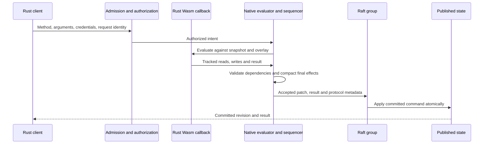

The sequence depicts a protocol, not implementation phases. Query reuse and result sharing do not bypass the selected read fence or current applicable policy. Hot keys, broad scans and changing graph shape naturally constrain useful speculation.

### The writer: staged preparation and group commit

Every client write a member leads (mutations, multi-database transactions, queue and timer operations, timer fires, retention and retry-session transitions) enters one queue, the leader's writer (`flower-cluster/src/writer.rs`); deployments and the history incarnation propose directly. A client request holds a `Writer` admission place (one of 1,024, with its bytes) from entering the queue until it is answered. The writer prepares writes in queue order, each on the state the writes before it staged: committed state, plus the batch still committing, plus the writes already prepared into the group being built. That state is one uncommitted redb write transaction (`GroupStore::begin_staged`, `StagedWrite`), into which the writer applies those writes with the same code every member applies them with, and which `ReadTxn` views read like any snapshot; `Engine::on_staged` makes every prepare path read it, and dropping it discards it. The engine lock is held only while a chunk of writes prepares, so applies run between chunks. No write prepares on state another write is about to change: concurrent read-modify-write mutations of one record each see the ones queued before them (before the writer, 64 concurrent increments of one counter ended at 6).

A group commits as one `ClusterWrite::Batch` entry: one append, one replication round and one apply transaction for all of its writes, while each keeps its own patch, receipt, revision, commit notice and answer (`WriteResponse::items`). Items are whole patches, not merged by key: followers replay each item's index, derived and receipt journal as prepared. One batch commits at a time; while it does, the writer keeps preparing arrivals into the next group on top of it, until that batch resolves, the group holds 256 writes or 4 MiB, or it was rebuilt 8 times (each rebuild stages the predecessor and the group so far again). So a group's size follows the arrival rate times the commit time, one write per entry when idle and hundreds under load, with no timer to tune. Answers a preparation decided without proposing (replays, refusals, failures) wait for their group's batch, since they may have read writes that had not committed yet.

A batch names its head: the last data entry it was prepared after, by log index, or by the writer's random identity and the batch's sequence when it was prepared on a predecessor still in flight (`flower_engine::batch`). Every data entry records itself as the group head in `$cluster` as it applies, on members, synced devices and restore replay alike, and a batch applies only when the recorded head is the one it names. Otherwise (a deployment, an incarnation entry or a new leader's entries landed in between, or its predecessor went stale or never committed) every item rejects as `stale_batch` on every member, the entry records itself as the head, and the writer prepares the writes again, up to 8 times before answering a retryable overload. A batch item checks its patch against the items before it in the same transaction; a database's first item must advance its applied position and later ones share it. Backup manifests record the head at their cut so restore replay reaches the live verdicts, and a restored engine starts its new history from no head. `/v1/metrics` reports the writer's batches, writes, writes decided without proposing, stale batches and the largest batch, and its speculation (below). Tests: `flower-cluster/tests/writer.rs` (no lost updates under concurrent increments, writes sharing one entry, interleaved entries making batches stale while every write still lands exactly once, followers applying the same batches and revisions) and the state machine's batch-verdict unit test.

Managed-key catalog changes (`POST /v1/admin/keys`) propose `ClusterWrite::Keys`, naming their database, directly, as deployments do, not through the writer. Batch items carry engine writes only, and the crypto host signs, seals and verifies with the catalog the group has *applied*: a key change queued behind writes still in flight would leave the writes prepared after it signing with the catalog it replaces. A direct entry instead records itself as the group head wherever it applies (members, devices, which receive it emptied of key material, and restore replay), so any batch prepared before it, which may have used the old catalog, applies nothing and the writer prepares it again against the new one. That costs a key change at most one re-preparation of the writes in flight, rejected changes included, since devices cannot tell those apart. Key changes are operator actions, rare enough that they never starve the writer, and their own concurrency control is the catalog revision each change is prepared from (`KEY_CATALOG_CONFLICT`, prepared again on the leader).

**Speculative preparation.** With `FLOWER_WRITER_PREPARATION_WORKERS` above 1, the writer prepares a chunk's mutations in *waves*, using staged state (`flower_engine::speculation`, `flower_cluster::speculation`). Its staged transaction logs every row it puts or deletes (`StagedWrite::log_writes`), and the writer keeps an *overlay* of those rows as the transaction holds them (`flower_engine::storage::Overlay`): committed state seen through it (`GroupStore::begin_overlay`, a redb snapshot taken while the staged transaction holds the write lock, so nothing commits under it) reads exactly what the staged state does, from any thread. A wave's candidates prepare at once on a pool of that many threads, the writer's own included (`Engine::speculation`), with the same code as `Engine::prepare_mutation` (both implement `PrepareMutation`) but each through a read that records every row it looks up, present or absent, and every key range it walks, cut at the row where a limited walk stopped (`ReadSet`), in all ten tables. That is the mutation's read certificate (`MutationCertificate`): records, collection scans, index ranges, derived outcomes and the edge rows evaluation and invalidation walk, receipts and idempotency rows, placement, lock, retention and code rows alike, so it covers everything a preparation reads from the store without knowing what any row means; code identities are recorded by `meta` name prefix rather than as a walk over every name, and the patch's base revision is read unrecorded (`ReadTxn::base_revision`). The writer then takes the wave in queue order. A candidate holds when no row logged since the wave's snapshot touches its certificate: it commits as prepared, its patch moved to the revision it lands on (`speculation::rebase`), which is the patch preparing it there would have produced. Any other candidate is discarded and prepared again in its turn on the staged state, exactly as without speculation: one that conflicted, one that read retained history (which comes from outside the store), one whose preparation failed or panicked. So a batch's writes, receipts, revisions and answers are those of preparing every write in its turn, and nothing prepared on stale state commits. A wave's mutations that name no timestamp all run at the wave's one clock, speculated or prepared again (`Engine::at_clock`), and wave clocks never go back. The engine lock and the staged transaction are held throughout a chunk, so code, placement and committed state do not move under a wave, and the idempotency memory cache is only read.

A wave starts two candidates wide, doubles after a wave without conflict up to the workers, keeps its width while a partly conflicting wave reuses more candidates than it rejects, otherwise halves, and at one prepares serially for a cooldown that doubles on each repeat up to the writer queue (1,024), reset by an accepted wave. Conflict prediction (`FLOWER_WRITER_CONFLICT_PREDICTION`, `1` by default, `0` off) keeps, for up to 64 methods (database, module, name), a share of their recent candidates whose certificates failed (decaying by an eighth per candidate; hot from half, after four) and which argument (the whole arguments, or a top-level property) names the record or derived outcome they failed on; a call of a hot method is placed in its turn instead of speculated when an earlier call of its wave names the same record, or always when no argument names it, one in 8 (one in 32 by record) still speculating to learn when it stops conflicting. Placing a call changes nothing it computes. `/v1/metrics` reports the writer's `speculation` (waves, candidates, reused, conflicted, untracked, failed, conflicts by class of row, placed serially, cooldown serial calls, backoffs), each method's `mutations.speculation` and `flower.writer.speculation.rejections` (see *Observability*). Tests: `flower-engine/tests/speculation.rs` (certificates catching reads of present and absent keys, rows inserted into scans, index ranges but not entries outside them, derived values through their outcomes; random calls in random waves proposing byte for byte what preparing each in its turn proposes), `flower-cluster/tests/speculation.rs` (independent writes committed from speculation, random interleavings of conflicting increments answering as a serial order, prediction placing calls on a hot record in their turn, one worker serial) and the policy and prediction unit tests.

Measured in process (`flower-cluster/tests/speculation_bench.rs`, release, `--ignored`): one member, 64 clients calling a read-modify-write mutation with about 1 ms of guest CPU work (`FLOWER_BENCH_WORK=200000`) as fast as answered, 3 s after 1 s of warm-up, three interleaved passes, medians (min to max), on an 18-vCPU Windows VM other agents' builds shared; *uncontended* calls each write their own counter, *contended* ones write one hot counter nine times in ten.

| workload, commits | writer | calls/s | p50 ms | p99 ms |
|---|---|---|---|---|
| uncontended, fsync | serial | 1,152 (917–1,237) | 51.8 | 94.2 |
| | 4 workers | 2,176 (1,237–2,261) | 27.3 | 48.6 |
| | 8 workers | 3,051 (1,664–3,136) | 19.3 | 46.4 |
| contended, fsync | serial | 1,387 (747–1,430) | 43.8 | 69.0 |
| | 4 workers, no prediction | 1,216 (960–1,429) | 50.2 | 74.8 |
| | 4 workers | 1,152 (1,088–1,451) | 52.0 | 78.7 |
| | 8 workers | 1,344 (1,216–1,344) | 45.5 | 92.7 |
| uncontended, no fsync | serial | 789 (619–1,088) | 73.6 | 134.2 |
| | 4 workers | 1,216 (1,216–1,573) | 40.2 | 59.4 |
| | 8 workers | 1,905 (1,792–2,346) | 30.3 | 53.3 |
| contended, no fsync | serial | 917 (640–1,045) | 68.0 | 104.4 |
| | 4 workers, no prediction | 747 (704–1,045) | 78.4 | 113.6 |
| | 4 workers | 960 (917–1,045) | 67.5 | 80.5 |
| | 8 workers | 1,067 (875–1,216) | 57.5 | 86.5 |

Independent writes prepare in parallel: 1.9 to 2.6 times the calls with durable commits, latency halved; with about 0.1 ms of guest work (`FLOWER_BENCH_WORK=20000`, no fsync) 4 to 8 workers still gave 5,541 to 6,079 calls/s against 4,395. On one hot record nothing can run in parallel (each write reads the one before it), and speculation ties serial preparation within this machine's noise (−19 % to +16 % medians, p99 from 24 ms better to 24 ms worse). Prediction avoids repeated conflicts: without it nearly every call ran in cooldown (13,624 cooldown calls, 161 reused in the fsync runs); with it the cooldown disappears (8 calls) and the cold tenth keeps speculating (5,249 reused, 8,708 hot calls placed in their turn). Measured again on a quiet machine (fsync on, three interleaved passes): independent writes 2,624 calls/s serial, 3,776 with 4 workers and 4,960 with 8 (p99 39.2 ms → 19.9 ms); on the hot record 2,608 serial, 2,704 with 4 workers and 2,752 with 8, prediction on: no configuration with prediction ever prepared fewer than serial. So speculation is on by default: `FLOWER_WRITER_PREPARATION_WORKERS` defaults to this machine's cores, at most 8 (every group's writer keeps its own pool of threads), and `FLOWER_WRITER_CONFLICT_PREDICTION` to `1`; `FLOWER_WRITER_PREPARATION_WORKERS=1` prepares every write serially.

### Dependency certificates, query reuse and watch wakes

A query's evaluation produces a *certificate* of what it observed (`flower-engine/src/certificate.rs`): every record it read, present or absent; every collection scan, as bounds over full record keys, so a row inserted inside a scanned range touches it; every index range; and every derived value it read, expanded transitively into the edges that value's outcome recorded (staged in the session when the evaluation computed it, else committed), so a certificate names records and ranges only. Reads that name no dependency (retained history, which also ages out of the log tail without commits, and timer rows, which invalidate no derived outcome) record a reserved *volatile* marker and make the certificate *broad*: every change to the database counts. A crypto op that signs, verifies, reads a public key or version, or runs any catalog operation resolves the replicated key catalog, whose changes move no database revision: both runtimes report it through `HostCall::read_keys`, which records a reserved *keys* marker, and the certificate *reads keys* (see **Key changes** below). Past 4,096 dependencies a certificate turns broad too. `now()` records a reserved *time* marker and makes the result `Polled`; the earliest `changes_at(t)`, its own or one a derived value it read carries, makes it valid `Until(t)` when after the evaluation's own clock; otherwise it is `Stable`. Markers are reserved record dependencies (collection `u32::MAX`), so derived outcomes persist them in their edges and older members decode them as ordinary records that no write names. A fourth, the module marker a read of another module records, serves derived outcomes only (an activation drops their readers): certificates leave it out. An authorization decision has a certificate of what the hook read; a module without a hook decides on nothing but its code.

Applying a replicated patch records its change set (the records it wrote by key, the index entries by components and primary) in the engine's *change journal* before the transaction commits, so no reader sees a revision the journal does not know. The journal keeps, per database, one contiguous chain of revisions, at most 4,096 change sets and 65,536 changed keys across databases. The writer stages the writes before the ones it prepares in a scratch transaction (`GroupStore::begin_scratch`) that refuses to commit, and applies in it record nothing: only the batch's own apply records each revision, once. A commit applies to the revision before it; one that does not continue its database's chain (a local commit to a database that is not replicated, which records nothing, a snapshot install, a wiped and recreated database) starts a new chain, and a read whose snapshot was captured before the break never anchors to the new one. Deployments move no revision: results also record the version of their database's code (the catalog's module set for that database, compared by identity), and a different version is a different result.

**Query reuse.** Queries on the `EngineReader` (HTTP queries, watch subscriptions and refreshes) reuse recent results (`flower-engine/src/query_cache.rs`); queries on the writer lane always evaluate. Results are keyed by database, module, definition, canonical arguments and the whole principal the call runs as. A lookup happens where the query would evaluate: after its read plan (the fresh-read proof, or the replica-local check), admission and authorization (the hook, or a decision of it that still holds), so the cache only ever serves the principal decided for the call. A cached result answers when the code version is the same, the call's clock is within the result's validity (not before the evaluation's clock, before a declared instant), and the journal shows no change since the cached revision touching its certificate; each hit moves the cached revision forward. Failures, broad results and results that polled the clock never enter. The cache holds 16 MiB by default (`EngineReader::set_query_cache_bytes`, `serve --query-cache-bytes` / `FLOWER_QUERY_CACHE_BYTES`, zero disables it), charged by key, value, rendering, certificate and derived graph, evicting in insertion order; `EngineReader::query_cache_stats` reports hits, misses, hits kept through unchanged derived values (`rederived`), entries, bytes and the budget, as `/v1/metrics` does. Replicated databases commit only through replicated patches, which the journal records; results of a database that is not replicated (a standalone engine's) do not validate across its local commits. Results that read keys never enter.

**Encoded answers.** An entry keeps its result twice: the value, and the JSON the API writes for it (`query_cache::Encoded`), rendered once when the result enters. Callers that only send the result on ask for the rendering (`EngineReader::query_encoded_at`, `query_replica_local_encoded`, `Node::query_read_encoded`): a hit answers with the entry's own bytes, neither cloning nor rendering the value, and an evaluation renders once for the cache and the caller alike. `POST /v1/query` writes its answer around those bytes (`{"ok":true,"value":` … `}`) for every result, cached or not, so a reused answer is byte for byte the answer an evaluation renders; before, every answer cloned the value, rendered it, parsed the rendering and rendered that again. The JSON a value takes in an answer is the contract, the same on every route (`/v1/query`, `/v1/mutate`, `/v1/transaction`, receipts' replays): the compact JSON `serde_json` prints for the value its canonical rendering reads as, so integral numbers print as integers (`10000000000000000`) and others in shortest round-trip form with an exponent past its range (`1e+21`, `1e-7`, `0.5`); a query and a mutation answering one value send the same bytes. Canonical JSON (`flower_engine::json::render`, which prints every number in full) is the storage and key form, never an answer's. A result that does not render fails with code `render`, as before. Each principal receives its own entry's rendering, after authorizing as usual.

**Unchanged derived outputs.** A stable result (one that read no clock, managed key or untracked state) also keeps the derived graph it read through (`certificate::Graph`): what its body read itself and, for each derived instance it read, directly or through others, what that instance read itself, the instances it read, and a SHA-256 digest of the outcome it served. When the changes since a cached result touch its certificate only through derived instances (none touches what the body read itself), the reader derives again, on its snapshot, the instances whose own reads a change touched, children first, and an instance above them only when one of its children came out different (`lane::rederive`). When every instance the body read comes out with its digest, the body would read the same values and nothing a change touched, so it answers what it answered: the entry stands, anchored at the new revision with the graph of the new derivations (instances derived again take what they read now; the others keep their part, since they read nothing a change touched and only children that came out the same), and the derived values installed as a query's caches are. The first instance the body read that comes out different stops the derivation, and the query evaluates from the outcomes derived so far rather than deriving them twice. Appliers run no guest code and drop the dependents of a changed record, so the reader that next needs them derives them, and stops where an output comes out the same.

**Identical queries in flight.** On a member, a query call identical to one being evaluated waits for it instead of evaluating the same thing (`flower-cluster/src/flight.rs`). Calls join by the call as presented (database, module, name, canonical arguments, asserted principal, credentials, whether the name is an alias, and the timestamp override) and by the database's revision once the caller's own read was proved: a call proved at a newer revision flies on its own. A waiter holds no admission slot, and its wait ends at its client deadline as an admission wait does: it is refused then (503 `overloaded`). Once the leader lands, the waiter answers as any call does: admitted, authorized as itself on a snapshot of its own, from the cache when the leader's result is there and its certificate holds at that snapshot, else by evaluating; so no call takes another's answer, and joined answers, their errors and their `Server-Timing` are a cached call's, plus `join;dur`. A waiter waits once; when the leader's result did not enter the cache (it polled the clock, failed or read untracked state) the waiters evaluate side by side and the call is marked solo, so later identical calls do not wait until one keeps its result again. A leader whose caller went away releases its waiters, who look for a flight once more. The table is bounded at 512 KiB (`Node::set_query_flight_bytes`, `serve --query-flight-bytes` / `FLOWER_QUERY_FLIGHT_BYTES`, zero turning joining off), solo marks leaving first; `/v1/metrics` `queries.flights` reports flights led, joined and run alone, those in the air, solo marks, bytes and the budget, and the `coalesce_wait` query stage the waits.

**Watch wakes.** The hub keeps, per entry, its newest evaluation's certificate, journal anchor and code version, and per subscriber its latest decision's. A commit notice for a database checks each entry there: a code change, or a journal that cannot vouch for the commits since the evaluation (a broken or trimmed chain), or a change touching the evaluation's certificate, starts an evaluating round (one fresh-read barrier per batch, every subscriber reauthorized, the query evaluated, on one view); otherwise a change touching a subscriber's decision starts a reauthorizing round on the member's own state; otherwise nothing runs, and the anchors move forward to the notice's revision. An evaluation or decision installed after the pump already handled later notices is checked against those commits at once, and caught up by another round when they touch it. A lagged notice stream refreshes every entry. Results valid `Until(t)` refresh at `t`; results that polled refresh every `POLL_INTERVAL` (250 ms; `Hub::with_poll_interval`); decisions valid `Until(t)` are rechecked at `t`, and decisions that polled on the reauthorization interval. At one revision, the value evaluated at the later clock is the newer one. `Hub::evaluations` counts refresh evaluations.

**Key changes.** A managed-key change (`ClusterWrite::Keys`) moves no revision, so nothing above notices it; Flower tracks a database's whole catalog as one dependency:

- *Derived values.* The keys marker persists in a derived outcome's edges. Applying a key change drops every committed outcome of its database edged to it, with everything depending on it, inside the apply transaction (`Engine::drop_key_readers`; other databases resolve keys in catalogs of their own); pinned outcomes stay as invalidated pins that evaluate again on their next read, so a signature under a rotated key is never served and one under a revoked key fails where it is read. Members, synced devices and restore replay all drop them, whether the change applied or was rejected, since devices receive it emptied and cannot tell (appliers run no guest code).
- *Races.* Each member keeps a key-change sequence (`Engine::begin_key_change`), odd from before the apply transaction commits until its crypto host serves the new catalog. A reader marks it before its snapshot; derived outcomes it computed persist only while the sequence is still even at that mark, so an evaluation that met the old catalog cannot land on top of the drop. A snapshot install counts as a key change, since the image may carry another catalog.
- *Watches.* Once the member serves the new catalog, its hub gets a key notice naming the database (`CommitNotice::keys`; `all_keys`, naming none, after a snapshot install). That database's entries whose result read keys evaluate; entries where only a subscriber's decision did reauthorize, so a hook that verified a token under a revoked key ends that stream `unauthorized`. An evaluation installed after a key change began or ended since its snapshot catches up at once.

Catalog-wide within the database is the simplest correct choice: a change names keys while values depend on aliases bound to them (and `bind` moves an alias between keys), devices receive changes without them, and changes are rare operator actions, so dropping every key reader of the database costs one re-evaluation each per change.

**Deltas.** Every published value has an identity, sent as the event's `id`. A subscriber that joins with a value the entry already holds shares the entry's identity for it. When a refresh renders a different value it diffs it against the entry's previous one (`flower-server/src/json_patch.rs`: RFC 6902 `add`, `remove` and `replace`; objects by key, arrays by common head and tail with index edits in the middle; at most 256 operations, 100,000 visited nodes and bounded pointer bytes) and keeps the patch when it is shorter than the value. A subscriber that asked for deltas and holds the value the patch starts from receives a `patch` event naming, as `base`, the `id` its stream last carried; every other subscriber receives the whole value. Clients that never ask, and servers that predate deltas, exchange snapshots only.

Tests: `flower-engine/tests/certificates.rs` (reuse across unrelated commits and absent keys, phantom inserts into scans, derived reads through staged and committed edges, declared instants, polls, untracked reads, principals, code versions, a disabled cache, scratch staging recording nothing, signatures and verifications across a key rotation and revocation, key changes dropping derived values, a derived value computed across a key change never persisting), `flower-engine/tests/wasm_crypto.rs` (a `wasm32` guest's signature across a rotation), the journal and certificate unit tests, `flower-server/tests/watch.rs` (commits to unread rows, derived and scan coverage, deltas to subscribers holding their base, declared instants and polls without commits, commits handled before a subscriber registers, `patch` events over SSE), `flower-server/tests/watch_keys.rs` (key changes refreshing direct and derived key readers, a revoked key ending a stream through its decision, a first evaluation straddling a key change catching up), the key-change drop on devices (`flower-client/tests/client.rs`), restore replay (`flower-cluster/tests/keys.rs`) and snapshot installs (`flower-cluster/tests/snapshots.rs`), the hub and diff unit tests, and `flower-client/tests/watch.rs` (patches from a live server, gaps that resync as `Reset`, falling back to snapshots).

### Read consistency, leases and routing

Every query declares how it reads, and any member answers any query (`flower-cluster/src/read.rs`, `Node::query_read`):

| Consistency | The answer reflects | How a member serves it |
|---|---|---|
| `Linearizable` (the default) | Every write that completed before the query began, whichever member served either. | The leader proves it still holds them by its lease, or by a quorum round once the lease lapsed. A follower asks the leader for a read fence: the leader's commit index, proved the same way after the request arrived. The member then waits until it applied the proven index and reads its own snapshot. |
| `ReplicaLocal` | The serving member's applied state as it is, possibly far behind, never ahead of what was committed. The answer reports how stale it may be in `x-flower-staleness-ms` (milliseconds, or `unknown`). | From the member's own state at once. |
| `ReplicaLocalWithin(ms)`, or `ReplicaLocal` bounded by the caller | State at most the bound stale: the tighter of the query's declared bound and the caller's. The caller sends `x-flower-max-staleness-ms` (whole milliseconds, 0 to 2^31 − 1; anything else is 400), or sets `RequestOptions::max_staleness`; it can tighten the query's bound, never loosen it. | From its own state when it knows its staleness and that is within the bound. Otherwise it proves a fresh read first and reports 0; when it cannot, the read fails with 503 `stale_replica`, retryable here or at another member. |

A fresh read that finds no leader known forwards, and the API sends it on once one is elected (see forwarding below). A proof that fails (no quorum, the leader unreachable, nothing applied) within the read timeout (10 s) answers 503 `quorum`. A member whose storage failed refuses linearizable reads with `storage_failed`. A member whose state may lag what it served before, because it is rejoining its group after opening without Raft state or recovering a log it opened with past its state, refuses replica-local reads at once with that retryable reason (`rejoining`, `recovering`) and reports its staleness as unknown: the appends it hears keep its staleness clock recent while its data is behind. Its fresh reads wait for the leader's fence and, while recovering, for the recovery fence.

**The lease.** OpenRaft 0.9 voters refuse every vote request for the leader lease (E: `Config::leader_lease` in Flower's fork, 300 ms by default; election max upstream) after their vote last changed or was touched: each append from their leader, heartbeats included, touches it on arrival, and a restarted voter touches it when it opens. Nor do they campaign before E plus an election timeout, and with pre-vote only once a quorum, each past its own E, says it would vote; a pre-vote changes no voter's state, so it never shortens a refusal. When a leader's quorum round that began at `t0` on its clock succeeds, every voter of that quorum touched its vote at or after `t0`, so none votes for another candidate until E of its own clock after `t0`; a new leader needs a quorum's votes, which intersect that quorum, so none can exist before the first of those refusals ends. The leader then serves fresh reads without a round until `t0 + δ`, the read lease. With every clock within `1 ± ρ` of real time, the lease ends at most `δ / (1 − ρ)` of real time after `t0` and the refusals at least `E / (1 + ρ)` after it, so the lease is safe while `δ ≤ E (1 − ρ) / (1 + ρ)`. The default `δ = 0.9 E` (270 ms) tolerates clock rates about 5% apart (NTP slews at most 0.05%); timing validation refuses `δ ≥ E`, and a node handed one cuts it to the default. The shorter lease costs reads nothing but a renewal round every 135 ms while they continue. Clocks must not stop while a member runs: a host suspended to RAM could serve a stale read on waking.

The leader itself is the one member of that quorum its refusal does not bind: OpenRaft has it grant a vote once its own vote is older than E, stepping down as it does. So a lease read first asks the Raft core whether this member still holds the vote, role and membership the lease was confirmed under; the core handles vote requests in order with that question, so a vote granted before the read began ends the lease even while the lease's timer runs and before the metrics say so. A membership change ends the lease too, since the new configuration's quorums need not intersect the one that confirmed it. A round confirms a lease only after the leader applied an entry of its own term (the round waits for its read index, which is at least that entry), so a lease read never misses what an earlier leader committed. Lease reads read the commit index the core reports and wait for it to apply. While reads continue, a background round renews the lease once half of it has passed, so steady reads never wait for one. A leadership transfer voids the refusals: a member told to campaign at once (`Raft::trigger().elect()`) ignores its own, and voters asked to release the leader's lease (`Raft::release_leader_lease`, OpenRaft fork) give theirs up until their vote changes. So the leader must call `Node::release_read_lease` before it asks: it gives up the lease for the rest of its term, and a transfer that fails does not restore it. Nothing persists a release, so a leadership OpenRaft restores from the files when its member reopens confirms no lease until it leads a later term. `--raft-read-lease-ms 0` proves every fresh read with a round instead.

**Fences and cohorts.** A follower asks for a fence over the member channel; the leader proves it by its lease or a round, never asking anyone else, and answers its commit index. Concurrent proofs share work only forward in time: a caller joins a round, or a fence request, only if it began after the caller arrived, so a burst costs at most two proofs and no caller reuses one that began before it asked. `/v1/metrics` reports `reads`: lease reads, quorum rounds, fences obtained from the leader and fences served to followers.

**Staleness.** A member's staleness is the time since its applied state last held everything its leader had committed. A follower learns it from the leader's appends: one that takes and leaves its log covering the leader's commit index (heartbeats included) says its log held everything committed when it arrived, and once the follower also applied that index its state was current then. A fresh read fence proves the same for the instant its request began. A leader within its lease is current, once it applied an entry of its own term, and stale from the lease's end after it; a sole voter is always current then. A member that heard nothing has unknown staleness, which a bound treats as past it. Instants are taken when an append arrives, so the one-way delay from the leader is not counted; and with five voters or more a follower still hearing a deposed leader cut off with a minority understates its staleness until it learns the new term.

**Forwarding.** A request only the leader can serve (mutations, transactions, deployments, membership, queue and timer operations) answers a forward on a follower, before the follower prepares anything: its state may lag the leader's, as when it has not yet applied a deployment the call needs; the API then sends the request as it arrived (method, path, body, and its `authorization`, `content-type`, `accept` and staleness headers) to the leader over the member channel, and relays the leader's answer verbatim (`flower-server/src/forward.rs`). The leader runs it through its own API as if the client had called it: the same credential checks, admission and idempotency apply, and the follower's credential checks already ran before it buffered the body. A forwarded request carries `x-flower-forwarded-by` and is never forwarded again. A leader that turned out not to lead, or could not be reached, ran nothing, so the request goes again to the next leader for up to 10 s; if the forwarding member leads by then, it serves the request itself. A follower that has not heard from its leader for three heartbeats (150 ms by default, at most the leader lease) treats it as gone: it does not dial it, and holds the request until the next leader's first append arrives (looking again every 10 ms), so a write sent to a follower when the leader dies goes through as soon as a new leader commits, instead of waiting on a dial to a dead host. An exchange that broke after the request may have arrived answers 503 `forward_failed`: its outcome is unknown, so only the caller, holding its idempotency key, sends it again. The leader may take up to 5 minutes to answer one forwarded request (a deployment's backfill); the caller's own deadline usually ends the wait first. A forward reaches the client only when no leader took the request in time, the leader serves no API, or this member belongs to no cluster yet.

**Routing.** Every reply through the API names the leader's advertised API URL in `x-flower-leader-url` when this member knows it: its own while it leads (`AppState::with_api_url`, `--advertise-http`), else what the leader described over the member channel in the current term, asked for in the background when unknown. Clients routing by leader send writes there directly. A follower names no leader it has not heard from for three heartbeats, and a leader names itself only while a quorum acknowledges it within the leader lease, so clients do not chase a dead or cut-off leader. A leader that has heard from no quorum for the leader lease (a partition, or both its peers down) takes no write and gives up waiting on the ones it took, with a retryable 503 `leader_isolated` whose outcome is unknown: the others may have elected another leader, and the caller retries elsewhere with the same idempotency key, which a receipt answers should the write commit after all (`flower-cluster/src/writer.rs`).

Tests: `flower-cluster/tests/reads.rs` (followers' fenced reads, lease reads without rounds and with the lease off, a cut-off leader whose last lease read began before any other leader existed and which never answers again until healed, a leader that grants a vote and can no longer confirm leadership by its still-running lease, a released lease that stays off for the rest of its term, an old leader that serves no lease read once a transfer began, rejoining and recovering members that refuse replica-local reads, replica-local reads on a cut-off follower within and past caller and declared bounds, TCP fences, staleness, forwards and descriptions), `flower-server/tests/reads.rs` (forwarded deployments and writes with idempotent replays, writes forwarded by a follower lagging their deployment, credential checks before forwarding, staleness headers and bounds, leader URLs, watches on followers, a bounded watch that ends on a cut-off follower while an unbounded one stays, membership and leadership requests forwarded to the leader), `flower-client/tests/routing.rs` (routed writes past a stopped follower API, fallback to the main URL when the leader fails, reported staleness), and unit tests of the cohort, the staleness clock and lease validation. Each fails with its mechanism removed.

### Published state and durable authority

In server deployments, OpenRaft orders accepted changes. redb backs records and receipts; immutable snapshots combine pinned backing reads and persistent overlays. Versions identify equal observations, not a globally ordered distributed clock.

Apply publishes effects, applicable receipts, revision and applied-log position together, in one redb transaction per entry. That transaction commits deferred (redb's `Durability::None`, `flower_engine::storage::deferring`): readers see it at once, and it becomes durable with the group file's next durable commit, which a node task makes every second (`--apply-flush-ms`, `FLOWER_APPLY_FLUSH_MS`, 1,000; 0 commits every apply durably, a second fsync per entry). Durability rests on the quorum's logs: a member that crashes reopens its group file at the last durable commit and re-applies the rest from its log (see Raft log, snapshots and startup recovery). Two guards keep that recoverable. Every durable commit of the group file, the apply flush, maintenance, an install or a compaction step alike, first makes the Raft log durable through every entry the file may hold applied (`GroupStore::set_before_durable`), so applied state never survives a crash ahead of an unflushed entry of the leader's log. And a snapshot build makes the group file durable before it publishes the snapshot, after which OpenRaft may purge the log up to it, so a crash never leaves the state behind a purged log (see `flower-cluster/src/flush.rs`).

A failed apply stops the member (see Storage failure), and the retained log re-applies the entry on restart. Startup cannot treat every durable log-tail entry as committed: it re-applies the committed prefix the log store remembers, then gates serving until a quorum-confirmed commit covers the rest (see Raft log, snapshots and startup recovery).

Snapshots pin one immutable redb read, encode it outside the apply lock into a file, spool incoming images to files, and fence publication against a newer install. A member's snapshot install replaces the whole group state: registered databases the snapshot lacks are wiped first, and every replaced database's modules and cached idempotency results leave memory with its rows. Log purging requires durable coverage. Disabling fsync weakens failure guarantees; boot markers cannot replace a surviving copy after correlated power loss.

Each replicated history carries a group incarnation: a random non-zero tag in `$cluster` meta. While none is applied, the leader's maintenance tick (`Node::run_maintenance`) proposes one as an ordinary log entry; the first applied proposal wins on every member, so racing leaders converge, and applying it labels every replicated database's history-incarnation meta row (databases registered later inherit the label). Log positions restart in a new history, so sync batches, backup manifests and archive segments carry the incarnation to tell histories apart. Opening a node over a fresh Raft log, as after a restore, starts a new history: applied positions reset and the incarnation clears until the new leader proposes a fresh one.

### Storage failure

A disk failure is permanent for the process: after an I/O error redb refuses every later transaction of that handle (`PreviousIo`) until the file is reopened, and OpenRaft stops a member for good on any storage error. The engine keeps that distinction in its errors: `Error::Io` (failure code `host_io`) for an I/O error or `PreviousIo`, `Error::Storage` for everything else. A member records its first storage failure (`flower-cluster/src/health.rs`), with the component (`group`, `raft_log`, or `raft` for a Raft core that stopped on its own), the error and when, from any of: engine work reporting `host_io`, a compaction step's I/O error, the flush of deferred applies failing, or the Raft core stopping on a storage error of either file (an append that can't flush, an apply that can't commit) or a panic.

From then on the member is unready (`/health/ready` 503 with the failure), refuses mutations, transactions, deployments, membership changes, queue and timer operations and linearizable reads with `storage_failed` (HTTP 503) before they reach the store, and stops maintenance and compaction. A write in flight when the disk fails returns an error rather than hanging or panicking. Nothing acknowledged is lost: an acknowledgement follows durable commits on a quorum of logs. Nothing diverges: an entry the log took but the group file couldn't apply is applied from the log on restart, and one the log couldn't take was never acknowledged. Deferred commits move where a full disk surfaces: redb keeps a deferred commit's pages in its write buffer, so a full disk under the group file shows at the file's next durable commit (the apply flush, within a second) rather than at the apply. The member may acknowledge a write in between; its entry is durable in the quorum's logs, and the restart applies it. The failed flush is the member's storage failure (`group`), and redb refuses every later transaction of the file, so the next apply stops Raft too. The leader's own deferred appends surface a full Raft disk at their flush the same way: the flush fails, the core stops, and the entries a quorum of followers committed are theirs.

The member probes its directory every second: its file system must have `--storage-recovery-free-bytes` available (`FLOWER_STORAGE_RECOVERY_FREE_BYTES`, default 64 MiB; `statvfs` on Unix, except `statfs` on Apple systems, whose `statvfs` counts blocks in 32 bits and fails past 16 TiB, and `GetDiskFreeSpaceExW` on Windows), then a 1 MiB file is written, synced and removed; once both pass, `serve` drains, shuts down and exits nonzero so its supervisor restarts it, and the restart reopens both files with every acknowledged write. Tests inject a backend that fails writes like a full disk under the Raft file, under the group file (at a deferred apply's flush, and at a durable apply), and under a compaction step, and check readiness, refusals, the HTTP 503s, the probe and recovery on restart (`flower-cluster/tests/storage.rs`, `flower-server/tests/storage.rs`). A disk with room for the probe but less than the threshold keeps the member waiting rather than restarting into a disk its first commits would fill again (`health::tests`, and the full-disk test waits out a threshold above the disk's free space).

### Raft log, snapshots and startup recovery

A member keeps two redb files, `group.redb` (the engine's ten tables) and `raft.redb` (vote, log entries, purge point, committed index, and the current snapshot's record), plus snapshot images in `snapshots/` beside them. Two files are deliberate: the files compact independently, restore and point-in-time recovery write only the group file (a fresh Raft log beside it starts a new history), and Raft appends never wait behind apply transactions on one redb write lock. Both record the storage contract they were written under when they are created (`flower_cluster::compat::storage_contract`, `state<n>-snapshot<n>-value<n>`: how entries apply and how snapshots and values encode), the group file in an eleventh table of its own (`store`, which no snapshot, move or backup carries), the Raft file in its meta table, and a restore records it in the group file it writes. A member refuses to start over a file another contract wrote, or one that holds rows but records none (a build from before files recorded theirs), naming both contracts (`incompatible_store`): it would otherwise read values, or apply logged entries again, as they were not written. There is no migration: across a bump of either version, a member starts over from a backup restored into a fresh directory. Two files still cost one fsync per write: a follower syncs each append before it answers (Raft's one fsync), the leader replicates before its own flush and defers it while its followers commit, and applies commit deferred, flushed every second (see **Deferred flushes** below). OpenRaft's storage conformance suite (`openraft::testing::Suite`, storage-v2) runs against `LogStore` plus `StateMachine` as a member opens them (`flower-cluster/tests/conformance.rs`).

**Deferred flushes: one fsync per write.** Without them a write paid three fsyncs in a row on its way to an answer: the leader's append (registry OpenRaft awaits it in `RaftCore::append_to_log` before replicating), a follower's, then the leader's apply into the group file. Now it pays one, a follower's (`flower-cluster/src/flush.rs`):

- *Parallel leader append* (Flower's OpenRaft fork, change 6). The core hands the current leader's appends to the log store marked `LogFlushed::is_leader_append` and replicates them at once; only `Notify::LocalLogFlushed`, sent once the store completes the callback, counts the leader toward the commit quorum for them, and one from an older leadership is ignored. The log store commits such an append to `raft.redb` without an fsync, so it is readable at once and ordered before every later write of the file (redb commits in order, and a durable commit makes every earlier one durable), and completes the callback once a durable commit covers it. Follower appends stay durable before they answer.
- *Deferred leader flush*. While the followers alone form a majority of every voter configuration (three voters or more in each, joint membership included), the leader flushes its held appends only when the group has not committed one within the grace (`--leader-flush-grace-ms`, `FLOWER_LEADER_FLUSH_GRACE_MS`, 30), its own vote then being needed, and otherwise at most every `--leader-flush-interval-ms` (`FLOWER_LEADER_FLUSH_INTERVAL_MS`, 500); after a grace ran out it flushes every append at once for a second, so a group with a follower down pays the grace once a second rather than on every write, and a new leader does the same for its first second, so a failover pays no grace on top of the election. With fewer voters in any configuration the leader flushes each append at once, in parallel with replication; a group of one, with nothing to overlap, appends durably. `--leader-flush immediate` (`FLOWER_LEADER_FLUSH`) always flushes at once. Every acknowledged write is durable on a quorum of logs: a leader that crashes can lose its unflushed tail, like a member that never received it. It must not resume its term over that shorter log, which would append other entries under log IDs its followers hold, so a member that did not shut down cleanly (a clean `Node::shutdown` flushes and records it in `raft.redb`) reloads its own committed leader vote as uncommitted: it must win a later term, which only a log holding every committed entry can. Its recovery fence (below) then holds until it applied a commit of its new leader's term, since its open-time log may end before what it served.
- *Deferred applies*, with the guards described under "Published state and durable authority": applies commit without an fsync and are flushed every second, after the Raft log, and before every snapshot is published.

Tests (`flower-cluster/tests/durability.rs`) run members over disks that lose every write since their last sync when a member's power is cut: with the leader's Raft disk holding its syncs, a write still commits on the followers (with upstream's core it times out); a lazy leader flushes at the interval while its followers commit, after the grace once a follower is down, then at once, and a leader of two voters flushes each append at once; with a follower down and the leader holding its flush, a write does not commit on the other follower alone; the whole group losing power with the leader's tail unflushed and every apply deferred loses no acknowledged write, and the leader, which lost its tail, does not resume its term (without the uncommitted vote it did, and reused log IDs); a group file that synced twice over the leader's unflushed log holds nothing past its log after a cut (it held 31 entries over a log of 1 without the guard); a cut after a snapshot purged the log leaves the state at or past the purge point (0 against a purge point of 39 without the snapshot's flush); and forty deferred applies sync the group file not once, durable ones once each, and a cut replays them from the log. Each fails with its mechanism removed. A new leader flushes at once for its first second, so a failover pays no grace (`a_new_leader_flushes_at_once_so_a_failover_waits_for_no_grace`; without it the write times out). Measured (`flower-cluster/tests/write_latency.rs`, release, three in-process members on one SSD under Windows, the machine shared with other builds at 25–66% CPU, before and after run back to back): fsyncs per write go from one per file on every member (leader log, leader group, follower log, follower group: 1.00 each) to a follower's log alone (1.00; the leader's log 0.10–0.47, as the grace and new leaderships turn it eager; both group files 0.00–0.01); one write at a time takes p50 1.64 ms against 2.90–3.36 ms before (mean 1.78 against 3.03–5.32 ms, p99 5.2 against 4.4–37 ms); 64 concurrent writers, whom the writer already batches so the fsyncs are spread over them either way, measured 6,045 writes/s (p50 10.3 ms, p99 14.9 ms) against 7,029 (p50 8.8 ms, p99 12.5 ms), and in a busier minute 2,948 against 3,765, within that machine's noise. Measured again on a quiet machine, two interleaved rounds: lazy (the default) 6,760–7,238 writes/s at p99 11.1–15.3 ms and one write at a time p50 1.33–1.34 ms; `FLOWER_LEADER_FLUSH=immediate` 6,571–6,763 writes/s and p50 1.36–1.38 ms; and durable applies besides (`FLOWER_APPLY_FLUSH_MS=0`, every file synced per write as before) 5,555–5,690 writes/s and p50 2.52–2.62 ms: the deferred flushes give a fifth more concurrent throughput and halve a single write's latency. With `FLOWER_LEADER_FLUSH=immediate` one write takes p50 1.53–1.65 ms. Before the apply flush took the log's flush outside the engine lock, lazy mode stalled at its p99 (68 ms).

**Shutdown.** `Node::shutdown` stops the Raft core and the background purge, then waits (up to 10 s) until OpenRaft's state machine worker and every snapshot builder, which outlive the core, have dropped their handles on both files, makes the leader's held appends and then the deferred applies durable and records a clean shutdown: when it returns the files can reopen at once.

**Purge.** OpenRaft awaits `purge` inside its core, which meanwhile sends no heartbeat, answers no AppendEntries and confirms no read. `purge` therefore records the purge point durably and deletes at most 1,024 entries in that one transaction; a background task deletes the rest, 1,024 per transaction and 2 ms apart, without an fsync except for its last transaction (redb reuses pages a commit frees only after a durable commit, so compaction can reclaim them on a member that writes nothing else). The purge point never moves back. Every read of the log by Raft and sync serving starts above the purge point, so entries a crash or a shutdown leaves below it are never read, and the next purge deletes them from the first entry on disk. `LogStore::sweep_bound` is the single place the backup's purge hold (below) lowers what either purge may delete; only backup archiving reads the entries it keeps below the purge point (`LogStore::read_retained`), and releasing them hands them to the background task. `Node::shutdown` stops the task before the files close.

**Triggers.** OpenRaft builds a snapshot every `--raft-snapshot-logs` entries (10,000) whatever else holds. `Node::run_snapshots`, which `serve` starts beside maintenance and compaction, adds soft triggers, checked every `--snapshot-check-ms` (`FLOWER_SNAPSHOT_CHECK_MS`, 1 s): a snapshot is due once the entries applied since the last one carry `--snapshot-after-bytes` (`FLOWER_SNAPSHOT_AFTER_BYTES`, 16 MiB, estimated from payload sizes; 0 disables), or once the last one is `--snapshot-max-age-ms` old (`FLOWER_SNAPSHOT_MAX_AGE_MS`, 300 s; 0 disables) and anything applied since. A soft trigger waits until the last build, whatever triggered it, is `d × (100 − duty) / duty` behind, where `d` is how long that build took and `duty` is `--snapshot-duty-percent` (`FLOWER_SNAPSHOT_DUTY_PERCENT`, 10), so snapshot work takes at most that share of the time however large the state grows. Age builds are staggered: the max age divides into eight wall-clock windows, and a member builds for age only in its node ID's window once its snapshot is half the max age old, or in any window past one and a half max ages. Bytes applied while a build runs stay counted after it publishes, an install resets the count, and a member reopening counts the entries applied since its snapshot again.

**Images.** A build takes the engine lock only to open one redb read (every entry applies whole under that lock, so the read is exactly the state at the group position it records), then encodes every database from that read on the blocking pool, one view at a time, into `snapshots/<n>.part`, while applies go on. The part is synced and renamed to `<n>.snapshot`, and only then does `raft.redb` record it as current (metadata and file name, under 1 KB whatever the image size); older images are deleted after that commit, and a reader that holds one open keeps reading it. A build never replaces a newer recorded snapshot, which an install that finished first left. OpenRaft's snapshot data is the file itself: it streams segments from it to followers, and a follower's arriving segments spool into a part file. The snapshot ID carries an FNV-1a checksum of the image (corruption detection, like the engine's snapshot chunks; the peer transport authenticates). An install first checks the whole image (it parses, with payloads skipped rather than held, its checksum matches the ID and its position and membership match the metadata), so a truncated, padded, corrupted or foreign image changes nothing; then it records the image and the install marker in one transaction, installs one database view at a time as it streams from the file, and clears the marker. The bytes are a `SyncSnapshotFile`'s JSON, unchanged, so device sync serves the file as it is. One database's payload is in memory at a time during a build or an install; sync serving still reads the whole image into memory for its response. Opening deletes parts and unrecorded images a crash left, and moves a snapshot an older build stored whole in `raft.redb` out to an image.

**Startup recovery.** The log store remembers the committed index OpenRaft reports and records it with its next log write, so the Raft core never waits for an extra fsync; OpenRaft re-applies up to that record before `Node::open` returns. A member whose log still runs past its state after that is *recovering* (`flower-cluster/src/recovery.rs`) until it has applied its whole open-time log or a commit index learned since it opened. Until then `/health/ready` answers 503 with the reason, `GET /v1/sync` answers 503 `recovering`, and linearizable reads (queries, watch subscriptions and refreshes, queue and timer operations) wait up to 10 s for the fence and then answer 503 `recovering`. A member whose log ends at its applied position has no fence. Applies defer their flush (above), so after a crash the group file is commonly behind its log: the fence is what keeps such a member from serving a floor older than what it served before. A leader that stopped without a clean shutdown may also have lost its unflushed log tail, so its open-time log proves nothing: it is recovering, whatever its log, until it applied a commit of its current leader's own term, which covers every entry committed before.

**`FLOWER_FSYNC=off`.** `serve --fsync off` (`FLOWER_FSYNC`; `on` is the default, anything but on or off is an error) opens both files through a redb backend whose `sync_data` returns at once and leaves snapshot images and their directory unsynced (`flower-cluster/src/fsync.rs`). Every write still reaches the kernel before its commit returns: a process crash loses nothing, an operating-system crash or power loss may. Each file opened that way has `<file>.unsynced` beside it, written and synced before the file opens and holding the kernel's boot ID (Linux's `/proc/sys/kernel/random/boot_id`; macOS's `kern.bootsessionuuid` through `sysctlbyname`; Windows's boot time from `NtQuerySystemInformation(SystemTimeOfDayInformation)`, less the boot time bias that setting the clock adds, so only another boot changes it); it goes once the file is synced, at a clean `Node::shutdown` (which also syncs the images) or when the file opens with fsync on. A member whose markers name another boot may have lost entries it acknowledged and could help elect a member lacking a committed one, so, it opens *rejoining* (see "Membership, leadership transfer and rejoin"), with fsync on or off: it votes, campaigns and serves only once it caught up with its leader, and reloads its own leader vote as uncommitted so it cannot resume leading a term whose entries it lost. Its rejoining mark is synced into `raft.redb` before the markers are rewritten for this boot (fsync off) or removed (fsync on), so no crash in between makes it an ordinary voter. A group of one has no leader to catch up from: removing the markers before it starts trusts its files as they are. A file the loss left unreadable to redb still refuses to open; emptying the data directory brings the member back as a new one. Without a boot ID (another system, or a kernel that won't say) a marker is taken as this boot's, which gives no protection against power loss there.

### Storage layout and string interning

Each Raft group persists its databases in one redb file with a fixed table set. Every key begins with the length-prefixed database identifier — the root database has a reserved identifier — so a logical database is a key range: partition moves transfer ranges, never rewrite keys. Local-only databases use the same layout. Cells below show logical key structure; stored keys length-prefix every variable component and use big-endian fixed-width integers, so each variable component orders by length first, then bytes ("b" sorts before "aa"); fixed-width components order by bytes. Range bounds compare in this same stored order, which is the order ranges iterate in, so a bounded range is one contiguous key range the storage scan can seek. Layouts that need byte order across values (queues, timers) use fixed-width components.

Repeated engine identifiers — collection names, index names and derived-definition names — are interned per database to fixed-width 32-bit IDs. Names appear in full only in the intern tables; every other key references IDs, so collection names are never repeated per row. IDs allocate monotonically from a counter in `meta` and are never reused. Values stay canonical JSON: field names inside stored values are not interned.

| Table | Key | Value |
|---|---|---|
| `meta` | database, well-known name | revision, applied-log position, history incarnation and a moved database's history lineage, retention floors, retention state and retry sessions, placement epoch, intern counter, deployed code identity, each module's code era (`code_era\0<module>`) and the counter minting them (`code_eras`), a removed module's kept declarations (`removed\0<module>`) and the purges in flight (`module_purges`); in `$cluster`, the group position, membership, expiry clock and head |
| `intern_id` | database, intern ID | name bytes |
| `intern_name` | database, name bytes | intern ID |
| `records` | database, collection ID, key bytes | lz4-packed canonical-JSON value bytes |
| `index_entries` | database, index ID, index key bytes, primary key bytes | empty; the primary key locates the record |
| `derived` | database, definition ID, canonical argument bytes | outcome: value or computation-error marker |
| `dep_edges` | database, dependency key, dependent key | empty |
| `dependent_edges` | database, dependent key | encoded prior edge list for replacement |
| `receipts` | database, retry identity bytes | result, fingerprint and floor metadata |
| `code` | database, artifact content hash | Wasm bytes and validated manifest |

Dependency keys carry a one-byte kind tag: record (collection ID plus key), index range (index ID plus bounds) or derived instance (definition ID plus arguments). Negative reads share their key's dependency: any change to the key invalidates. Time and policy dependencies use due-queues and policy versions rather than the edge table.

`derived` is the durable cell store: materialized roots are pinned and non-root demanded outcomes are cached and evictable under pressure, recomputed on demand. Successful evaluation replaces the dependent's edges transactionally through `dependent_edges`; failed evaluation retains old edges plus newly observed ones.

### Backup objects and S3 encryption

Backup writes compressed objects and archive segments to object storage: in-memory and local-filesystem backends plus S3-compatible storage behind the `s3` feature, which `cargo-flower` builds. `serve`, `backup list` and `backup restore` take `--backup-url s3://BUCKET/PREFIX` (`FLOWER_BACKUP_URL`; `file:///PATH` names a directory, like `--backup-dir`), and `Driver::s3_from_url` reads the rest from the environment: `FLOWER_BACKUP_S3_REGION` (else `AWS_REGION`, `AWS_DEFAULT_REGION`, `us-east-1`), `FLOWER_BACKUP_S3_ENDPOINT` for another S3 implementation (plain HTTP when it says `http://`), `FLOWER_BACKUP_S3_ADDRESSING` (`path` or `virtual`; virtual-hosted without an endpoint, path-style with one) and the credentials `FLOWER_BACKUP_S3_ACCESS_KEY_ID`, `FLOWER_BACKUP_S3_SECRET_ACCESS_KEY` and `FLOWER_BACKUP_S3_SESSION_TOKEN`, else their `AWS_` names, else AWS's chain (a web identity token, container credentials, instance metadata). Objects live below the prefix. The S3 path is covered end to end against an in-process s3s server, through the driver (`cargo test -p flower-backup --features s3`) and through `serve` and the `backup` commands (`cargo-flower`'s `cli` tests); aws-lc builds with clang on `PATH`, which Windows ARM64 needs for every build. Every object at rest is encrypted: object contents are always ciphertext under the deployment's backup key, with no plaintext objects and no plaintext fallback reads. Objects live under kind directories (`obj/`, `manifest/`, `seg/`) with opaque names carrying no business data, collection names or key material. Plaintext exists only in host memory during encode; only ciphertext is uploaded. Flower encrypts objects before upload; any storage-side encryption is defense in depth, not a substitute. Views and segments compress with zstd level 3 before sealing.

**The sealed format is chunked.** Every backup object is a sealed stream (`aead::StreamSealer`, above) of 1 MiB frames, or of the part size when that is smaller: one envelope over a whole object would have to be held whole to seal, and opened whole before a byte of it could be trusted, so a base past memory could neither go up nor come back without releasing unauthenticated plaintext. Frames make every object, a manifest or an archive position included, verifiable as it streams. A base is cut from one pinned read of the group file (the engine lock is held only to open it, as for a snapshot build), and each replicated database is encoded from that read on the blocking pool, compressed, sealed and uploaded as it goes, so applies go on and one database's view is in memory at a time. An object up to the part size (`Driver::with_part_bytes`, `--backup-part-bytes`, 16 MiB by default, at least 5 MiB, S3's smallest) goes up in one request; a larger one as a multipart upload of full parts with a shorter last, aborted when any step fails, or in the background when the upload is dropped unfinished, its future cancelled, as by a shutdown that stops waiting for it or a caller's timeout (a store that cannot abort leaves parts no name refers to, which a bucket lifecycle rule for incomplete uploads removes). S3 takes at most 10,000 parts, so the default stores objects up to 160 GiB; LocalFileSystem stages parts beside the object and renames it into place, and listings skip staged files. Downloads open frames as their bytes arrive. Restore spools each view, decompressed and checked against the manifest's SHA-256, to an unnamed temporary file beside the target, so every view is checked before the target is touched, and installs them one at a time. Re-encryption streams each object from its old version into its new one, so neither copy is whole in memory, and an in-place reseal (segments, archive positions) replaces its object only when the upload completes, after the last byte was read.

One backup key covers the whole deployment, kept in the file keystore sealed under the operator's 32-byte KEK. Each object records the key version that sealed it, and each of its frames a unique 96-bit nonce; views and manifests are immutable once written, while segments and archive positions are rewritten in place under deterministic names, each write sealed with a fresh nonce, so a version-nonce pair never repeats. Reads accept any retained version; writes always use the current version. A sealed archive-position pointer per history incarnation tracks that history's archived log prefix. No pointer tracks the newest backup: the latest is the live manifest with the greatest creation time (backup ID breaking ties), derived from the listing, so a re-encryption racing a backup can never move it back to an older one.

Rotation introduces a new current version through the key lifecycle and is deployment-wide; it never rewrites existing objects. Old versions stay readable while any object references them. Version retirement is gated: a version retires only after every object sealed under it is re-encrypted or has expired past retention. Re-encryption copies views forward under superseding manifests, which keep the original creation time and backup ID, and reseals segments and archive positions in place, as bounded resumable operator work; it writes new views, then the superseding manifest, and only then deletes what was superseded, so a failure at any step leaves the latest backup restorable. Until complete, both versions remain active. Destroying a version renders its remaining objects permanently unreadable — retirement, not destruction, is the routine path. Retention is by time (`Driver::enforce_retention(window, spacing)`): it keeps every point of the window restorable, however many bases that takes, since bases due by bytes come as often as writes fill them and a count of them would keep only hours under load. In each history the newest base at or before the horizon stays (the oldest when every base is newer) with every base after it; older bases go, with the segments at or below the oldest kept cut. Kept bases older than the spacing (the base interval) thin out to one per spacing, and the newest stays: a point a dropped base covered restores from an earlier one through the segments after it, which all stay. A history that ended before the horizon, other than the newest base's, goes whole; a history with no base keeps its segments until they are older than the horizon. Orphan collection removes superseded manifests, unreferenced views older than a grace period (24 h by default, so a backup still uploading keeps its views) and segments contained in a wider segment.

Archiving copies only applied log entries — never the uncommitted tail — into segments named by their history incarnation and index range (`seg/{incarnation}/{first}-{last}`), so an interrupted run that re-uploads overlapping ranges is harmless: restore plans its chain from segment names, takes the segment reaching furthest from each needed index and refuses only a real hole. Nothing archives until the group has established its incarnation; a restored or re-bootstrapped cluster then archives its new history from the start of its log in a namespace of its own, never touching the old history's segments.

### Continuous backup and the purge hold

`cargo flower serve` with `--backup-dir` or `--backup-url`, `--keystore` and `--kek-file` (or `FLOWER_BACKUP_DIR` or `FLOWER_BACKUP_URL`, `FLOWER_BACKUP_KEYSTORE`, `FLOWER_BACKUP_KEK_FILE`) runs continuous backup on that member (`Driver::run_continuous`), stopped on shutdown with maintenance. Every `--backup-archive-ms` (default 1 s) the leader archives what it applied, then takes a base when its history has none, when the newest is older than `--backup-base-ms` (default 24 h), or once the sealed segment bytes archived since the newest outgrow both `--backup-base-bytes` (`FLOWER_BACKUP_BASE_BYTES`, 64 MiB by default; 0 leaves bases to the interval) and that base's own sealed size, so replaying the archive never costs more than another base. The base follows the archiving, so it covers what was just archived; the bytes count from a new leader's first tick (from the history's segments chained after the newest base's cut) and reset with every base. Retention by time (`--backup-retention-ms`, `FLOWER_BACKUP_RETENTION_MS`, 30 days, thinning bases to one per `--backup-base-ms`), orphan collection and key-version retirement run after each base and every `--backup-retention-interval-ms` (an hour), apart from the base: their failure, such as a store refusing deletes, fails the tick and shows in the status but never makes another base due. A base that fails waits a minute before the next try (`ContinuousSettings::base_retry`), so a store refusing part of one never uploads another every tick. Every member first checks the store's format (`Driver::check_format`: every object begins with the stream magic, so the first one listed tells) and refuses a store holding backups in another format, such as one written before objects became sealed streams: the loop ends with the reason in its status and on stderr, and lets go of the log it held, which nothing could ever archive, instead of failing every tick while the hold filled. `backup list` and `backup restore` refuse such a store the same way. Members that do not lead take no bases and archive nothing. A leader that stops archives what it applied since its last tick before its group closes (no base: a log that needs one leaves it to the next leader), within a sixth of the shutdown budget (`--shutdown-timeout-ms`, 5 s by default); a tick still running when the stop comes, a base or an archive stalled on its store, is cancelled, and a host tells every group's duties to stop at once, so a stalled store never holds a stop past that bound however many groups the member hosts; `serve` hands off leadership first, so this matters to a member that still leads when it stops, such as a single node.

Every member gets the same flags because every member holds its Raft log for the archive. A purge moves the purge point Raft sees as usual, but entries below it stay on disk until the history's shared archive position passes them (`LogStore::hold_purges`, `release_purges`): the leader releases what it archived, other members what the archive position records, and the background purge deletes what was released. The hold lowers the purge's bound (`LogStore::sweep_bound`), so OpenRaft's storage conformance suite passes with it on as with it off. The hold is recorded in the Raft file, so a restart holds from open, before Raft can purge, and releases nothing until the backup reports again; serving without backup flags drops the hold and deletes what it kept. Raft never reads below its purge point, and the log reports that point as its last entry when only held entries remain. A new leader therefore stores every entry the archive lacks and continues the same history's archive from the shared position, without a base of its own.

Archiving reads what the member's log stores, held entries included, never Raft's purge point. Entries the log lacks (purged before a hold existed, replaced by a snapshot install, or archived by another member past a position a deposed leader wrote back) are skipped only when the history's own segments or a base of the history already cover them; otherwise the leader takes a base and archives on from there. A tick that fails, such as against an unreachable store, is logged and retried at the next while the log stays held. `--backup-hold-max-entries` caps the entries kept below the purge point and `--backup-hold-max-bytes` (`FLOWER_BACKUP_HOLD_MAX_BYTES`, 1 GiB by default; 0 for none) their stored bytes, measured in spans of 1,024 entries as purges pass them (and anew from disk after a restart, at the first purge): past either cap the oldest spans go unarchived, the next leader to miss them takes a base, and PITR targets inside the gap refuse. Without caps, a store that never answers grows the log until storage-failure handling stops writes. `GET /v1/admin/backup` reports the hold and what continuous backup last did.

### Point-in-time recovery

Point-in-time recovery restores a base backup and replays its history's archived log entries up to a target timestamp. Replay runs as that history: the base installs with its incarnation, so writes made under scoped request IDs and retry sessions after the cut apply as its members applied them, and a replayed move records its arrival as it did live; only after replay does the restored group end the history (`StateMachine::end_history`: incarnations and lineages clear). Clearing it first, as restores once did, refused every such write as `wrong_history`. Every replicated write carries a proposed wall-clock timestamp agreed in the log; replay applies entries in index order while their timestamps do not exceed the target and stops at the first entry past it. The base must cover the oldest replayed entry, or recovery refuses; a base taken before the group established its incarnation has no archived history to replay. Replay reads receipt expiry at the replicated expiry clock, not at entry stamps: the manifest records the clock at the cut, restore seeds it, and replay advances it entry by entry exactly as live members did, so replayed duplicate verdicts match theirs. Replaying a deployment registers its database as replicated, as live apply does, so a database first deployed after the base comes back with its module.

Restore by log index (`Driver::restore_to_index`, `cargo flower backup restore --index`) reaches exactly one index of one history: it installs that history's base with the greatest cut at or before the index, then replays its archived entries through it. Indexes count within a history, since a restored cluster restarts them, so the history is the latest backup's unless `--history` names another. It refuses before touching the target when no base of the history qualifies or the archive stops short of the index. `cargo flower backup list` (`Driver::list_backups`) prints each live backup, oldest first: its manifest, creation time, history, cut, and the last index and write stamp a restore from it reaches through the contiguous archive after its cut.

Recovery targets a new or an existing cluster. A new single-node cluster bootstraps on the restored group file with a fresh Raft log. Recovering an existing cluster requires stopping every member, restoring the same target on each, wiping Raft logs and re-bootstrapping together. Restore re-registers deployed runtimes from the stored artifacts and resets the applied-log position and history incarnation, so the restored cluster's leader establishes a fresh one; `$cluster` metadata never backs up because a fresh ordering rebuilds it, except the expiry clock and the group head, which the manifest carries: replay continues both as live members did, and the head resets once replay ends. Proposal timestamps approximate commit time, so recovery lands at or slightly before the target, never past it.

### Retry and retention state

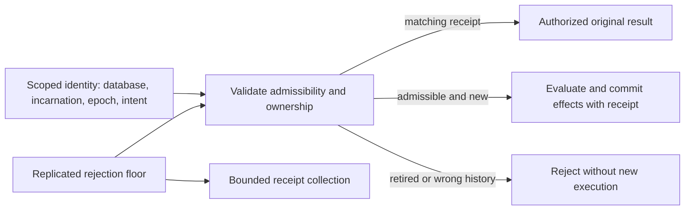

Receipt fingerprints include business intent and explicit preconditions, not refreshed credentials. Current authorization precedes replay. Retention floors advance through consensus before detail collection; snapshots and movement retain them. Contiguous session acknowledgements can release results without allowing the original sequence to execute again. Merely sending an HTTP reply is not durable consumption.

Receipt identity bytes are the incarnation, epoch and length-prefixed intent; the value is a tagged result blob (value or failure), the 32-byte fingerprint, the floor and an expiry instant with zero meaning none. Releasing a receipt replaces its result with a released marker while the floor stays, so the identity can neither replay nor execute again. Reusing an identity with a different fingerprint is a conflict and rejects without execution. Expired receipts read as unavailable history: the work executes afresh and commits a new receipt.

Unscoped caller IDs share the receipts table under an `unscoped\x00` key namespace with the same value format (zero fingerprint): first result wins, with no fingerprint conflict check, until 24 hours past the call timestamp while the database has no retention state; once it has one, the receipt records the epoch it ran in as its floor, has no expiry, and lasts until retention collects it (see below). A bounded in-memory cache, scoped per database, fronts the table for the hot path; it mirrors only outcomes with a live durable receipt and expires with it — prepares cache nothing, and budget exhaustion, storage failures and stale revisions are never cached, so a retry re-executes them exactly as it would after a restart. Receipts commit atomically with their mutation — inside the patch on replicated databases, inside the write transaction on local ones — so redelivery replays across restarts and failover. Expired rows miss on read and a periodic per-member purge reclaims the rows expired at the replicated expiry clock (below); scoped rows are never purged. Scoped identities reject retired work. No-effect operations outside retry sessions need not retain receipts. Retry expiry means unavailable history, not proof the business mutation failed.

Successful mutations stage their receipt atomically with the commit. Applying a patch stamps its receipts with where their outcome committed (`flower_engine::retry::Committed`: the revision the patch leaves, unchanged by a business failure, and its entry's log index), a trailer after the expiry; this happens at apply because only apply knows both, and every applier knows the same ones, so members, synced devices and restore replay record identical receipts (a restore stamps each replayed entry's archived index, where its caller was answered). The writer's scratch staging stamps nothing. Replays, whether caught at admission, at apply as a duplicate of a copy prepared earlier, or forwarded from a follower, answer the stamped revision and position, as the original call was answered; a replay admitted against a copy still committing in the writer waits up to 5 s for the committed receipt. Every such replay says so: `ApplyOutcome::duplicate` and `MultiApplyOutcome::duplicate` at apply, `WriteResponse::duplicate`, `duplicate` on every HTTP call answer (`false` for queries) and the client's `MutationResult::duplicate` and `TransactionResult::duplicate`; a retry of a cross-group transaction answered from its coordinator's record is one too, and a refusal a receipt decides is not: released, another principal's key, or a scoped identity reused for other content, which apply refuses with `identity_conflict` as admission would. Receipts from before stamping decode unchanged and replay with the current revision and position 0, and older members cannot decode the trailer, so the state-machine contract is 3. Business failures persist only their receipt, best-effort and without a revision bump, so retries replay the failure instead of re-executing; receipt loss degrades to re-execution and never masks the business failure. Poisoned invocations persist no receipt. Admission rejections carry `wrong_history`, `epoch_retired`, `identity_conflict` and `receipt_released` codes; failed authorization returns the policy's own failure before any replay. Queries take no retry identities and commit only derived caches, best-effort and without a revision bump. Scoped identities assume cooperative callers within one engine: two concurrent lanes may both admit the same identity, but the applier skips the duplicate journal and replays the first receipt, so concurrent duplicates never double-apply. The same apply-time skip covers idempotency keys: duplicate batches replay the recorded outcome before any other verdict, reading expiry against the replicated expiry clock — the largest proposal stamp applied so far, persisted in the apply transaction — so every member reaches the same verdict however and whenever its local purge ran. Synced replicas advance the same `$cluster` clock row in each entry's apply transaction, and point-in-time recovery continues it from the backup's, so both reach the members' verdicts even after a leader's wall clock stepped back.

**Epochs and floors** (`flower_engine::retention`, `flower-cluster/src/node/retention.rs`). A database may hold a replicated retention state: the current epoch new identities are minted in, the floor below which they are retired, an optional rotation, a collection cursor, byte counters and an optional byte budget. Only retention items the writer orders with the writes they govern change it: `rotate` (initialize at epoch 0 if needed; set `epoch_ms` of at least 1 s and `keep_epochs` of at least 2, or stop rotating), `advance` (to a current epoch and floor, both only rising, refused with `retention_epoch_moved` unless the current epoch is still the one it was planned from), `collect`, `budget` (initialize if needed, recount, and set or clear `max_receipt_bytes`), the leader's `default` (initialize with a rotation unless the database has retention already, which it never changes) and the session transitions below. Retention items move no revision. Preparation and every apply — on members, synced devices and restore replay alike — refuse a scoped identity of another history (`wrong_history`: neither the database's incarnation nor one its moves carried in, see [Moving a partition](#moving-a-partition)), below the floor (`epoch_retired`, whether or not its receipt is still stored) or past the current epoch (`epoch_not_admitted`), before any replay; so a request ordered after an advance never runs under the retired identity. A caller's own (unscoped) key records the epoch it ran in as its receipt's floor; receipts from before initialization count as epoch 0.

A leader with a rotation advances a database after `epoch_ms` of its own monotonic time in the current epoch, counted from when it first saw that epoch, to the next epoch with floor `current − keep_epochs + 1`: an identity minted or run in an epoch stays retryable for at least `(keep_epochs − 1) × epoch_ms`, and a leader change restarts the count, which only delays retirement. Once the floor rises (or a session closes, or an abandon leaves results behind), collection walks the database's receipts a page per entry (1,024 by default) from the replicated cursor (a walk asked for while one runs follows it rather than restarting it, so requests arriving faster than a walk never keep one from reaching the end), deleting scoped receipts below the floor or of another history, a caller's own receipts that ran in an epoch below it, and acknowledged or closed session results; at the end of a walk it drops session rows below the floor or of another history. A walk sees only receipts without an expiry: every member holds exactly those at every entry, while receipts with one (a caller's own keys from before initialization) are each member's to purge once expired, at its own pace, so a walk that paged over them would keep a different cursor on each member. The leader's maintenance collects incomplete walks, resting `T × 90 / 10` after an entry that took `T` (at most 10 s), so collection takes at most a tenth of the writer. The engine's memory cache of a caller's own results answers only while the receipt it mirrors is kept.

**Default retention.** With a retry window set (`Node::set_retry_window`; `serve --retry-window-ms`, `FLOWER_RETRY_WINDOW_MS`, 24 hours by default, `0` for none; an embedded member has none), the leader gives every registered database without retention state that serves here, `$` system databases excepted, the default: a `default` item rotating every eighth of the window (at least 1 s) and keeping nine epochs, so a result stays retryable for at least the window and at most an eighth longer. The item never changes epochs anyone set (an operator's `rotate` or `advance`, or an earlier default), so an operator's settings always win and a later window changes no database already initialized; a `budget` alone sets no epochs, so a database an operator only bounded still takes the default rotation, whichever applied first. Initializing counts the database's receipts while holding the writer, so one keeping more than 50,000 is left to an operator, with a warning every ten minutes. Without retention a database's scoped identities are checked against its history only and kept until an operator configures it, and a caller's own keys keep their 24-hour expiry and local purge.

**Receipt byte budget.** The state counts, exactly and on every transition, the logical bytes of what only retention removes: every receipt without an expiry (identity plus stored receipt) and every session row (row name plus row). A state written before retention counted bytes is counted the first time anything uses it, from what every member holds alike; until then its counters read as unknown. Applying a patch whose receipts would take that past `max_receipt_bytes` refuses it with `receipt_budget_exceeded` before its journal applies (a multi-database patch as a whole, before any participant commits); opening a session past it is refused the same way, and an abandon that grows its session row by more than it frees must fit. Replays, writes that keep no result, acknowledgement, close and collection always go on, and lowering the budget evicts nothing: new results wait until use is back under it. Receipts with an expiry stay outside it, bounded by their 24 hours. Cross-group transactions reserve nothing: their participants keep no receipts, and the coordinator's record is collected on its own schedule. These rules (with the history checks above, acknowledgement limits and the walks that see only receipts without an expiry) change how entries apply: the state-machine contract is 7.

**Retry sessions.** A session is opened under a caller-chosen 128-bit ID by the principal the named module's authorization hook decides for `$flower.session.open` (anonymous callers share one owner), in the current epoch; opening again answers the same session to its owner, so a lost answer is recoverable, and another principal is refused (`retry_session_forbidden`); a session of a history a restore ended is refused (`wrong_history`). Its requests carry identities whose intent is the session and a positive sequence the caller allocates; a request never opens a session (`retry_session_unknown`). Acknowledging through a sequence deletes the results of every sequence up to it and moves the watermark in one replicated transition. Each acknowledgement carries the work it may do, a `limit` from 1 to 65,536 (256 unless the caller sets one): a strict one moves past at most that many sequences (`retry_ack_budget`), each of which must have a result (`retry_ack_gap`); an explicit abandon, never a reaction to a timeout, fences sequences however far, deletes at most `limit` of the session's results at once (found in key order, since the sequences it fences may number in the billions and most never ran) and leaves the rest to a walk. A sequence at or below the watermark is `already_acknowledged` and never runs again; a closed session runs nothing (`retry_session_closed`). Only the owner acts on a session or uses its identities.

**Request IDs over HTTP.** `GET /v1/retry?db=` answers the incarnation (16 hex digits), the current epoch, the floor and the rotation. A mutation whose idempotency key is `f1:<incarnation>:<epoch>:<64 hex digits of SHA-256 over the business intent>` or `f2:<incarnation>:<epoch>:<32 hex digits of session>:<sequence>` runs under that scoped identity; its receipt pins the module, alias, canonical arguments and expected revision, so the same ID with other arguments is `identity_conflict`. Any other key stays the caller's own. `POST /v1/retry/session` (`operation` `open`, `status`, `ack` with `through`, `abandon` and `limit`, `close`) and `GET`/`POST /v1/admin/retention` (admin; `rotate`, `advance`, `collect`, `budget` with `max_receipt_bytes`, the state's counters and the leader's maintenance counters) complete the surface; refusals are business outcomes. `cargo flower retry` prints the identity new scoped IDs take, mints `f1` IDs (`id --intent`) and `f2` IDs (`session-id`), and opens (under a fresh random ID when none is given), reads, acknowledges and closes sessions; `cargo flower call --mutation --request-id` sends a request under any of them and prints `duplicate=`; `cargo flower retention ... budget` sets the budget. Transactions take no scoped identity. Tests: `flower-cluster/tests/retention.rs` (floors, the advance race, paged collection, leader rotation and collection, sessions, acknowledgement limits, the budget, the leader's default), the state machine's apply-time refusal test, engine request-ID parsing and walk determinism, `flower-client/tests/client.rs` over HTTP and `cargo-flower/tests/cli.rs` from the command line.

Backup restore rolls back floors, revocations, decisions and worker tokens. Every restore starts a new history by itself: the restored engine's fresh log clears its incarnation and the lineages its databases carried, and its first leader establishes a fresh random one, so the old history's scoped request IDs, retry sessions and queue claims are refused (`wrong_history`) before any replay and its sessions cannot be reopened (`flower-cluster/tests/pitr.rs`). Fence the old deployment outside restored state and reconcile uncertain effects: a new history alone neither shuts down the old cluster nor tells an external sink which history is authoritative.

### Placement and resource accounting

Live movement combines base pre-copy, a frozen final delta, digest verification and epoch-fenced cutover (see [Moving a partition](#moving-a-partition)). Old ownership cannot accept writes after cutover. Prepared cross-group transactions constrain freeze. All authoritative logical-database metadata moves as rows; the whole frozen image is the fallback when the source lost its base.

Admission accounts for bytes/work before retaining snapshots. Global scheduling includes fair logical lanes and reserved Raft/recovery/control capacity. Bound guest/native work, speculative candidates, retained versions, outputs, snapshots and deployment pages. Limits estimate resource use; they are not a hard process-RSS or per-tenant isolation proof.

Today `flower-cluster/src/admission.rs` admits every client entry point before it pins a snapshot or takes the writer lane: a waiter holds only its bytes and a queue entry. Queries (after their freshness proof, if they need one) and watch refreshes share an evaluation pool of `--query-workers` slots (`FLOWER_QUERY_WORKERS`, default the CPU count), each reserved `--evaluation-memory-bytes` (256 MiB: a guest instance plus the host's share), and no more slots run than `--evaluation-memory-budget-bytes` holds (default a reservation per worker); `/v1/metrics` reports the reserved and budgeted bytes. The reservation is static, not a measurement. A waiting query goes first, but while both wait refreshes take one turn in four (`--admission-refresh-share-percent`, 25) up to that share of the slots; refreshes are never refused. Writes (mutations, transactions, queue, timer and retention operations) hold one of 1,024 places of their own (`WRITER_QUEUE`, four of the writer's largest groups) from admission until answered, so they never queue behind reads; the place is not an evaluation slot (the writer prepares one write at a time) and reserves no evaluation memory. Deployments hold one of `--control-workers` (1) control slots for their whole run. Raft apply, snapshot builds and maintenance never pass admission and are never refused; the pool's bound is what leaves blocking threads and cores for them. Queries and writers charge their decoded input plus 512 bytes against `--queued-input-bytes` (`FLOWER_QUEUED_INPUT_BYTES`, 64 MiB); deployments charge their memory footprint (four times the module plus a quarter, the manifest and 64 KiB) against `--control-queued-input-bytes` (two 64 MiB deployments' worth). A request larger than its whole budget is charged the whole budget and runs alone. Request bodies lease their bytes before they are read, after the route's credential check: a declared `Content-Length` (plus 512 bytes) at once, an undeclared body as its chunks arrive, held until the answer is ready; call, queue and worker bodies draw on the user budget, operator bodies (deployments, admin and timer routes) on the control budget, so a flood of user bodies cannot keep an operator out. A body past the route's size limit answers 413 unread; one that does not fit its budget answers 503 `overloaded` before it is read. The handler then charges the decoded input again (conservatively).

Within a class, waiters queue FIFO per database lane, and lanes are served by the slot time they held, using start-time fair queueing: the waiting lane with the least held time goes next (ties in arrival order), a lane's time counts when its slot is released, and a lane that went idle returns at the class's current virtual time, with neither credit for its idle spell nor debt from before it. A database running long evaluations cannot starve another, however many requests it queues. Once a class holds more than half its budget (its own queued and running requests and body leases; bytes other classes hold on the same budget do not count), a query or writer that would queue is refused at once (503 `overloaded`, counted in `/v1/metrics` as `shed.share`) when its lane already has more than an even share of its class's waiters, a lane with nobody waiting, or the only lane waiting, never is, so one noisy database cannot take the bytes every other database needs to queue at all.

A client states its budget in `x-flower-timeout-ms` (whole milliseconds, at most a day; anything else answers 400). The request runs under that deadline (`flower_cluster::deadline`, task-local): a query or writer still waiting for admission at its deadline is refused then (503 `overloaded`, counted under `shed.deadline`), as is a query still waiting for an identical one in flight (see [Dependency certificates, query reuse and watch wakes](#dependency-certificates-query-reuse-and-watch-wakes)), and so is a write still waiting in the writer's queue at its turn, first or after a stale batch, before it prepares, so it never ran, a follower forwarding it sends the leader what is left of the budget in the same header, and the forward itself gives up looking for a leader at the deadline. A modified CoDel controller watches queries' and writers' queue delay separately: once an interval (`--admission-interval-ms`, 500 ms) passed in which every wait exceeded the target (`--admission-target-ms`, 50 ms), or which shed someone, and the queue holds mostly requests with a deadline, the queue stands: such requests that waited past twice the target are refused at their turn (`shed.queued`), and new ones at arrival when the oldest waiter of their own lane already did (`shed.arrival`; a quiet database is never refused for another's backlog), until an interval passes with a wait at or under the target and no refusal. Requests without a deadline are never shed early: they wait at most `--admission-max-wait-ms` (10 s) for a slot or place. A write's wait is measured from admission to its turn in the writer's queue, where the writers' controller measures and sheds it (`admission::Permit::turn`), not when it gets a place, so a write is decided once; places run out only past 1,024 writes, while the writer's queue is where writes stand. The writer's queue is FIFO across databases, so a writer arriving while it stands expects the last turn's wait (within an interval), whatever its database, and is refused at arrival like any other. A write that settles a queue claim (a renewal, completion, failure, kill or release) is never shed, at arrival, at its turn or for its lane's share (`Admission::acquire_settling`, counted as `settling`): refusing it wastes the work done, since the job is delivered again once its lease lapses and dies at its attempt budget. It still waits at most the wait bound and its deadline, is refused for bytes, and counts toward the writers' overload decision like any request with a deadline, so a queue mostly of settling writes still sheds other databases' writes.

A request whose bytes don't fit is refused at once, and one still waiting at its bound is refused then, all as `NodeError::Overloaded`, which the HTTP API answers with 503, code `overloaded`, `retry_after_ms` and `Retry-After: 1`; `flower-client` already retries non-forward 503s after that hint. `/v1/metrics` reports each class's active, queued and lane counts and oldest wait, held bytes against each budget and the body bytes leased, reserved evaluation memory, admitted, rejected, timed-out and canceled totals, the shed counts, and the CoDel settings and whether each queue stands.

Observe queue age, accepted/rejected work, conflict causes, replication/apply lag, retained bytes, timer lateness and checkpoint/snapshot duty. Logical tenant isolation, physical placement and resource fairness are separate contracts.

## Synced replicas and offline operation

A synced replica is a device deployment running the engine core without the replication layer. It follows one or more server-group databases: it applies their ordered effects, serves reads from its local store and queues shared-database writes as intents for later submission. It exposes the named-method interface to its application in-process. It is not a Raft member, never votes and never commits shared state locally. All synchronization is device-initiated outbound traffic over the native HTTP transport; a replica never accepts inbound connections.

### Sync position and sync-down

The replica holds one sync position: the cloud applied-log position consumed so far, shared across followed databases. Sync-down is ordered and gapless: the device requests effects after its position and applies them in order, advancing the position only after durable local application. Results, receipts and revision metadata ship with effects, so local reads observe the same committed revisions the cloud published at that position. Per-database positions are future work.

When the device's position has been purged from cloud logs, sync-down sends a snapshot at a newer position instead of effects. Snapshot installation follows the same generation-fenced publication as replica snapshot installation: newer local state never loses to an older snapshot, and an install is journaled before it starts, so an interrupted install finishes before any further sync-down applies; an installed database's modules reload from its installed rows alone, so a module removed since the device last synced leaves its memory too. Each synced entry commits together with the advanced sync position in one local transaction, a module removal and a removed module's purge pages included, which the device applies exactly as members do (see [Removing modules and purging their data](#removing-modules-and-purging-their-data)); a batch must be strictly increasing, past the position and no newer than the server's reported position, or it is refused before anything applies.

Every batch carries the serving member's history incarnation, since positions restart when a cluster is restored or re-bootstrapped. The replica records the incarnation it follows beside its position: it adopts the server's at position zero or with a snapshot install, in the same transaction, or from the replicated incarnation entry when it synced before the group had one. A batch from another incarnation is refused with `HistoryChanged` before anything applies; a batch from a server that has not established one yet applies nothing while the replica follows one.

A replica tracks no placement epochs of its own; it follows the currently authoritative owner implicitly through wherever the server routes its sync requests. If the cloud database is restored from backup under a new history incarnation, stored sync positions for that database are invalid: sync refuses loudly and the replica must be rebuilt (nothing resyncs automatically), and its queued intents for the old incarnation are rejected without execution, the same rule as wrong-history retry identities.

### Queued intents and sync-up

A queued intent is a locally stored mutation: target method alias, arguments, stable request identity and optional expected revision. Queueing commits only to a local-only intent log; it is not shared state and never affects other replicas. Intents submit in queue order when connectivity allows. Submission is an ordinary mutation call carrying the stored identity, so cloud-side deduplication and receipt replay apply unchanged within the idempotency horizon, and intent outcomes are identical to direct submission.

An intent can fail terminally: business failure, violated precondition, stale expected revision, retired identity or wrong history incarnation. Terminal failure drops the intent and reports the outcome to the application; it never substitutes a new identity. Transport loss during submission leaves the outcome unknown exactly as for any mutation; resubmission reuses the stored identity.

An intent may record the followed database revision it was written against as its expected revision. A group sync position is a different counter and must never be used as a database revision. The cloud validates it like any expected revision; it is never refreshed silently on retry or resync. The intent queue is bounded; a full queue rejects new intents instead of growing without limit.

The intent log lives inside the ten-table layout: intents are records of the reserved `$intents` collection keyed by big-endian sequence, a `$intents_by_identity` index maps identity bytes to sequence, and `$intent_seq` / `$intent_count` meta counters assign sequences and enforce the bound. Stored intents carry sequence, alias, canonical JSON arguments, identity bytes, optional expected revision and lifecycle status (queued, submitted, acknowledged, committed with revision, or failed with the terminal outcome), so statuses stay readable keyed by identity until the intent leaves the queue.

### Offline reads, watches and authorization

Offline reads execute against the local store at the last synced revision and report that revision. Staleness is exact and known, unlike replica-local reads whose lag is only estimated. Derived values evaluate locally from synced source state with the same dependency tracking. Offline `now()` uses the device clock; results depending on it are time-polled as usual and never confused with cloud-committed time. Reads take a preview mode and default to committed state; Preview mode is explicit and defined below.

Watches on a replica reflect local state only. While offline no new revisions arrive; on resync the watch delivers the new snapshot with `reset = true`, the same reconnect semantics as subscriptions.

Authorization offline runs the same hook and policies on the device engine, against the last synced snapshot and with the credentials the application presents locally. Operations requiring fresh policy — managed-key declarations and explicitly fresh reads — are unavailable offline and fail without guessing. Credentials cannot refresh offline; expiry follows the same invocation-time rules against the device clock.

### Read your own intents: preview mode

Reads take a preview mode. `Committed` serves the synced snapshot only and is the default. `Preview` serves the synced snapshot plus the overlay of previewed intents. Preview applies per followed database and never crosses database boundaries; intents and overlays belong to exactly one database. Local-only databases need no preview because their writes commit.

The engine previews the queue's longest successful prefix in queue order. Each intent evaluates its mutation callback against the synced snapshot plus the overlay of prior previewed intents, staging its writes into the overlay. The first intent whose preview fails — business failure, trap, budget exhaustion or authorization failure — ends the preview set. Preview is a pure function of the synced snapshot, the replica's deployed code and the intent list; implementations may compute it incrementally or from scratch with identical results. The overlay is bounded; exceeding the bound ends the prefix at that intent.

Preview-mode reads report the synced revision plus the ordered preview set of intent identities. An empty preview set reads exactly as `Committed`. Preview-reflecting watches redeliver with `reset = true` at the unchanged synced revision whenever the preview set or overlay changes; cloud resync still delivers with `reset = true` at the new revision. `Committed`-mode reads and watches never observe the overlay.

Sync-down discards the overlay and re-previews against the new snapshot; queue changes re-preview the same way. Submitted intents with known outcomes leave the queue, but an acknowledged intent stays previewed, marked acknowledged, until its receipt arrives in the sync-down stream, so committed effects never flicker out between submission and sync. The preview set is not monotonic across resyncs; applications key optimistic rows by intent identity, not position.

Preview success predicts nothing about submission. Submission re-evaluates under cloud state, cloud-deployed code and current policy, and can fail where preview succeeded or succeed where preview failed. Preview evaluation consumes device-local budgets only; it uses provisional entropy, consumes no one-shot capabilities, emits no external effects, advances no sync position and creates no receipts. Preview effects are never uploaded: the cloud always evaluates submitted intents fresh from method and arguments.

Each intent's status — queued, submitted, committed with revision, or failed with the terminal outcome — is readable locally and watchable keyed by intent identity, exposed as reserved engine operations alongside application methods.

### What replicas cannot do

- Commit shared state, claim cloud queue jobs, fire cloud timers or publish external results while offline: all require writer-lane authority, which stays with the cloud group. Local-only databases keep local queues, timers and external pools fully working.
- Use cloud-managed keys offline: managed secrets never leave the cloud key store. Device-local managed keys belong to local-only databases.
- Serve other replicas or accept inbound sync: a replica is a sync client only.

### Local-only databases

A local-only database commits through the core writer lane without the replication layer: validation, dependency tracking and atomic publication are identical, and ordering needs no consensus because there is a single writer. Durability is local redb durability, including idempotency receipts. Only consensus-backed guarantees (floors, quorum freshness) don't apply. A local-only database is never synced or moved, and never joins a replicated transaction; promoting one to a shared database is a fresh deployment, not an upgrade. Local-only databases transact atomically with each other through the same multi-database commit without consensus.

Deploy validates the manifest and trigger targets, interns every collection, index and definition name the execution layer resolves plus the shared `$raw` collection, stores the code artifact and records the deployment identity. The server computes the identity with `content_identity` over the Wasm bytes and canonical manifest unless the deploy supplies an override. History-provider failures are engine errors that fail the invocation; corrupt retained bytes never surface as guest-catchable failures.

## Whole-system guarantees

System guarantees compose in layers. The engine core guarantees atomic source/index/graph/result publication and rollback including nested savepoints; negative reads, phantoms, branch-changing dependencies, unchanged outcomes and error repair; capability enforcement beyond Rust types; canonical codecs and stable keys; and bounded operation under admission. The replication layer adds one accepted order across replicas; durable retry identity with retention floors; durable idempotency receipts with TTL retention; partition movement with epoch fencing; multi-database transactions, in one entry within a group and by two-phase commit across groups; and quorum-backed freshness. Synced replicas add ordered gapless sync, exact-staleness offline reads and duplicate-safe intent submission through stable identities.

### Durability

Every acknowledged write reaches stable storage on a quorum of members' Raft logs before its reply, and every member's state is recoverable from its own files: records, indexes, derived values, receipts, timers, queues, intents, staging state, sync positions, the Raft log, votes, the committed index, snapshots and membership all survive crashes and restarts; snapshot images are synced and renamed into place before the Raft file records them. Commits fsync (`Immediate` durability) except four kinds: the leader's own log appends and every apply, deferred by design (see "Deferred flushes" under Raft log, snapshots and startup recovery), whose loss a member recovers from its log and its followers' logs; the background purge's intermediate transactions, whose loss only leaves purged entries on disk below the purge point for the next purge; and every commit of a member run with `FLOWER_FSYNC=off`, a weaker crash model by operator choice. Backup objects are content-sealed with checksums; the deployment keystore and the managed-key store write atomically through fsynced temp files plus renames. A node reopened over its files recovers runtimes from stored artifacts; a node opened over a fresh Raft log starts a new history incarnation with reset applied positions.

Deliberately ephemeral state never affects committed results: watch subscriptions and the commit broadcast resync on reconnect, the idempotency memory cache fronts durable receipts, fuel and provisional entropy are per-call, sweep scheduling re-derives from stored timers, worker claim handles expire back to the queue by lease, and backup run counters are per-run.

Acceptance covers:

- Atomic source/index/graph/result publication and rollback, including nested savepoints.
- Negative reads, phantoms, branch-changing dependencies, unchanged outcomes and error repair.
- Capability enforcement beyond Rust types, field redaction, revocation and replay ownership.
- Canonical codecs and stable keys across guest/client/artifact boundaries.
- Lost replies, duplicate/delayed RPCs, crashes around append/apply/checkpoint and failover with prepared work.
- Idempotent redelivery across restarts from durable receipts, TTL expiry and retention purges.
- Retention-floor/collection races, ownership cutover and restore with old capabilities.
- Correct worker protocol adapters and rejection of obsolete claims/results.
- Admission and recovery under overload without unbounded retained state.
- Layer separation: the core links and runs without consensus or networking.
- Sync correctness: gapless ordered application, snapshot resync after purge, loud refusal after an incarnation change, and intent outcomes identical to direct submission.
- Preview correctness: longest-successful-prefix overlay, re-preview on resync and queue change, and acknowledged-intent retention until receipt arrival.

A serial reference evaluator is an oracle for the integrated implementation. Throughput measurements distinguish offered/admitted/completed work, durable effects and query/cache traffic, and include tail latency and independent business audits.

**Central contract:** isolated Rust code computes against tracked state; the native engine validates and atomically publishes its consequences; consensus replicates accepted consequences; explicit identities and fences govern authority, retries, movement, recovery and external work. Synced replicas follow ordered consequences and submit intents with stable identities.
